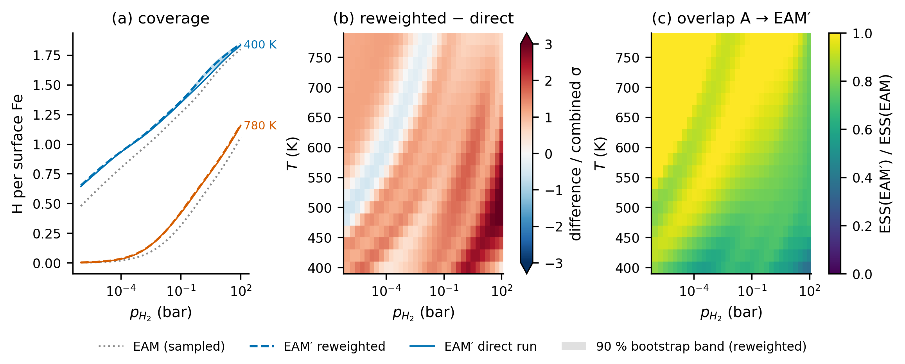

# regc user manual

> For the physics behind the method, diagrams of how the package works, and
> illustrated worked examples (observables, heat capacity, phase
> structures), start with the illustrated manual,
> [`manual/regc_manual.md`](manual/regc_manual.md) (PDF:
> `manual/regc_manual.pdf`). This document is the complete reference.

`regc` computes surface phase diagrams: the coverage of an adsorbate on
a slab as a function of temperature T and gas pressure p. It runs
replica-exchange grand-canonical Monte Carlo (REGC) on a grid of
(T, mu) replicas, as in Zhou, Scheffler and Ghiringhelli, Phys. Rev. B
100, 174106 (2019), referred to below as [ZSG]. It then reweights all
samples with MBAR to a continuous θ(T, p) map.

You can use it in two ways:

- **As a Python library** (Part I): you build the structure, potential,
  gas reservoir and replica grid yourself, and keep full control.
- **As a standalone program** (Part II): you describe the study in one
  YAML (or JSON) file and run `regc-run config.yaml`.

Both use the same code, and the same study gives the same kind of
output either way. Part III collects practical advice and
troubleshooting.

The algorithm, with every acceptance rule, is in
[`REGC_algorithm.md`](REGC_algorithm.md). Every public class and
function, with all its parameters, is listed in
[`API_REFERENCE.md`](API_REFERENCE.md), which is generated from the
docstrings (`python docs/build_api_reference.py`). This manual explains
how the pieces fit together.

## Contents

- [0. Installation and conventions](#0-installation-and-conventions)
- [Concepts](#concepts)
- [Part I: the library](#part-i-the-library)
  - [1. A first run in 20 seconds](#1-a-first-run-in-20-seconds)
  - [2. Structures](#2-structures)
  - [3. Calculators (potentials)](#3-calculators-potentials)
  - [4. Gas reservoirs](#4-gas-reservoirs)
  - [5. The replica grid](#5-the-replica-grid)
  - [6. Running the simulation](#6-running-the-simulation)
  - [7. Long runs: checkpoints and batch jobs](#7-long-runs-checkpoints-and-batch-jobs)
  - [8. Saving and loading samples](#8-saving-and-loading-samples)
  - [9. Analysis with MBAR](#9-analysis-with-mbar)
  - [10. Several gas species](#10-several-gas-species)
  - [11. Worked examples](#11-worked-examples)
- [Part II: the standalone program (YAML)](#part-ii-the-standalone-program-yaml)
  - [12. A first run from a config file](#12-a-first-run-from-a-config-file)
  - [13. Command-line reference](#13-command-line-reference)
  - [14. Config file reference](#14-config-file-reference)
  - [15. Output files](#15-output-files)
  - [16. Batch jobs with the runner](#16-batch-jobs-with-the-runner)
  - [17. Calling the runner from Python](#17-calling-the-runner-from-python)
- [Part III: practice](#part-iii-practice)
  - [18. A workflow for a new system](#18-a-workflow-for-a-new-system)
  - [19. Choosing settings](#19-choosing-settings)
  - [20. Troubleshooting](#20-troubleshooting)
- [API reference](API_REFERENCE.md) (separate file)

---

## 0. Installation and conventions

### Installing

With mamba (recommended; includes LAMMPS from conda-forge):

```bash
mamba env create -f environment.yml     # from the repository root
mamba activate gcmc_re
pytest                                  # optional: the test suite, about 1 minute
```

The environment keeps the package's former name, `gcmc_re`. The package
itself is `regc`. `import gcmc_re` and `gcmc-re-run` still work as
deprecated aliases, so old scripts and checkpoints keep loading.

With pip:

```bash
pip install .                 # core only: numpy
pip install ".[all]"          # + ase, pymbar/scipy, matplotlib, pyyaml
pip install -e ".[dev]"       # editable install + pytest
```

| Extra | Brings | Needed for |
|---|---|---|
| `ase` | ASE | EMT/EAM/MLIP calculators, `ase.build` structures, trajectories |
| `mbar` | pymbar, scipy | `MBARSurfaceAnalysis` (any phase diagram) |
| `plot` | matplotlib | `plot_phase_diagram` |
| `yaml` | PyYAML | `.yaml`/`.yml` configs (JSON needs nothing) |
| `records` | h5py | per-sample records and reweighting to other potentials (§9.6) |

LAMMPS is not a pip extra. Install it from conda-forge (EAM, ACE/`pace`,
`grace/fs`). For GRACE-1L/2L/3L models (`pair_style grace/runtime`), build
the grace-runtime fork of LAMMPS with `hpc/build_lammps.sh`. It installs
next to conda-forge's build as `liblammps_grace.so`, and you select it with
`lammps_name="grace"` (§3.2.1).

The core needs only numpy. Every optional dependency is imported inside
the function that needs it, so `import regc` always works.

### Units

| Quantity | Unit | Notes |
|---|---|---|
| Energy, chemical potential μ | eV | Real-units calculators (EMT, EAM, LAMMPS, MLIPs). |
| Length | Å | |
| Mass | amu | |
| Temperature **inside the engine** | eV (k_B T) | Convert with `kelvin_to_eV(T_K)`. Every `ReplicaExchangeGCMC` temperature and every analysis temperature is in eV. |
| Temperature at the edges | K | Reservoir methods (`mu_eV`, `mu_grid`) and the YAML file take Kelvin. |
| Pressure | Pa, bar or atm | Chosen with a `unit=` / `pressure_unit=` argument (`PRESSURE_UNITS`). |
| MD time step | fs | `timestep_fs`. |
| HMC time step `hmc_dt` | internal unit, 1 = 10.1805 fs | 0.5 fs is `0.5 / 10.1805`. The YAML key `hmc.timestep_fs` converts for you. |

The Lennard-Jones examples use reduced units instead (σ = ε = 1,
Λ³ = 1); see [§5](#5-the-replica-grid).

### The energy zero

Each calculator has its own energy zero. The chemical potential must sit
on the same scale. For a gas atom, that means adding the calculator's
energy of the isolated atom, `e_atom`. For EMT this is +3.21 eV for H.
Leaving it out shifts μ by that amount and makes every pressure absurd.
The reservoirs in [§4](#4-gas-reservoirs) handle this when they are built
from the calculator.

---

## Concepts

This section explains what the package computes, in enough depth to
choose settings and read results. The full derivations are in
[`REGC_algorithm.md`](REGC_algorithm.md).

### The system

A simulation box holds a slab and a variable number N of gas atoms
above it, periodic in x and y. The slab has two kinds of atoms:

- **frozen atoms** never move;
- **substrate atoms**, if any, relax.

The gas atoms are the *mobile* or *exchanged* particles. Hard walls
keep them between z = 0 (the top frozen layer) and z = Lz.

A nanoparticle works the same way (§2.6). The cluster's atoms are the
frozen and substrate atoms, the box has no periodicity, and hard walls
close all six faces.

### The grand-canonical ensemble

At fixed temperature T and chemical potential μ, the box exchanges
atoms with an ideal reservoir. A configuration R with N gas atoms has
probability

```
P(R, N)  ∝  V^N / (N! Λ³ᴺ(T)) · exp(−β [E(R) − μ N]),     β = 1 / k_B T
```

where E is the calculator's energy and Λ the thermal de Broglie
wavelength of the gas atom. Grand-canonical Monte Carlo samples this
with three kinds of moves.

- **Insertion:** a new atom is placed at a random point in the insertion
  volume V_ex and accepted with probability
  `min(1, V_ex / (Λ³ (N_ex+1)) · exp(β [μ − ΔE]))`.
- **Deletion:** a random atom inside V_ex is removed with probability
  `min(1, Λ³ N_ex / V_ex · exp(−β [μ + ΔE]))`.
- **Diffusion** at fixed N: MC displacements, HMC or MD. This moves the
  atoms between insertions and relaxes the substrate.

Here N_ex counts the atoms inside V_ex. The insertion window changes
only how efficiently the ensemble is sampled, not which ensemble is
sampled.

### Why a grid of replicas

At low temperature or high coverage a single GCMC run gets stuck: the
energy barriers between surface phases are large compared with k_B T.
REGC runs one replica at each point of a (T, μ) grid and lets
neighbouring replicas swap configurations. The swap obeys detailed
balance in the combined ensemble of all replicas:

```
P_swap = min(1, (Λ³(T_a)/Λ³(T_b))^(N_a−N_b) · exp{(β_a−β_b)(E_a−E_b) − (β_a μ_a − β_b μ_b)(N_a−N_b)})
```

A configuration can then melt at high T, travel across the grid and
settle at low T in a different phase. This works only if neighbouring
replicas overlap: their energy and N distributions must share some
range. The swap acceptance measures this.

### From samples to a phase diagram: MBAR

Each replica records (U, N) every `record_every` steps. MBAR (the
multistate Bennett acceptance ratio) uses all samples from all replicas
together. It estimates the relative free energy of every sampled state,
and from that the average of any observable at any (T, μ), including
points between replicas, together with a statistical uncertainty. That
is why a 6×6 grid of replicas yields a smooth 150×120 map.

Two kinds of maps come out:

- **Mean coverage** θ(T, p) = ⟨N⟩ / area: a smooth function. Phase
  transitions appear as steep steps.
- **Most probable N**, the maximum of the distribution P(N): a
  piecewise-constant map whose regions are the stable phases. This is
  [ZSG]'s Fig. 3. Where P(N) has two peaks, two phases coexist.

### From pressure to chemical potential

Experiments control T and the gas pressure p, while the simulation
controls μ. The reservoir converts between them, on the calculator's
energy scale:

- **Monatomic gas:** `μ(T, p) = k_B T ln(p Λ³ / k_B T) + e_atom`.
- **Diatomic gas X2 (H2, O2, ...)**, which supplies atoms:
  `μ_X(T, p) = ½ [μ_X2(T, p) − D0] + e_atom`. Here μ_X2 is the
  molecule's ideal-gas chemical potential from its translational,
  rotational and vibrational partition functions, measured from its
  ground state. D0 is the zero-point-corrected dissociation energy.

Both D0 and e_atom must come from the potential that computes the slab.
Otherwise μ is offset from the energies it is compared with, and the
predicted pressures are wrong by orders of magnitude.

A decade of pressure changes μ by k_B T ln 10 for a monatomic gas, and
by half that for atoms from a diatomic gas. At 300 K, that is 0.060 eV
and 0.030 eV per decade.

### What "coverage" counts

- **N** counts every gas atom in the box, including atoms in the gas
  phase above the surface.
- **N_ads** counts only atoms within `adsorbed_cutoff` of a slab atom.
  Use it when the headroom is large, or at high pressure.
- **Normalisation:** per surface atom (monolayers, ML), per Ų, per
  slab or cluster atom, or as an absolute count. A cluster has no area.

---

# Part I: the library

## 1. A first run in 20 seconds

This script runs a complete study on a toy system. The system is H on a
rigid 3×3 Cu(100) slab, with a pairwise Lennard-Jones potential and a
monatomic gas. It needs `ase`, `pymbar` and `matplotlib`, and takes about
20 seconds on one core.

```python
import os
import numpy as np
from ase.build import fcc100
from regc import (MBARSurfaceAnalysis, MonatomicIdealGasReservoir, PairLJCalculator,
                     ReplicaExchangeGCMC, kelvin_to_eV, load_samples, plot_phase_diagram,
                     save_samples, slab_geometry_from_atoms)

# 1. Structure: a rigid 3x3 Cu(100) slab with 4 A of space above it
slab = fcc100("Cu", size=(3, 3, 2), a=3.6, vacuum=None, orthogonal=True)
geometry = slab_geometry_from_atoms(slab, headroom=4.0)
print(geometry.summary())

# 2. Potential: a toy pairwise Lennard-Jones model, {(a, b): (epsilon_eV, sigma_A)}
pair_params = {("Cu", "H"): (0.15, 1.4), ("H", "H"): (0.01, 2.2)}

def make_system(rng):
    """A fresh system (and calculator) for every replica."""
    return geometry.make_system(PairLJCalculator(pair_params, r_cut_factor=1.7), "H")

# 3. Reservoir: a monatomic ideal gas of H atoms (toy: real H comes from H2)
gas = MonatomicIdealGasReservoir(mass_amu=1.008)
T_K = [300.0, 400.0, 500.0]
p_bar = [1e-3, 1e-1, 1e1, 1e3]
mus = gas.mu_grid(T_K, p_bar, unit="bar")           # shape (3, 4), eV
print(np.round(mus, 3))

# 4. Sampling: the REGC loop on a 3 x 4 replica grid
os.makedirs("tutorial", exist_ok=True)
with ReplicaExchangeGCMC([kelvin_to_eV(T) for T in T_K], mus, make_system, seed=1,
                         lambda_cubed_of_T=gas.lambda_cubed_of_T(),
                         adsorbed_cutoff=2.5) as sim:
    sim.run_regc(n_steps=2000, x0=0.9, diffusion="mc", diffusion_steps=2,
                 record_every=10, burn_in_steps=300, verbose=False)
    save_samples(sim, "tutorial/samples.npz")
    print("swap acceptance:", sim.swap_acceptance())

# 5. Analysis: MBAR reweighting to a fine (T, p) mesh
analysis = MBARSurfaceAnalysis(load_samples("tutorial/samples.npz"),
                               reservoir=gas, pressure_unit="bar")
T_grid_K = np.linspace(300, 500, 21)
p_grid = np.geomspace(1e-3, 1e3, 31)
theta = analysis.phase_diagram_Tp([kelvin_to_eV(T) for T in T_grid_K], p_grid,
                                  area=geometry.n_surface, observable="N_ads")
print(f"coverage: {theta.min():.2f} to {theta.max():.2f} H per surface Cu")
plot_phase_diagram(T_grid_K, p_grid, theta, save_path="tutorial/theta.png",
                   colorbar_label="H per surface Cu", xlabel="p (bar)", ylabel="T (K)")
```

Output (acceptance values rounded):

```
18 frozen + 0 displaceable slab atoms, 9 per surface layer, cell |a1| = 7.637 A, |a2| = 7.637 A (rectangular), mobile species in z in (0, 4.00] A
[[-0.453 -0.334 -0.215 -0.096]
 [-0.629 -0.47  -0.311 -0.153]
 [-0.81  -0.612 -0.413 -0.215]]
swap acceptance: {'T': 0.49, 'mu': 0.28, 'cross_left': 0.15, 'cross_right': 0.38}
coverage: 0.00 to 1.54 H per surface Cu
Saved phase diagram to tutorial/theta.png
```

Every real study has the same five steps:

1. **Structure:** an ASE slab, laid out by `slab_geometry_from_atoms`.
2. **Calculator:** the potential, created fresh for every replica inside
   a *system factory* `make_system(rng)`.
3. **Reservoir:** maps (T, p) of the gas to μ, and supplies the thermal
   wavelength Λ³(T).
4. **Sampling:** `ReplicaExchangeGCMC` over the (T, μ) grid, run with
   `run_regc` (or `run_with_checkpoints` for long runs).
5. **Analysis:** `MBARSurfaceAnalysis` on the saved samples, given the
   same reservoir.

The rest of Part I covers each step in detail.

## 2. Structures

### 2.1 `slab_geometry_from_atoms`

```python
geometry = slab_geometry_from_atoms(atoms, n_frozen_layers=None, headroom=5.0, layer_tol=1e-3,
                                    n_thermostat_layers=None, planes_per_layer=1)
```

This takes an ASE `Atoms` slab and returns a `SlabGeometry`.

- **Layers** are found by z, grouping atoms within `layer_tol` Å into
  atomic planes. By default each plane is one layer.
- **`planes_per_layer`**: counts each layer as that many consecutive
  planes, from the bottom. Open and stepped surfaces need this:
  `ase.build` stacks a repeat unit of 2 planes on hcp(10-10) and 3 on
  fcc(211). `layer_planes(atoms, n_layers)` gives the value for an
  `ase.build` slab. `layer_z` always lists the individual planes.
- **`n_frozen_layers`**: the bottom layers kept rigid. Layers above
  them are *displaceable substrate*: MC (with `displace_substrate`),
  HMC and MD move them. The default `None` freezes every layer.
- **Placement:** the slab is shifted so the top *frozen* layer sits at
  z = 0. The box has a hard wall at z = 0, so gas atoms can reach the
  displaceable layers and subsurface sites above the frozen block but
  never enter it.
- **`headroom`**: the space in Å for gas atoms above the topmost atom.
  The box height is `Lz = top_z + headroom`.
- **Cell:** a1 must lie along x and a2 in the xy plane, the form that
  `ase.build` surface functions produce. Oblique cells, such as a
  hexagonal fcc(111) cell, work. A cell in any other orientation raises
  `ValueError: ... a1 along x ...`.
- **`n_thermostat_layers`**: splits the displaceable layers into a
  thermostatted block right above the frozen layers and a free top (at
  least one layer). See §2.1.1. The default `None` thermostats every
  moving atom.

Useful attributes of `SlabGeometry`:

| Attribute | Meaning |
|---|---|
| `cell_xy` | 2×2 in-plane cell (rows a1, a2), Å |
| `Lz` | box height, Å |
| `top_z` | z of the topmost slab atom |
| `n_surface` | atoms in the top layer, for coverage per surface atom |
| `area` | in-plane area, Ų |
| `orthogonal` | True for a rectangular cell |
| `frozen_positions`, `substrate_positions` | the two atom blocks |
| `summary()` | one-line description |
| `make_system(calculator, exchange_species, mass_of_species=None, insertion_z_range=None)` | the `SlabSystem` |

`make_system` is what your system factory calls:

```python
system = geometry.make_system(calc, "H", mass_of_species={"H": 1.008},
                              insertion_z_range=(geometry.top_z + 1.0, geometry.top_z + 3.0))
```

`insertion_z_range` restricts insertion attempts, and the volume that
weights them, to a z window. Use it when the interesting region is a
thin layer above the surface. Insertions and deletions then only happen
inside the window. The default is the whole box.

#### 2.1.1 Fixed, thermostatted and free layers: `surface_slab`

The usual layout for MD of a surface has three regions, counted from
the bottom:

| Region | What it does | Role |
|---|---|---|
| fixed | never moves | stands for the bulk below |
| thermostat | coupled to the MD thermostat (Bussi or Langevin) | the heat bath |
| free | plain Newtonian (NVE) dynamics, with the adsorbates | the surface |

The free layers and the gas atoms are not damped by the thermostat.
Their energy, for example the heat released by an adsorption, flows
through the lattice into the thermostatted layers, as on a real surface.

`surface_slab` builds this template in one call:

```python
from regc import surface_slab, cubic_lattice_constant

a = cubic_lattice_constant(ase_calc, "Pd", "fcc")
geometry = surface_slab("Pd", "fcc100", size=(5, 5), layers=(2, 2, 2), a=a, headroom=5.0)
print(geometry.summary())
# 50 fixed + 50 thermostatted + 50 free slab atoms (2 / 2 / 2 layers), 25 per surface layer, ...
system = geometry.make_system(calc, "O")      # the thermostat region comes with it
```

- `layers` is `(fixed, thermostat, free)` or the dict
  `{"fixed": 2, "thermostat": 2, "free": 2}`, each at least 1. Their sum
  is the slab depth.
- `size` is the lateral `(nx, ny)` only.
- Layers are `ase.build` layers, so a split has the same physical
  thickness on every surface. On fcc(211), `layers=(2, 2, 2)` gives
  6 layers of 3 atomic planes each, and `summary()` says so.
- Other keywords go to the `ase.build` function, for example
  `orthogonal=True`.
- For a slab you already have, use
  `slab_geometry_from_atoms(atoms, n_frozen_layers=2, n_thermostat_layers=2)`.
- On any system, `system.set_thermostat_region(mask)` (one bool per
  substrate atom) does the same. `None` restores thermostatting every
  moving atom.

**What it changes.** Only MD diffusion (`diffusion="md"`, ASE or
native LAMMPS) uses the split:

- Each step is thermostat(dt/2), velocity Verlet(dt), thermostat(dt/2),
  with the thermostat acting on the bath atoms only.
- Bussi uses the bath's 3·n degrees of freedom; in LAMMPS this is
  `fix temp/csvr` or `fix langevin` on a `gcmc_bath` group, with
  `fix nve` on every moving atom.
- Every segment still starts from fresh Maxwell–Boltzmann velocities
  for all moving atoms, so the sampled ensemble is still canonical.
- In short REGC diffusion segments (tens of steps) the split barely
  matters. It matters for long MD and for reading the dynamics.

MC and HMC moves, and the subsurface NCMC kernel, see only "fixed" versus
"displaceable".

### 2.2 Building the slab

Use any `ase.build` surface function. Pass `vacuum=None`, since the
geometry adds the headroom itself, and `orthogonal=True` where the
function supports it:

```python
from ase.build import bcc100, fcc111
slab = bcc100("Fe", size=(3, 3, 4), a=2.855, vacuum=None, orthogonal=True)
slab = fcc111("Pd", size=(2, 2, 4), a=3.89, vacuum=None)          # hexagonal cell: fine
slab = ase.io.read("my_slab.xyz")                                  # or any file ASE reads
```

### 2.3 The lattice constant of the potential

Build the slab at the potential's own lattice constant, otherwise the
slab carries strain:

```python
from regc import cubic_lattice_constant
a = cubic_lattice_constant(ase_calc, "Fe", crystal="bcc")
```

The function scans `a_range` and refines the minimum. The default range
is 0.8–1.2 times the experimental lattice constant from ASE's tables,
or 2.3–5.5 Å for elements without one. Keep the range close for
machine-learned potentials. Well below the real lattice constant they
can have unphysical energy holes, and a wide scan finds those instead of
the minimum: GRACE-2L-OMAT puts fcc Pt's lowest energy at a = 2.3 Å in
a 2.3–5.5 Å scan.

### 2.4 Checking a site before a run

`insertion_energy_scan(system, xy_points, z_values)` returns the energy
of inserting one atom along vertical lines. Use it on the bare slab to
check that the potential binds the adsorbate where you expect, at a
sensible height, before spending CPU time.

### 2.5 Other systems

- **`SlabSystem(Lx, Ly, Lz, calculator, ...)`** builds a slab by hand,
  with `frozen_positions`, `substrate_positions`, `insertion_z_range`,
  an optional continuum wall (`wall_epsilon`, `wall_sigma`, `wall_cut`)
  and `cell_xy` for oblique cells. `geometry.make_system` does this for
  you.
- **`BulkSystem(box_length, calculator, ...)`** is a fully periodic
  cubic box, used for bulk-gas validation.

`LJSystem` and `SlabLJSystem` are older aliases of `BulkSystem` and
`SlabSystem`.

### 2.6 Clusters (nanoparticles)

`cluster_geometry_from_atoms` lays out a nanoparticle the way
`slab_geometry_from_atoms` lays out a slab. Build the particle with
`ase.cluster` (or read it from a file):

```python
from ase.cluster import Icosahedron
from regc import cluster_geometry_from_atoms

atoms = Icosahedron("Pt", noshells=3, latticeconstant=a)   # Pt55
geometry = cluster_geometry_from_atoms(atoms, headroom=6.0, frozen="center")
print(geometry.summary())
# 55 atoms (55 Pt): 1 frozen + 54 displaceable, 42 on the surface, radius 5.61 A,
# in a 23.23 A cubic box (no periodicity)

system = geometry.make_system(calc, "O", mass_of_species={"Pt": 195.08, "O": 15.999},
                              insertion_shell=geometry.shell(-2.0, 3.0))
```

- **The box.** The cluster's centroid sits at the centre of a cube of
  edge 2 (radius + `headroom`). There is no periodicity. `external_energy`
  is infinite outside the box, and MD reflects at all six faces, in ASE
  and in LAMMPS (`fix wall/reflect`). LAMMPS runs with `boundary f f f`
  and a box padded by `z_padding` on every side.
- **`frozen`.**
  - `"center"` (default) freezes the atom nearest the centroid. That pins
    the particle at the centre of the insertion shell while all the
    other atoms relax.
  - `"core"` freezes every fully coordinated atom.
  - `"none"` freezes nothing.
  - A number freezes that many central atoms.
- **Surface atoms.** These are atoms with fewer than `full_coordination`
  neighbours: 12 for fcc and icosahedral particles, 14 for bcc. The
  neighbour cutoff lies halfway between the first and second shells.
  `geometry.n_surface` is the normalisation for coverage per surface
  atom: 42 for Pt55 (12 vertices and 30 edges), 32 for the Pt38
  truncated octahedron. `coordination_numbers(positions)` gives the
  per-atom numbers.
- **The insertion shell.** `geometry.shell(d_in, d_out)` gives radii
  relative to the cluster radius, the distance of the outermost atom
  (a vertex for an icosahedron). Facet hollow sites lie *inside* that
  radius, so start the shell below it: `(-2.0, 3.0)` covers facet,
  edge and vertex sites, plus subsurface sites. The acceptance rules use
  the shell's volume, and deletions pick only atoms inside it, so the
  ensemble stays exact, as with a slab's `insertion_z_range`. Without a
  shell, insertions are drawn over the whole box. That is correct too,
  but most attempts land in vacuum.
- **`ClusterSystem(box, calculator, ...)`** builds the system by hand:
  `box` (one length or three), `frozen_positions`/`substrate_positions`,
  `insertion_shell=(r_in, r_out)` and `center`.
- **Coverage.** A cluster has no area: normalise per surface atom
  (`n_surface`), per cluster atom (`n_atoms`), or not at all.

## 3. Calculators (potentials)

All calculators subclass `Calculator`.

| Calculator | Use it for | HMC | MD | Notes |
|---|---|---|---|---|
| `LJCalculator(sigma, epsilon, r_cut)` | reduced-unit LJ tests | yes | no | **Ignores the slab:** mobile–mobile only. |
| `PairLJCalculator(pair_params, r_cut_factor=2.5)` | toy models that see the slab | yes | no | `pair_params = {(a, b): (epsilon_eV, sigma_A)}` |
| `LammpsCalculator(pair_commands, species, ...)` | EAM, ACE/PACE, GRACE, any LAMMPS pair style | yes | yes, native | The fastest choice for real potentials. |
| `ASECalculatorAdapter(factory, cell, pbc)` | any ASE calculator: EMT, EAM, MACE, NequIP, ... | if ASE gives forces | yes, ASE MD | Needs a *factory* for `n_workers > 1`. |

### 3.1 Cutoffs and the minimum image

The pairwise calculators use the minimum-image convention. Every cutoff
must be shorter than half the shortest in-plane cell width
(`system.min_image_radius`). A larger cutoff raises an error naming both
numbers. Lower `r_cut` / `r_cut_factor`, or use a larger cell.

### 3.2 LAMMPS

```python
from regc import LammpsCalculator, eam_pair_commands, lammps_ase_calculator

pair = eam_pair_commands("FeH_Wen.eam.fs", ["Fe", "H"])    # style from the file name
pair = ["pair_style pace", "pair_coeff * * FeH.yace Fe H"]   # ...or any pair style
calc = LammpsCalculator(pair, ["Fe", "H"], masses={"H": 1.008},
                        min_distance=None, z_padding=5.0,
                        lammps_name=None)                   # which LAMMPS build, §3.2.1
ase_calc = lammps_ase_calculator(pair, ["Fe", "H"])         # same potential, ASE interface
```

- **`species`:** the LAMMPS atom-type order; it must match `pair_coeff`.
- **`min_distance`:** a hard core in Å. Insertions closer than this to
  any atom are rejected. Use it for machine-learned potentials, which
  can be wrong at short range, where they have no training data.
- **`z_padding`:** extra box height LAMMPS adds beyond the atoms.
- **Startup:** LAMMPS starts lazily on first use, so a
  `LammpsCalculator` can be pickled to worker processes before it has
  run.
- **`ase_calc`:** an ordinary ASE calculator running the same potential.
  Use it for setup work: `cubic_lattice_constant`,
  `DiatomicReservoir.from_calculator` and site scans. It takes the same
  `lammps_name` argument.

#### 3.2.1 Choosing a LAMMPS build: `lammps_name`

One environment can hold several LAMMPS shared libraries:
`liblammps.so` (the default, e.g. conda-forge's) and named builds
`liblammps_<name>.so`. `lammps_name` picks one:

| `lammps_name` | Loads |
|---|---|
| `None` (default) | the build named by the environment variable `REGC_LAMMPS_NAME`; if it is unset, `liblammps.so` |
| `""` | `liblammps.so` |
| `"grace"` | `liblammps_grace.so` (built by `hpc/build_lammps.sh`) |

The LAMMPS Python module looks for the library next to itself, then on
the loader path (the environment's `lib/`, `LD_LIBRARY_PATH`).
`REGC_LAMMPS_NAME` is useful for scripts with no option for it, such as
example 13 and the Slurm jobs: `export REGC_LAMMPS_NAME=grace`. Worker
processes inherit it. `python hpc/check_env.py --lammps-name grace
--grace-runtime` shows what a build provides.

- **One build per process.** The LAMMPS Python module loads libraries
  with `RTLD_GLOBAL`, so two builds in one process would share symbols
  and corrupt each other's memory. regc refuses to load a second,
  different library and raises a `RuntimeError`. To compare builds, run
  each in its own process.
- **Version mismatch.** The Python module refuses a library from another
  LAMMPS version (conda-forge's module is 22 Jul 2025, the grace-runtime
  fork is 30 Sep 2026). The calls regc makes are the same in both
  versions, so regc warns once and turns that check off. The test suite
  checks that both builds give the same EAM energies and forces.

**GRACE-1L/2L/3L models** run through `pair_style grace/runtime`, which
reads a `kokkos.npz` file:

```python
pair = ["pair_style grace/runtime",
        "pair_coeff * * /home/me/.cache/grace/GRACE-2L-OMAT-medium-ft-E/kokkos.npz Fe H"]
calc = LammpsCalculator(pair, ["Fe", "H"], min_distance=0.6, lammps_name="grace")
```

- **Getting a model:** pretrained models come from `grace-runtime models
  download <name>` (pip package `grace-runtime`). Your own fits come from
  `grace_utils -p model.yaml -c CHECKPOINT export_kokkos -o model.npz`.
- **Gas reference: keep `d0="self"`.** Foundation models (OMAT, OAM, ...)
  describe isolated atoms poorly, because isolated atoms are not in their
  training data. Molecules are, in molecular crystals. GRACE-2L-OMAT-medium-ft-E
  gives D0(H₂) = 7.5 eV, against 4.48 eV in experiment, because its
  isolated-H energy is off. With `d0="self"`, μ is referenced to the model's
  own molecule (μ = ½(μ_X₂ − D0) + e_atom, and the model's e_atom cancels).
  An experimental D0 would bring the bad e_atom back into μ.
- **`pace/runtime`:** reads pacemaker ACE `.yaml` files on the same
  runtime.

**Speed.** An energy call has to send the configuration to LAMMPS and run
it. LAMMPS's setup for a run (neighbour lists, pair initialisation) costs
far more than the force evaluation itself for a slab of ~100 atoms, so the
calculator avoids it where it can:

- **Same atoms, new positions** (MC displacement moves, HMC): only the
  positions are sent, and the energy comes from `run 1 pre no`, one step
  with no integrator. It skips the setup but still refreshes the periodic
  images, and LAMMPS rebuilds the neighbour lists itself when an atom
  has moved more than half the skin. (`run 0 pre no` would skip the image
  update and give wrong energies.)
- **The energy before a trial move** is the one computed at the previous
  move: the last two configurations are cached, by exact match of
  positions, species and cell.
- **After an MD segment** the energy of its last step is reused instead of
  a new evaluation.
- **Insertions and deletions** change the atom count and still need a full
  reload and setup.

On a 60-atom Fe(100) + H slab with an EAM (one core), this made an MC
move 13× faster (3.6 to 0.27 ms), a REGC step with ten MC moves per
replica 5.6× faster, and one with 40 MD steps 1.7× faster. Every energy
agrees with a full setup to round-off; `tests/test_lammps_backend.py`
checks this along a random walk of moves, insertions, deletions,
boundary crossings and MD segments. `REGC_LAMMPS_FAST=0` turns the fast
path off (a full reload and setup for every energy), for checks.

### 3.3 ASE calculators and parallel runs

```python
import functools
from ase.calculators.eam import EAM
from regc import ASECalculatorAdapter

factory = functools.partial(EAM, potential="FeH_Wen.eam.fs")
calc = ASECalculatorAdapter(factory, cell=[geometry.cell_xy[0, 0], geometry.cell_xy[1, 1], geometry.Lz],
                            pbc=(True, True, False))
```

With `n_workers > 1`, replicas are pickled to worker processes. Many ASE
calculators cannot be pickled once they have been used. EMT, for
example, fails with `Can't pickle local object 'EMT.initialize.<locals>.<lambda>'`.
To avoid this, pass the adapter a zero-argument factory (a class, or a
`functools.partial`) instead of a live instance. It then builds the
calculator inside each worker. A live instance is fine for
`n_workers=1`.

For an oblique cell, pass the full 3×3 cell as `cell`.

### 3.4 Writing your own calculator

Subclass `Calculator` and implement `total_energy(system)`. It returns
the energy of `system.full_configuration()`, the mobile, substrate and
frozen atoms together. Optionally add:

- `forces(system)` and `supports_forces = True`, to enable HMC and MD;
- `pair_energy_of(system, pos, exclude=None, species=None)` and
  `supports_incremental = True`, for fast single-particle moves.

Without `pair_energy_of`, the engine recomputes the total energy for
each move. That is always correct, only slower.

## 4. Gas reservoirs

A reservoir converts the gas state (T, p) into the chemical potential of
the exchanged atom. It also gives the atom's thermal wavelength Λ³(T).
Build it from the same potential as the slab.

### 4.1 Diatomic gases (H2, O2, ...)

```python
from regc import DiatomicReservoir

h2 = DiatomicReservoir.from_calculator(ase_calc, "H", d0="self")
print(h2.D0_eV, h2.e_atom_eV, h2.calculator_info)
```

`from_calculator` evaluates the potential's own molecule and isolated
atom. **e_atom** (the zero of the energy scale) always comes from the
calculator. **D0** (the zero-point-corrected dissociation energy)
depends on `d0`:

| `d0` | D0 used | When |
|---|---|---|
| `"self"` (default) | the potential's own molecule | Consistent; use it when the potential's molecule is reasonable. |
| `"experimental"` | 4.478 eV (H2 only) | The potential describes the molecule poorly. |
| a number | that value, in eV | A corrected or literature value. |

`calculator_info` holds the diagnostics: `r0_angstrom`, `D0_eV`,
`zpe_eV`, `d0_source` and more. Compare them with experiment before a
production run.

For elements other than H, pass the real molecule's spectroscopic
constants:

```python
o2 = DiatomicReservoir.from_calculator(ase_calc, "O", bond_length_angstrom=1.2075,
                                       vib_wavenumber_cm=1580.2)
```

Without a calculator, construct a reservoir directly:

```python
h2 = DiatomicReservoir.hydrogen(D0_eV=4.478, e_atom_eV=0.0)
res = DiatomicReservoir(D0_eV, e_atom_eV, mass_molecule_amu, bond_length_angstrom,
                        vib_wavenumber_cm, symmetry_number=2)
```

O2 has a triplet ground state (³Σg⁻). `from_calculator` sets
`electronic_degeneracy=3` for O (1 for every other element), which lowers μ_O
by ½ kT ln 3 (0.024 eV at 500 K) relative to a closed-shell rotor. With it,
the O2 gas chemical potential is within 2 meV of NIST-JANAF at 300–1000 K;
H2 (closed shell) is within 7 meV. Constructing a `DiatomicReservoir`
directly, pass `electronic_degeneracy` yourself.

This is the standard atomistic-thermodynamics reference for atoms that
adsorb dissociatively: quantum vibrations, ZPE and spin. The sampled
atoms are classical, though. If two exchanged atoms form an intact
molecule in the gas zone, that molecule carries the classical/quantum
mismatch of §10.1: it is over-stabilised by 0.02 eV (O2) or 0.19 eV
(H2) at 300 K. The equilibrium number of such molecules is then βpV·R
instead of βpV, where V is the gas-zone volume and R ≈ 2 for O2 and
≈ 1800 for H2 at 300 K. At low pressure this is negligible. For H2 near
1 bar it can amount to several molecules in a typical gas zone. Atom-by-
atom insertion rarely forms them, because an isolated gas atom costs
about D0/2, but associative desorption can. At high H2 pressure, check
the gas zone for H2 molecules and leave them out of the coverage.

### 4.2 Monatomic gases

```python
from regc import MonatomicIdealGasReservoir
ar = MonatomicIdealGasReservoir(mass_amu=39.95, e_atom_eV=0.0)
```

### 4.3 What a reservoir gives you

| Method | Returns |
|---|---|
| `mu_eV(T_kelvin, p_pascal)` | μ at one point |
| `pressure_pascal(T_kelvin, mu_eV)` | the inverse |
| `mu_grid(temperatures_K, pressures, unit="Pa")` | the (n_T, n_p) μ array for a pressure ladder |
| `lambda_cubed_of_T()` | Λ³ as a function of k_B T in eV, for the engine |
| `mu_at_T_eV(T_eV, p, unit="Pa")` | μ with the engine's temperature unit |
| `analysis_functions(unit="Pa")` | `(mu_of_Tp, p_of_Tmu)` for MBAR |

For lower-level work, `regc.reservoir` also has
`diatomic_dissociation_energy_eV`, `diatomic_gas_mu_eV`,
`mu_atomic_from_diatomic_reservoir_eV` and
`pressure_from_atomic_mu_reservoir_pascal`.

## 5. The replica grid

```python
sim = ReplicaExchangeGCMC(temperatures, mus, system_factory,
                          seed=0, max_disp=0.2, n_workers=1,
                          lambda_cubed_of_T=..., hmc_enabled=False,
                          hmc_leapfrog_steps=10, hmc_dt=0.005,
                          adsorbed_cutoff=None)
```

| Argument | Meaning |
|---|---|
| `temperatures` | The T ladder, in **eV**: `[kelvin_to_eV(T) for T in T_K]`. |
| `mus` | 1D (n_μ, shared by all T) or 2D (n_T, n_μ). A pressure ladder is 2D: `reservoir.mu_grid(T_K, p, unit)`. With S species, add a last axis of length S. |
| `system_factory` | `factory(rng) -> ParticleSystem`, called once per replica. **Create a new calculator inside it**, so replicas never share one. |
| `seed` | Master seed. Each replica draws its own stream from it, so runs are reproducible. Parallel and serial runs give identical results. |
| `max_disp` | Largest single-atom MC displacement per axis, Å. |
| `n_workers` | Worker processes. Use up to one per replica; more brings no gain. |
| `lambda_cubed_of_T` | Λ³(T): `reservoir.lambda_cubed_of_T()` in real units. The default, Λ³ = 1, is correct only in reduced LJ units. |
| `hmc_enabled` | Sweep scheme only: use HMC in place of single-atom displacements. |
| `hmc_leapfrog_steps`, `hmc_dt` | HMC trajectory length and step (internal time unit, 1 = 10.1805 fs). Used by `diffusion="hmc"` and by the sweep scheme's HMC. |
| `adsorbed_cutoff` | If set (Å), each sample also records `N_ads`, the number of gas atoms within this distance of a slab atom. |

`ReplicaExchangeGCMC` is a context manager. `with ... as sim:` shuts the
worker pool down at the end; without `with`, call `sim.close()`.

**Choosing the grid.** Neighbouring replicas must overlap in energy and
particle number, or swaps between them are never accepted. Space
temperatures geometrically, for example `np.geomspace(300, 900, 6)`.
Space pressures by decades or less. If `swap_acceptance()` reports
values near zero for a pattern, tighten the grid along that axis.

## 6. Running the simulation

### 6.1 The REGC loop (`run_regc`)

```python
finished = sim.run_regc(n_steps, x0=0.99, diffusion="mc", diffusion_steps=10,
                        record_every=100, burn_in_steps=0,
                        swap_types=("T", "mu", "cross_left", "cross_right"),
                        convergence_every=None, convergence_tol=0.05, convergence_bins=30,
                        verbose=True, trajectory_dir=None, trajectory_every=None,
                        **diffusion_kwargs)
```

One REGC step:

1. **Choose the move.** With probability `x0`, every replica makes one
   insertion or deletion attempt. Otherwise one replica-exchange pattern
   is drawn from `swap_types`, with an offset of 0 or 1, and all its
   disjoint pairs are attempted.
2. **Diffuse.** Every replica moves at fixed N for `diffusion_steps`
   units, in parallel.
3. **Record.** Every `record_every` steps after `burn_in_steps`, each
   replica records U, N, and `N_ads` / `N_s` where available.
4. **Check convergence.** Every `convergence_every` steps, the run
   checks the reduced-energy densities ρ(u).
   - `convergence_mode="blocks"` (the API default): ρ(u) since the
     previous check is compared with the interval before it, and the run
     stops when the largest change is below `convergence_tol` (0.05).
   - `convergence_mode="noise"` (the config default): the first and
     second halves of all samples are compared, in units of the
     distance a stationary chain would show. The run stops when the
     largest ratio is below `convergence_tol` (3.0), the median below
     `convergence_median_tol` (1.3), every half holds at least
     `convergence_min_neff` (50) independent samples, and every walker
     has made `convergence_min_round_trips` (1) round trips along T. All
     of this must hold at `convergence_consecutive` (2) checks in a row.
     The independent samples come from the statistical inefficiency of
     the whole window, not of each half: short halves underestimate it.
     Replicas whose u never changes, for example empty ones on a rigid
     surface, carry no information and are left out.
   - Comparing halves only sees changes inside the window. A relaxation
     slower than the whole run looks stationary, and a state held by one
     walker stuck in a metastable phase passes. The n_eff, round-trip and
     consecutive-check conditions guard against stopping on such a run.
   Fixed blocks cannot pass when samples are strongly correlated: with
   200-sample blocks and a statistical inefficiency of 60 the distance
   stays near 0.4 however long the run.

The return value is True if the run converged, otherwise False. [ZSG]
use x0 = 0.99 for the LJ surface and 0.9 for Si clusters. 0.9 is a good
start for a real surface.

**Diffusion modes**

| `diffusion` | One unit of `diffusion_steps` is | Needs | Keyword arguments |
|---|---|---|---|
| `"mc_moves"` | one single-atom displacement attempt | – | – |
| `"mc"` | one MC cycle: as many attempts as movable atoms | – | `displace_substrate=True` to move substrate atoms too |
| `"hmc"` | one HMC trajectory (all atoms, Metropolis-corrected) | forces | set via `hmc_leapfrog_steps`, `hmc_dt` on the constructor |
| `"md"` | one NVT MD step | `LammpsCalculator` or `ASECalculatorAdapter` | `timestep_fs=1.0`, `thermostat="bussi"` or `"langevin"`, `taut_fs=20.0`, `friction_per_fs=0.01` |

- **MD needs a full-featured calculator.** With `LammpsCalculator` it
  runs natively in LAMMPS, about 1000× faster than ASE for an EAM slab.
  With `ASECalculatorAdapter` it uses ASE's MD. `LJCalculator` and
  `PairLJCalculator` raise
  `ValueError: diffusion='md' ... needs an ASECalculatorAdapter`; use
  `"mc"` or `"hmc"` with them.
- **Substrate motion:** HMC and MD always move the displaceable
  substrate.
- **MD sampling error:** MD has no accept/reject step, so the samples
  carry its time-step error. Keep `timestep_fs` small: [ZSG] use 1 fs,
  and 0.5 fs is safer with H.

**Swap patterns.** `"T"` pairs neighbours in T, `"mu"` neighbours in μ,
and `"cross_left"` / `"cross_right"` the two diagonals. Restricting
`swap_types` is mostly useful for tests.

**Trajectories.** Pass `trajectory_dir` (and optionally
`trajectory_every`, default `record_every`). Each replica's
configuration is appended as an extended-XYZ frame to
`<dir>/replica_T{i}_mu{j}.xyz`. This needs ASE.

### 6.2 The sweep scheme (`run`)

The older scheme mixes displacement, insertion and deletion moves in
each cycle. Replicas are exchanged every `exchange_every` cycles.

```python
sim.run(n_cycles, sweeps_per_cycle=200, exchange_every=1, record_every=1, burn_in_cycles=0,
        p_displace=0.5, p_insert=0.25, p_delete=0.25, p_displace_substrate=0.0,
        diagonal_swaps=True, trajectory_dir=None, trajectory_every=None, verbose=True)
```

It is often more efficient for cheap force fields. Prefer `run_regc` for
anything you want to compare with [ZSG]. Only `run_regc` supports
checkpoints.

### 6.3 Diagnostics

- `sim.swap_acceptance()`: acceptance per swap pattern. [ZSG] report
  about 25%.
- `sim.summary()`: one dict per grid point with T, μ, N, energy, sample
  count and acceptance rates.
- `sim[(i_T, i_mu)].acceptance_rates()`: the move acceptance of one
  replica.
- `sim.rho_u_change(n_prev)`: the convergence measure used by
  `run_regc`.

## 7. Long runs: checkpoints and batch jobs

```python
from regc import run_with_checkpoints, EXIT_RESUBMIT

status = run_with_checkpoints(sim, "run_dir", n_steps=20000, chunk=1000,
                              x0=0.9, diffusion="md", diffusion_steps=40, record_every=10,
                              convergence_every=2000, convergence_tol=0.05,
                              time_limit=None, resume=True, overwrite=False,
                              metadata={"potential": "FeH_Wen.eam.fs", "a": a},
                              timestep_fs=0.5, taut_fs=20.0)
print(status.steps_done, status.finished, status.converged, status.resumed_from)
```

This runs `run_regc` in chunks of `chunk` steps. After each chunk it
compares every replica's running energy with a full recomputation
(`sim.check_energies()`): a drift above `energy_tol` (default 1e-6 per
atom) is resynced with a warning, and smaller round-off is left untouched
so the run stays bit-identical. Then it writes:

- `samples.npz`, all samples so far;
- `checkpoint.pkl`, the complete simulation state, including every
  random number generator;
- `run_metadata.json`, your `metadata`;
- `mixing.json`, swap acceptance per pattern and per pair, round
  trips per walker, and `chunks`: the pair counts of every chunk.

How restarts behave:

- **`resume=True`** continues the run in `run_dir` if there is one. The
  checkpoint must match `sim` (grid, species, seed), and every key of
  `metadata` must equal the saved value. Otherwise you get a
  `ValueError`, so a resumed run can never silently change its setup.
  `n_steps` may be raised to extend a finished run.
- **A directory that already holds a run** raises `FileExistsError`
  unless you resume, or pass `resume=False, overwrite=True`.
- **`time_limit`** (seconds from the call): the function stops before
  starting a chunk that would end later, and returns
  `finished=False`. A batch script then exits with `EXIT_RESUBMIT`
  (75) and resubmits itself; `hpc/run.sbatch` does exactly this.
- **Early stops:** a run stopped before its first chunk completes
  writes nothing, and the next call starts afresh.
- **Burn-in:** discard equilibration in the analysis
  (`load_samples(..., discard=0.2)`). `burn_in_steps` would apply to
  every chunk.

For finer control there are `sim.save_checkpoint(path, extra=None)` and
`sim.load_checkpoint(path)`.

### 7.1 Watching a run: the live monitor

```bash
regc-monitor output_fe100_h_eam                    # then open http://127.0.0.1:8050
regc-monitor run1 run2,run2.log --port 8051        # several runs; DIR,LOG names the log
python -m regc.monitor runs/                       # a directory of runs: one entry each
```

The monitor is a small local web page that refreshes every 5 s. It only
reads files and never touches the run. It shows:

- progress, rate and remaining time;
- the replica grid (mean, current and spread of N, sample counts, mean
  and current U). Click a cell to see that replica's recent N and U traces;
- mean N across the grid against step;
- swap acceptance per pattern, the worst neighbouring pairs, and the round
  trips of every walker;
- the ρ(u) convergence checks;
- the files written so far (samples, checkpoint, records with the
  potentials evaluated, analysis results) and the plots of a finished
  analysis;
- the last lines of the log.

Most of this comes from `status.json`, a heartbeat the run replaces at
most every 5 s (`ReplicaExchangeGCMC.save_status(path, interval_s=5)`).
`regc-run` always writes it, and `run_with_checkpoints` makes its step
count cover the whole run rather than the current chunk. A run started
without the heartbeat is still followed through its log (progress lines
and errors), and through `samples.npz` and `mixing.json` once a
checkpoint or the end of the run writes them. `records.h5` is summarised
only when the run is idle, so the monitor never reads a file that is
being written.

The server listens on 127.0.0.1 only. On a cluster, start it on the node
(or on the login node, if it sees the output directory) and forward the
port: `ssh -L 8050:localhost:8050 user@node`. The page loads Plotly from
a CDN, so the browser needs internet access but the node does not. For an
offline browser, pass `--plotly-js path/to/plotly.min.js`.

With a subsurface section, the monitor also shows subsurface atoms. The
progress card holds whole-grid totals: atoms in the subsurface region now,
and accepted NCMC insertions and removals. The grid can show the mean or
current subsurface N per replica and its acceptance, and the traces include
N_sub.

### 7.2 Building, running and monitoring: `regc gui`

```bash
regc gui examples/                 # desktop window (PySide6 + matplotlib), workspace examples/
regc gui --pythonpath /path/to/other/worktree
regc gui --web examples/ --port 8060   # the same in a browser: http://127.0.0.1:8060
```

`regc` is the umbrella command: `regc gui`, `regc run` (= `regc-run`),
`regc monitor` (= `regc-monitor`) and `regc reevaluate` (=
`regc-reevaluate`); `regc-gui` is `regc gui`. The desktop GUI needs
PySide6 (`pip install regc[gui]`).

The GUI works on a workspace directory (*File → Open workspace* changes
it). It finds every config (`*.yaml` with a `replica_exchange` section,
up to four levels deep; output directories are skipped). The window has
three tabs.

- **Runs**: every config with its output directory, state, progress, latest
  convergence check, subsurface totals and the last log line. The selected
  run's log is shown below. The states are new, starting, running, stalled,
  finished, converged, stopped (a checkpoint to resume from), error and
  ended. The actions are *Edit*, *Start* (refused over an existing
  checkpoint), *Resume* (`--resume`), *Start over* (`--overwrite`, after a
  confirmation), *Analyze* (`--analyze-only`), *Stop* (SIGTERM to the run's
  process group, so the last checkpoint stays) and *Monitor*
  (double-clicking a row does the same). *workers* sets `--workers`.
- **Build**: the config as YAML next to a form of the common keys
  (structure, gas and reservoir, calculator, ladder, sampling,
  convergence, subsurface, output). Helpers fill a geometric T ladder and
  a log-spaced pressure ladder. *Form → YAML* rewrites the text without
  its comments. *Validate* runs `validate_config` and shows the grid size.
  *Save* writes the file, only inside the workspace, and replaces an
  existing file only when *overwrite* is ticked. *Check setup* runs
  `regc-run --check` and streams its output. *Save & start* saves and then
  launches the run. Built-in templates: a one-minute EMT test and a slab +
  O2 MLIP skeleton.
- **Monitor**: one run's heartbeat (`status.json`, or `samples.npz` for
  runs without one). It shows progress, rate, the remaining time to the
  `n_steps` cap, mean N, subsurface totals and the latest convergence check
  in one line. Below that are four plots: the replica grid of a chosen
  quantity (N, U, N_ads, subsurface N and acceptance, ...; click a cell),
  that replica's N, N_sub and U traces, the convergence checks against
  their tolerances, and the swap acceptance with round trips. The end of
  the log is at the bottom. *Open directory…* monitors any output
  directory.

Runs are launched the same way as the examples' `run_monitor.sh` scripts:
detached (`setsid`), in the config's directory, logging to
`<output>/run.log`, with the process id in `<output>/run.pid`. They outlive
the window, and the scripts, the window and the web version all see the
same runs. They use the GUI's interpreter (`--python`) and `PYTHONPATH` =
`--pythonpath`. By default that is the directory holding the `regc`
package the GUI imported; it can be changed in the toolbar, e.g. to
another git worktree. A run counts as alive while the process in
`run.pid` runs (its start time, kept in `run.pid.start`, must match, so a
reused id is not taken for the run), or while its `status.json` heartbeat
says so: the process named in it is alive on this machine, or, for
heartbeats from another machine or older versions, the heartbeat is fresher
than two minutes. Runs started by scripts or plain `regc-run` thus show as
running (external), and starting, resuming or starting over into their
output is refused. A run that stopped for its time limit shows as stopped
(resumable).

The web version (`--web`) has the same tabs in a browser page, with the
§7.1 monitor under `/monitor/`. It listens on 127.0.0.1. Requests that
write files or start or stop processes need a token that only the served
page holds, so other pages open in the same browser cannot send them.
Requests naming another host (DNS rebinding), and changes coming from
another origin, are refused; so are foreign host names on `regc-monitor`.

## 8. Saving and loading samples

```python
from regc import save_samples, load_samples
save_samples(sim, "samples.npz")
samples = load_samples("samples.npz", discard=0.2)   # drop the first 20% per replica
```

The file stores, for each replica, the recorded U, N, `N_ads` (when
recorded) and per-species counts `N_s`. It also stores the temperature
ladder, the μ grid and Λ³, so the analysis needs nothing else. The
result is a `SampleSet` that `MBARSurfaceAnalysis` accepts like a
finished simulation. `samples.discard(fraction)` drops more data later.

## 9. Analysis with MBAR

```python
from regc import MBARSurfaceAnalysis
analysis = MBARSurfaceAnalysis(samples, reservoir=h2, pressure_unit="bar")
```

MBAR combines all replicas' samples into one estimate of the free energy
of every sampled state. It can then predict averages at any (T, μ)
where the samples overlap, including points between replicas.

- **Input:** a finished simulation or a `SampleSet`.
- **Pressure mapping:** give `reservoir` and `pressure_unit` to convert
  pressures to μ the same way the sampling did. Alternatively, pass
  `mu_of_Tp(T_eV, p)` and optionally its inverse `p_of_Tmu`.
- **Λ³:** taken from the samples.
- **Units:** temperatures are k_B T in eV; pressures are in
  `pressure_unit`.

| Method | Gives |
|---|---|
| `phase_diagram_Tp(T_grid, p_grid, area=1.0, observable="N")` | ⟨observable⟩ / area on the (T, p) mesh: the coverage map |
| `phase_diagram(T_grid, mu_grid, area, observable)` | the same on a (T, μ) mesh |
| `most_probable_N_Tp(T_grid, p_grid, observable="N")` | the most probable N: the stable phase, labelled by its N ([ZSG] Fig. 3) |
| `most_probable_N(T_grid, mu_grid, observable)` | the same on (T, μ) |
| `mean_N(T, mu)`, `mean_N_p(T, p)` | ⟨N⟩ and its uncertainty at one point |
| `isotherm(T, mu_grid, area)`, `isotherm_p(T, p_grid, area)` | coverage along one isotherm |
| `pN(T, mu, observable)`, `pN_p(T, p)` | the reweighted distribution P(N) |
| `lowest_energy_N(mu_values)`, `lowest_energy_N_Tp(T_grid, p_grid)` | the atomistic-thermodynamics (aiAT) diagram from the lowest sampled energy per N, for comparison |
| `locate_coexistence_p(T, p_bracket)`, `coexistence_curve_Tp(T_grid, p_bracket)` | the 2D condensation line, where P(N) is bimodal |
| `mean_N_species`, `most_probable_composition` | several species ([§10](#10-several-gas-species)) |

**Observables.**

| `observable` | Counts | Needs |
|---|---|---|
| `"N"` | every gas atom in the box | – |
| `"N_ads"` | atoms within `adsorbed_cutoff` of a slab atom | a run with `adsorbed_cutoff` |
| `"N_<species>"` | one species, e.g. `"N_Cl"` | a multi-species run |

Choose `N_ads` when the headroom holds gas-phase atoms that are not
adsorbed.

**Normalisation.** `area=geometry.area` gives atoms per Ų.
`area=geometry.n_surface` gives atoms per surface atom (monolayers).
`area=1` gives absolute counts.

**Plotting.**

```python
from regc import plot_phase_diagram
plot_phase_diagram(T_grid_K, p_grid, theta, save_path="theta.png",
                   colorbar_label="H per surface Fe", xlabel="p(H2) (bar)", ylabel="T (K)",
                   coexistence=None)
```

The x axis is log10(p). `coexistence` overlays a list of (T, p) points.

**Extrapolation.** Reweighting is reliable only where the sampled
energies and particle numbers overlap with the target state. Inside the
sampled (T, p) window this is usually true. Beyond it, the map is an
extrapolation; mark it as such or extend the ladder.
`effective_sample_size(T_grid, grid, pressure=True)` gives the Kish
number of samples carrying each cell's average, 1/Σw². It is about the
sample count of a simulated state inside the ladder, and about 1 where a
single sample dominates. Grey out cells below a few tens:
`plot_map(..., valid=ess >= 20)`.

### 9.1 Structural observables

Anything you can compute from a configuration can be recorded with every
sample and reweighted by MBAR exactly like N. Pass the observables to the
engine:

```python
from regc import CoordinationNumber, CoordinationHistogram, RadialDistribution, FunctionObservable

obs = [
    CoordinationNumber("cn_HFe", r_cut=2.2, center="mobile", neighbor="substrate"),
    CoordinationHistogram("cn_Si", r_cut=2.6, max_cn=6, center="substrate", neighbor="all",
                          z_range=(geometry.top_z - 3.0, geometry.top_z + 0.5)),  # top 3 A
    RadialDistribution("rdf_HH", r_max=4.5, n_bins=90, a="mobile", b="mobile"),
    FunctionObservable("height", mean_height),          # any module-level f(system)
]
sim = ReplicaExchangeGCMC(T, mus, factory, observables=obs, ...)
```

- **Atom selections:** `'mobile'` (the exchanged atoms), `'substrate'`
  (frozen and displaceable), `'all'`, a species (`'H'`), or a species
  within a group (`'substrate:Si'`). `z_range=(z_min, z_max)` keeps
  only centre atoms in that slab of absolute z. In a built slab the top
  frozen layer is at z = 0 and `geometry.top_z` is the height of the
  topmost slab atom, so `(top_z - 3, top_z + 0.5)` is the top 3 Å
  (`--check` prints `top_z`). [ZSG]'s "surface region" is defined this
  way.
- **Ratios are divided after reweighting.** `CoordinationNumber` records
  (bonds, centres), and the mean coordination is ⟨bonds⟩/⟨centres⟩.
  Averaging per-configuration ratios would weight a configuration with
  one centre atom as much as one with fifty.
- **Cutoffs** must stay below `system.min_image_radius`, half the
  smallest cell width. A good bond cutoff is the first minimum of the
  RDF; [ZSG] chose 2.0 Å for D–Si this way.
- **Parallel runs:** observables are evaluated in the worker processes,
  so they must be picklable (no lambdas).

| Method | Gives |
|---|---|
| `observable_map(name, T_grid, grid, pressure=False)` | every component of a recorded observable on a mesh |
| `observable_mean(name, T, mu)` | the same at one state |
| `mean_coordination(name, T_grid, grid, pressure)` | ⟨bonds⟩/⟨centres⟩ on a mesh (NaN without centre atoms) |
| `coordination_distribution(name, T, mu)` | P(CN = 0, 1, …, max_cn) of a centre atom ([ZSG]'s H_coord) |
| `radial_distribution(name, T, mu, normalize)` | `'per_center'`: neighbours per centre per Å, whose integral to r_c is the coordination (use this for surfaces and clusters); `'density'`: local density (1/ų); `'g'`: bulk g(r) |
| `phase_diagram(..., observable="height")`, `observable="cn_HFe[bonds]"` | a scalar observable, or one component, wherever an `observable` is accepted |

Observables are stored in `samples.npz` together with their definitions,
so `load_samples` gives them back without the original objects.
Checkpoints refuse to continue with different observables.

### 9.2 Heat capacity

[ZSG] PRL 128, 246101 (2022), Eq. (1), locates phase boundaries without
knowing the phases in advance:

C_V(T, p) = (⟨E²⟩ − ⟨E⟩²) / (k_B T²),

where E = U + K is the total energy and the averages are reweighted by MBAR.

```python
cv = analysis.heat_capacity(T_grid, p_grid, pressure=True)        # C_V / k_B
ess = analysis.effective_sample_size(T_grid, p_grid, pressure=True)
ridges = heat_capacity_ridges(T_grid_K, p_grid, cv, valid=ess >= 20)
plot_map(T_grid_K, p_grid, cv, "cv.png", valid=ess >= 20, points=ridges["points"],
         log_color=True, cmap="magma", colorbar_label="$C_V/k_B$")
```

- **Kinetic energy** is added analytically, so MC runs need no momenta.
  For n moving atoms (mobile atoms plus displaceable substrate),
  ⟨K⟩ = (3/2) n k_BT and Var(K) = (3/2) n (k_BT)². `kinetic=False`
  gives the configurational part Var(U)/(k_BT)².
- **What it is:** in the grand ensemble this fluctuation formula is
  exactly d⟨E⟩/dT at fixed βμ, not at fixed p or N. A unit test checks
  this against a finite difference. An ideal gas gives 15/4 ⟨N⟩.
- **Ridges:** `heat_capacity_ridges` returns the local maxima along p at
  fixed T (`along_y`), along T at fixed p (`along_T`), and their union
  (`points`). [ZSG] draw the phase boundaries through these points. A
  coverage change without a ridge is a smooth crossover. A ridge that
  fades out ends at a critical point.
- **Finite size:** in a small cell every N → N+1 step gives some C_V bump.
  A first-order boundary shows up as a ridge that stays sharp and tall,
  and grows with the cell, and as a bimodal P(N) across it (`pN`).
- **Noise:** C_V is a variance, so it converges more slowly than ⟨N⟩.
  Compare the first and second halves of the run (`SampleSet.discard`).
  Raise `prominence` (default 0.2, a 20% bump over the deeper flank) for
  noisy maps.

### 9.3 The structures behind the phase diagram

Store the configuration of every recorded sample, or every k-th one:

```python
sim = ReplicaExchangeGCMC(..., configurations_dir="run/configurations", configurations_every=1)
```

Each grid point gets `configs_T{i}_mu{j}.extxyz`. Every frame carries its
`sample` index, U and N in the comment line, and a per-atom `group`
column (0 frozen, 1 substrate, 2 mobile). A resumed run rewrites the
frames written after the last checkpoint; on reading, the last frame of
each sample wins.

Then export what the diagram shows:

```python
from regc import export_phase_configurations
export_phase_configurations(analysis, "run/configurations", T_grid, p_grid, "phases.extxyz",
                            pressure=True, mode="phases", min_ess=20, temperature_K=True,
                            tile_path="phases_tiled.extxyz")
```

- **Picking:** each cell's phase is its most probable N (or `observable`).
  The exported structure is the stored sample with the largest MBAR
  weight there among those with that N: a typical configuration of the
  phase at that (T, p).
- **`mode="phases"`:** one frame per connected region of the
  most-probable-N map, taken where that phase is most probable.
  `min_cells` drops regions smaller than that many mesh cells.
- **`mode="grid"`:** one frame per cell; use a coarse mesh.
- **Frame metadata:** the comment line gives T (and `T_K`), p or μ, the
  phase, its probability there (`P_phase`), the effective sample size,
  the sample's weight, and where it came from (`source_T_index`,
  `source_mu_index`, `source_sample`).
- **`tile_path`:** puts all frames side by side in one frame (rows T,
  columns p or μ), a visual phase diagram like pySNOW's replica grid.
  Per-atom `tile_row` and `tile_col` let a viewer colour or label the
  tiles.

The files are standard extended XYZ: OVITO, ASE (`ase.io.read(path,
":")`), VMD and pySNOW open them.

`examples/14_observables_heat_capacity.py` does all three on the [ZSG] LJ
surface.

### 9.4 Reliability

`regc.diagnostics` says how far to trust a map (the illustrated manual,
§5.4, shows it on a real run):

```python
from regc.diagnostics import (bootstrap, neighbour_overlap, replica_inefficiencies,
                              ridge_support)

ineff = replica_inefficiencies(samples)          # {key: {g_N, g_U, g_u, g, n, n_independent}}
ov = neighbour_overlap(analysis)                 # {'pairs', 'min_map', 'gaps'}
b = bootstrap(analysis, lambda a: a.heat_capacity(T, p, pressure=True), n_boot=100)
lo, hi = b.interval(0.95)                        # percentile interval; b.std(), b.agreement()
ridges = heat_capacity_ridges(T_K, p, b.estimate, ladder=ladder_p)
support = ridge_support(ridges, b.replicates)    # fraction of resamples keeping each peak
```

- **Correlation:** $g = 1 + 2\sum_t\rho(t)$ per replica (Sokal window);
  a replica with $n/g$ below about 20 cannot support averages, let alone
  $C_V$. `MBARSurfaceAnalysis(samples, subsample="g")` keeps every g-th
  sample per replica, so that pymbar's analytical errors (`mean_N`) apply
  to roughly independent samples. The estimates get noisier; for maps,
  prefer the full data with bootstrap intervals.
- **Overlap:** the MBAR overlap of grid neighbours; below about 0.03
  (Klimovich, Shirts & Mobley, J. Comput.-Aided Mol. Des. 29, 397 (2015))
  the states between them rest on few samples, and variances such as
  $C_V$ are biased low there.
- **Bootstrap:** blocks of about $2g$ consecutive samples per replica,
  MBAR re-solved for each resample (warm-started Newton, about a second
  for ~10⁴ samples), any statistic of the analysis. `agreement()` gives
  the fraction of resamples that keep an integer label (the most probable
  N). The bootstrap measures noise, not the bias of poor overlap: an
  artefact peak on a sampled state can have support 1. Use it together
  with the overlap and ladder checks.
- **Mixing:** `sim.pair_acceptance()` (per neighbouring pair) and
  `sim.round_trip_counts()` (per walker, along T and μ); the driver writes
  both to `mixing.json` after every chunk. It also records the cumulative
  pair counts at the end of each chunk (`sim.snapshot_pair_stats`, kept in
  the checkpoint): `sim.pair_acceptance_by_chunk()`, and `mixing.json`
  `chunks` (`step_start`, `step_end`, `attempts`, `accepted`, aligned with
  `pairs`), give the acceptance of every pair chunk by chunk. Cumulative
  acceptances hide drift; per-chunk ones show whether the swap rates are
  stationary, and are what a ladder adapted between chunks should use.

#### 9.4.1 What one bootstrap resample does

`bootstrap(analysis, statistic, n_boot)` answers one question: had the run
produced a different but statistically equivalent set of samples, how
much would `statistic(analysis)` change? It cannot rerun the simulation,
so it builds `n_boot` such sets from the samples it has and repeats the
whole analysis on each. One resample goes through the following steps
(code: `regc/diagnostics.py`, `bootstrap` and `_block_resample`;
`MBARSurfaceAnalysis.resampled`).

**0. Once, before the first resample: block lengths.** For every replica
$k$ the statistical inefficiency $g_k$ is computed
(`replica_inefficiencies`): the largest of those of N, U and the reduced
potential u, each $g = 1 + 2\sum_{t\ge1}\rho(t)$ with the
autocorrelation $\rho$ summed up to Sokal's window ($c = 5$). The block
length is $b_k = \lceil 2 g_k\rceil$, at least 1 and at most a quarter of
the replica's samples. Two inefficiencies per block keep almost all of
the correlation inside blocks, so consecutive correlated samples are not
treated as independent (which would make the error bars too small).

**1. Redraw every replica's samples.** For a replica with $n_k$ samples,
$\lceil n_k / b_k\rceil$ block starts are drawn uniformly from
$0 \dots n_k - b_k$, with replacement; the blocks are concatenated and
cut to $n_k$ samples. The result is an index array (`indices[key]`):
some stretches of the run appear twice, others not at all, and the
sample count per replica is unchanged. Replicas are resampled
independently of each other. Replica exchange correlates neighbouring
replicas a little (a configuration that was at state $k$ is later at
$k\pm1$), and this correlation is ignored. The intervals can therefore
be slightly too narrow, the more so when walkers mix slowly (few round
trips, small neighbour overlaps).

**2. Build the resampled data set.** `_subset_samples` copies every
per-sample column (U, N, N_ads, N_s, `obs:*`, and `E:*` energies under
other potentials) at those indices into a new `SampleSet` with the same
ladder, μ grid, Λ³ and metadata.

**3. Re-solve MBAR.** The resampled set gets its own free energies $f_k$:
the solution of the MBAR equations

$$\sum_n W_{kn} = N_k, \qquad
W_{kn} = \frac{N_k\,e^{f_k - u_k(x_n)}}{\sum_j N_j\,e^{f_j - u_j(x_n)}},$$

where $u_k(x_n) = \beta_k(U_n - \mu_k N_n) + N_n\ln\Lambda^3(T_k)$ is
the reduced potential of sample $n$ at sampled state $k$ (a K × N matrix:
32 × 38 400 in the Fe–H benchmark below). The package solves this by
Newton's method on the convex function whose gradient is
$(\sum_n W_{kn} - N_k)/N$, with the K × K Hessian
$\mathrm{diag}(\sum_n W_{kn}) - W W^{\mathsf T}$ (divided by $N$), $f_0$
fixed to 0, steps capped at 5 kT and Armijo backtracking (halve the step
until the objective decreases enough). It starts from the full data's
$f_k$, which are within a few tenths of kT of the answer, so a resample
normally takes 4 to 5 Newton steps (about 0.1 s for 32 states and
38 400 samples). pymbar is not called for resamples: its setup would
dominate the cost, and its analytical errors are not needed here.

The solve stops when the largest gradient component falls below
$10^{-10}$, i.e. when every state's weight sum matches its sample count
to $10^{-10} N$. Since November 2026 it also stops when the line search
accepts only steps below $10^{-6}$ of the Newton step while the gradient
is already below $10^{-6}$ (`stall_tol`). That situation is round-off: the
objective is a sum of N logarithms, and once the remaining decrease
along the Newton direction is smaller than its floating-point
resolution, Armijo's test passes only by noise, after about 25
halvings. Without this exit, about one resample in eight of the Fe–H
benchmark ran all 500 allowed Newton steps, each with about 25 objective
evaluations of 32 × 38 400 exponentials, which took 175–185 s instead of
0.1 s. The answer is the same either way: on such a resample the two
solutions differ by 2.7 × 10⁻¹³ kT and the coverage maps by 7 × 10⁻¹⁵ H
per surface atom; the remaining imbalance is 1.7 × 10⁻⁴ of 38 400
samples. A bootstrap of 40 resamples of that run now takes 58 s instead
of up to 16 min.

**4. Rebuild the reweighting.** With the new $f_k$, the log of the mixture
denominator $\ln\sum_k N_k e^{f_k - u_k(x_n)}$ is stored for every
sample. The weight of sample $n$ at any target state (T, μ) is then one
vector operation,

$$w_n(T,\mu) \propto \exp\!\big[-u_{T,\mu}(x_n) - \ln\textstyle\sum_k N_k e^{f_k - u_k(x_n)}\big],$$

normalised to sum to 1. An analysis reweighted to another potential
(`with_potential`, §9.6) is rebuilt the same way: the resample is first
solved with the sampling potential, then its target energies are
switched.

**5. Recompute the statistic.** `statistic(resampled_analysis)` is called
exactly as on the full data. For a (T, p) coverage map this means, for
each cell: convert p to μ through the reservoir, compute all weights, and
average N.

**6. Summarise.** The `n_boot` results form `BootstrapResult.replicates`
(shape `(n_boot, ...)`):

- `std()`: the standard deviation over resamples, an estimate of the
  standard error of the full-data value;
- `interval(level)`: the percentile interval, e.g. the 5th and 95th
  percentiles for `level=0.9`. With 40 resamples the 5th percentile is
  the 2nd–3rd smallest value, so the interval edges are themselves noisy;
  quote 95 % intervals only from a few hundred resamples;
- `agreement()` (integer maps such as the most probable N): the fraction
  of resamples that give the same label as the full data.

**What the bootstrap does not measure.**

- **Bias.** Anything that is the same in every resample: a poorly
  overlapping ladder ($C_V$ peaks on sampled states, §9.2), an
  unequilibrated start (use `discard` and compare halves), or a potential
  that is simply wrong.
- **Correlation between replicas** (step 1). It is the main reason to
  confirm important numbers with a second, independent run (another
  `seed`): the scatter between independent runs is the honest error.

**Comparing two estimates** (two runs, or a reweighted map and a direct
one, as in §9.6): divide the difference by the combined standard error,
$z = (a - b)/\sqrt{\sigma_a^2 + \sigma_b^2}$. Without bias and with
correct errors, about 95 % of cells have $|z| < 2$. Do not test whether
$b$ falls inside $a$'s 90 % band: even with perfect estimates of equal
error, that happens in only about 75 % of cells, because the band ignores
$b$'s own error.

### 9.5 Filling ladder gaps: merged runs and the ladder advisor

Where neighbouring replicas barely overlap, add states there and analyse
the old and new samples together, instead of rerunning everything:

```python
from regc.diagnostics import suggest_ladder, system_factory_from_configurations
from regc.io import merge_samples

s = suggest_ladder(analysis, target_overlap=0.03)    # pressure=True for pressure ladders
print(s.to_config())                                 # fill runs as replica_exchange snippets
run = s.fill_runs[0]                                 # {'T': ..., 'y': ...}: a rectangular grid
factory = system_factory_from_configurations(make_system, "run/configurations", analysis,
                                             run["T"], run["y"])
with ReplicaExchangeGCMC(list(run["T"]), list(run["y"]), factory, ...) as fill:
    run_with_checkpoints(fill, "fill", ...)

merged = merge_samples(load_samples("run/samples.npz", discard=0.2),
                       load_samples("fill/samples.npz", discard=0.2), labels=["run", "fill"])
analysis = MBARSurfaceAnalysis(merged, reservoir=..., pressure_unit=...)
```

- **Merging.** MBAR needs every sample's energy and particle numbers and
  every state's (T, μ), not a rectangular grid. `merge_samples` returns a
  `SampleSet` keyed `(run, it, imu)` with a `state_table`; the analysis,
  bootstrap, overlap check and structure export work on it, and
  `export_phase_configurations` takes one configurations directory per
  run. It refuses runs with different exchanged species, Λ³ convention or
  substrate, and drops observables not recorded identically. It cannot
  see the structure or the potential: merge only runs of the same system
  (`regc-run` checks `run_metadata.json`). A merged set is not saved;
  save the runs and merge again after loading.
- **Solving merged sets.** Each run is solved alone first and the runs
  are then aligned by one constant each, so the merged solve takes
  seconds, not the many minutes of a cold start. Merged sets often contain
  identical states (an end of the fill ladder on an old one), which
  stalls pymbar's solver, so by default they keep the package's Newton
  solution (equal to pymbar's to round-off on single runs) and give no
  analytical errors. Use the bootstrap for those.
- **The advisor.** For each neighbouring pair (along μ or log p at fixed
  T, along T at fixed μ or p) with overlap $o$ below the target, the
  interval between them is cut into $\lceil \ln o / \ln o_\text{target}\rceil$
  pieces. That is exact for overlap decaying like $e^{-ad}$ with the
  distance, and conservative for faster decay. Each interval gets one set of
  points shared by every row, so the fill runs are rectangular: new μ (or
  p) columns at every temperature, and new temperatures at every μ. One
  round brings the gaps near the target. Ask again after merging.
- **Warm starts.** `system_factory_from_configurations` gives each new
  replica the last stored configuration of the nearest sampled state, in
  (β, βμ). Build exactly one simulation with it, since it hands out the
  configurations in grid order.

On the [ZSG] LJ surface run of the illustrated manual (6 × 11 replicas,
μ every 0.15 eV), the advisor proposes 17 new μ columns for a target of
0.03 (one fill run of 102 replicas), and 25 columns plus 5 temperatures
for 0.1. Merging that run with the dense run of the same manual (132
states, solved in 17 s) cuts the neighbouring pairs below 0.03 from
118 of 215 to 36 of 231. Inside the dense window, the merged ⟨N⟩ and C_V
at 290 K stay within the dense run's own 90 % bootstrap band at 81 % and
87 % of the points.

### 9.6 Other potentials: records, re-evaluation and reweighting

A run samples with one potential A. To learn what another potential B
(a refitted EAM, a fine-tuned MLIP, a DFT check) would give, without a new
run, record the samples' configurations, compute their energies under B,
and reweight:

```python
from regc.records import attach_energies, reevaluate

with ReplicaExchangeGCMC(..., records_path="run/records.h5", records_potential="EAM") as sim:
    sim.run_regc(...)                                  # or run_with_checkpoints(sim, "run", ...)
save_samples(sim, "run/samples.npz")

reevaluate("run/records.h5", make_system_B, "EAMprime", n_workers=8)    # resumable
samples = attach_energies(load_samples("run/samples.npz", discard=0.2), "run/records.h5")
A = MBARSurfaceAnalysis(samples, reservoir=res, pressure_unit="bar")
B = A.with_potential("EAMprime")                       # reservoir=res_B if B binds H2 differently
theta_B = B.phase_diagram_Tp(T_grid, p_grid, area=n_surf, observable="N")
ess_B = B.effective_sample_size(T_grid, p_grid, pressure=True)
dOmega, ess = B.grand_potential_shift(T, mu)           # Omega_B - Omega_A at one state
```

- **The records file** (`regc.records`, HDF5) holds one row per recorded
  sample: grid point, sample index, walker, N (and per-species counts),
  the energy under the sampling potential, and every `records_every`-th
  configuration (positions as one array with an offset and a length per
  sample, since N varies). It is flushed at every checkpoint and at the
  end of every run call. Samples recorded after the last checkpoint of an
  interrupted run are written again when it resumes, and readers keep the
  last record of each (state, sample), so a resumed run's records match
  its samples. In float64, a sample of 60 atoms takes about 1.5 kB.
- **Re-evaluation.** `reevaluate(path, make_system, name)` rebuilds every
  stored configuration in a system from `make_system` (same geometry, new
  calculator) and stores `total_energy()` as `E/<name>`. It writes after
  every chunk and skips what is done, so an interrupted call can simply be
  repeated, and calls after a run was extended evaluate only the new
  samples. Evaluate a subset with `subset=lambda key, s: s % k == 0`.
  The subset must not depend on the configurations, or the reweighting is
  biased.
- **Reweighting.** With $U_B$ known for the samples drawn under A, the
  weight of sample $n$ at any $(T, \mu)$ under B is

  $$w_n^B \propto \frac{\exp[-\beta U_B(x_n) + \beta\mu N_n - N_n\ln\Lambda^3]}
  {\sum_k N_k \exp[f_k - u_k^A(x_n)]},$$

  with A's MBAR mixture as the denominator (Shirts and Chodera 2008).
  `with_potential` returns an analysis whose every map (coverage, most
  probable N, C_V, observables, effective sample size, structure export)
  is B's. Samples without a B energy get zero weight. The bootstrap
  (`regc.diagnostics.bootstrap`) resamples and reweights again, so B's
  maps get error bars the same way A's do.
- **Where it works.** The Kish effective sample size of B's weights
  measures how well A's samples cover B's distribution. Where it is small,
  B favours configurations that A rarely visited, and only a run with B
  can say what happens there. Shifts that are linear in N are harmless: a
  potential $U_B = U_A + cN$ is A at $\mu - c$, and the reweighting
  reproduces that exactly (a test checks it to round-off). Changes in site
  preference or in the H–H interaction are what limit the overlap.
- **Chemical potentials.** μ keeps its meaning only if both potentials
  put the reservoir's reference (the isolated H2 molecule, $D_0$, $e_\text{atom}$)
  at the same energy. If B binds H2 differently, pass B's reservoir
  (`with_potential(name, reservoir=res_B, pressure_unit=...)`) so the
  pressure axis is B's. `regc-reevaluate` stores B's reservoir in the
  records file, and the runner uses it.
- **Grand-potential shift.** `grand_potential_shift(T, mu)` is
  $\Omega_B - \Omega_A = -k_BT \ln\langle e^{-\beta(U_B - U_A)}\rangle_A$
  (Zwanzig's free-energy perturbation in the grand ensemble). It is
  reliable only where the effective sample size is large.
- **LAMMPS and h5py.** A conda-forge LAMMPS can link a different HDF5
  than h5py's, and h5py then fails to import once LAMMPS is loaded. regc
  imports h5py before it loads LAMMPS, so this matters only if your own
  script starts LAMMPS before importing regc.

#### 9.6.1 Benchmark: Fe(100)–H, EAM → EAM′

Does reweighting to another potential give what a run with that
potential gives? The benchmark is H on Fe(100), sampled with an EAM and
reweighted to a modified EAM′, compared with a run made directly with
EAM′.

**The two potentials.**

- **EAM (A, sampling):** the Fe–H embedded-atom potential of Wen,
  Comput. Mater. Sci. 197, 110640 (2021) (`examples/FeH_Wen.eam.fs`),
  in LAMMPS.
- **EAM′ (B):** the same potential plus a weak Fe–H Morse attraction,
  $V(r) = D[(1 - e^{-\alpha(r - r_0)})^2 - 1]$ with $D = 0.01$ eV,
  $\alpha = 1.5$ Å⁻¹, $r_0 = 2.0$ Å, cut at 3 Å
  (`pair_style hybrid/overlay eam/fs morse 3.0`). It binds an adsorbed H
  a few hundredths of an eV more strongly, depending on its site.
  Fe–Fe and H–H are untouched, so the lattice constant (2.8549 Å from
  the potential), the slab, the H2 reservoir ($D_0$ = 4.4577 eV, computed
  with the potential) and the μ ladder are identical for both
  (`regc-run --check` prints the same setup).

**The runs.** The setup is the same for both, only the calculator differs:

| Setting | Value |
|---|---|
| Slab | Fe(100), 3 × 3 × 4 cell (8.565 × 8.565 Å), 2 frozen + 2 displaceable layers (18 + 18 atoms), 9 surface atoms |
| Gas | H from H2, insertions in z ∈ (0, 7.85] Å (subsurface included) |
| Grid | T = 400, 500, 625, 780 K × $p_{H_2}$ = 10⁻⁶ … 100 bar (8 values, factor 13.9) = 32 replicas |
| Sampling | REGC, $x_0$ = 0.9, MC diffusion (20 moves), 15 000 steps, a sample every 10 steps |
| Samples | 1500 per replica, the first 20 % discarded: 1200 per replica, 38 400 in all |
| Records | `records: {save: true}`: 48 000 records with configurations, 52.7 MB (float64) |
| Cost | 2 h 10 min (EAM) and 2 h 25 min (EAM′ direct), 6 workers each, on a shared 14-core workstation |

**The workflow.**

```bash
regc-run base.yaml                                           # EAM, with records
regc-reevaluate base.yaml eam_prime.yaml --name EAMprime --workers 6
# phase_diagram: {potentials: [EAMprime], ...}, then:
regc-run base.yaml --analyze-only
```

Re-evaluating all 48 000 stored configurations with EAM′ took **77 s**
on 6 workers (1.6 ms per configuration), against 2 h 25 min for the
direct EAM′ run.

**Energy check.** Every 25th stored configuration of each run (1920 per
run) was evaluated again from scratch with its own potential. The
energies recorded during sampling, computed by the LAMMPS fast path, agree
to 7.6 × 10⁻¹² eV in both runs. The direct EAM′ run therefore samples
exactly the model that the re-evaluation computes, including the
`hybrid/overlay` pair style.

**Results** (coverage = H per surface Fe on a 20 T × 33 p mesh; error bars
from 40 block-bootstrap resamples of each run; data and figure from
`docs/manual/make_figures.py --reweight-npz`):



*(a) Coverage at 400 and 780 K: EAM as sampled (dotted), reweighted to
EAM′ (dashed, with its 90 % bootstrap band) and the direct EAM′ run
(solid). (b) Reweighted minus direct, in units of the combined bootstrap
standard error; hatched cells would have fewer than 20 effective samples
(there are none). (c) Effective sample size of the EAM samples under
EAM′, relative to EAM's own.*

| Quantity | Value |
|---|---|
| Coverage, EAM / EAM′ direct | 0.002–1.80 / 0.003–1.83 H per surface Fe |
| Effect of EAM′ (direct EAM′ − EAM) | up to 0.17, mean 0.09 H per surface Fe |
| Reweighted − direct | mean \|d\| 0.010, max 0.074 H per surface Fe |
| Bootstrap standard error (median over cells) | 0.005 reweighted, 0.006 direct |
| \|z\| < 2 / < 3 | 94 % / 99 % of the 660 cells; max \|z\| = 3.3 |
| Mean z | +1.0 (spread 0.67): reweighted systematically slightly higher |
| Fraction of the EAM→EAM′ shift recovered | median 1.07, 5–95 %: 0.98–1.26 (527 cells where the shift exceeds 0.05) |
| Effective samples under EAM′ | min 759, median 7713 (EAM: min 2081, median 8294); ratio median 0.91, min 0.37 |
| Ω_EAM′ − Ω_EAM on the sampled states | −0.001 eV (780 K, 10⁻⁶ bar) to −0.54 eV (400 K, 100 bar) |

What this shows:

- **Reweighting reproduces the change.** Where EAM′ raises the coverage
  by 0.05–0.17 H per surface Fe, the reweighted map recovers that shift
  to within about 10 % of the shift, everywhere within 3.3 combined
  standard errors. It costs 77 s instead of a 2.4 h run.
- **The overlap is good everywhere.** The EAM samples keep at least 37 %
  (median 91 %) of their effective sample size under EAM′. Overlap is
  lowest at 400 K and high pressure, where the most H is adsorbed and the
  per-atom change adds up (the grand potential differs by up to 0.54 eV
  there, panel c and the last table row).
- **A small systematic offset remains.** The reweighted coverage is
  higher than the direct one by about 0.01 H per surface Fe (about one
  combined standard error, panel b). Part of it is not resolved by this
  benchmark:
  - It is not a code error: the energy check above rules out any
    difference between the model sampled and the model re-evaluated.
  - It is not overlap: with at least 759 effective samples per cell, the
    bias of the reweighting ratio is far smaller.
  - It is the same in both halves of the runs (+0.011 from samples
    20–60 %, +0.009 from 60–100 %). Both runs creep upwards between
    halves (EAM by 0.003, the direct EAM′ run by 0.005), so slow
    equilibration of the direct run accounts for part of it.
  - The rest is within what one pair of runs can show: the bootstrap
    treats replicas as independent (§9.4.1), and this ladder is coarse
    (26 of 94 neighbouring pairs overlap less than 0.03; the
    `cross_left` diagonal swaps are accepted in 6.5 % of attempts, and
    never for several pairs). A second
    pair of runs with another `seed` would measure the run-to-run
    scatter directly.
- **For a real comparison** (EAM vs an MLIP, an MLIP vs DFT): use the
  effective-sample-size map to see where the reweighted answer can be
  trusted. Treat differences of about one bootstrap standard error as
  unresolved, and confirm the important region with a short direct run
  of the other potential.

## 10. Several gas species

Pass a list of species to exchange several at once, for example O and
Cl from an O2/Cl2 feed. Each species gets its own μ and Λ³. Insertions
and deletions choose a species. The swap rule and MBAR sum over species.
A one-species run uses the original code path, with identical results.

The ladder stays 2D. Its second axis becomes a path through
(μ_O, μ_Cl) space; the natural path is a feed of fixed composition at
increasing total pressure.

```python
x = {"O": 0.999, "Cl": 0.001}                                    # feed mole fractions
o2  = DiatomicReservoir.from_calculator(ase_calc, "O",  bond_length_angstrom=1.2075, vib_wavenumber_cm=1580.2)
cl2 = DiatomicReservoir.from_calculator(ase_calc, "Cl", bond_length_angstrom=1.988,  vib_wavenumber_cm=559.7)
p = np.array(p_bar)
mus = np.stack([o2.mu_grid(T_K, x["O"] * p, unit="bar"),
                cl2.mu_grid(T_K, x["Cl"] * p, unit="bar")], axis=-1)     # (n_T, n_p, 2)

sim = ReplicaExchangeGCMC([kelvin_to_eV(T) for T in T_K], mus,
                          lambda rng: geometry.make_system(LammpsCalculator(pair, ["Ag", "O", "Cl"]), ["O", "Cl"]),
                          lambda_cubed_of_T=[o2.lambda_cubed_of_T(), cl2.lambda_cubed_of_T()])

def mu_of_Tp(T, p):                                              # the same path, for MBAR
    return np.array([o2.mu_at_T_eV(T, x["O"] * p, unit="bar"),
                     cl2.mu_at_T_eV(T, x["Cl"] * p, unit="bar")])

analysis = MBARSurfaceAnalysis(load_samples("run/samples.npz"), mu_of_Tp=mu_of_Tp)
theta_cl = analysis.phase_diagram_Tp(T_grid, p_grid, area=geometry.n_surface, observable="N_Cl")
```

- **Species order:** `mus` and `lambda_cubed_of_T` follow the order of
  `exchange_species`.
- **Analysis:** `mean_N_species(T, mu_vec)` gives every species' mean.
  `most_probable_composition` labels phases by (N_O, N_Cl), which
  separates an O-rich and a Cl-rich phase with the same total coverage.
- **Coexistence:** `locate_coexistence_mu` is disabled with several
  species; scan `pN` along the path instead.
- **Molecules:** CO, CH4 and other molecules are inserted and deleted
  as blocks of atoms; see §10.1.

### 10.1 Molecules (CO, O2, CH4, ...)

A pure CO gas fixes only μ_C + μ_O, so CO cannot be exchanged atom by
atom. `MoleculeMove` inserts and deletes a molecule as a block of
atoms. The atoms keep their elemental chemical potentials, so replica
exchange, MBAR and the sample files work as in §10: `N_C` and `N_O` are
recorded, and `obs:molecules` counts the intact molecules. The moves
are exact (docs/REGC_algorithm.md §10). HMC or MD may stretch, break and
re-form the bonds. A molecule whose atoms have drifted out of the
bonding shell can no longer be deleted as a unit. Atomic moves, where
they are enabled, can still exchange those atoms.

`MolecularGas` is the reservoir. It relaxes the molecule with the
simulation's potential and takes the vibrations from that potential's
Hessian. Rotation (linear or not, symmetry number) is the standard
ideal-gas term. `MolecularGasFeed` turns a gas mixture at fixed mole
fractions into elemental μ's. Each gas g fixes ν_g · μ = μ_g. The
masses are those of `gas.mass_amu` (or `masses_amu=` in
`from_calculator`), so isotopes such as D enter Λ, the moments of
inertia and the Hessian frequencies.

**Classical or quantum vibrations (`vibrations`).** The moves sample a
molecule's internal coordinates classically, with exp(−βU) on a single
potential energy surface, both in the gas zone and adsorbed intact. The
reference consistent with that sampling, the default
`vibrations="classical"`, counts each vibration classically from the
potential minimum, q_vib = Π kT/(hν_i), with no zero-point energy and
no spin degeneracy (the sampled Hamiltonian has one electronic state).
With it, a sampled ideal gas of flexible molecules has exactly
⟨N⟩ = βpV, and the internal modes of an intact adsorbed molecule are
treated alike in the gas and on the surface.
`vibrations="quantum"` is the physical gas (quantum harmonic
vibrations from v = 0, ZPE, spin multiplicity 3 for O2), within meV of
NIST-JANAF. With it, every sampled intact molecule is over-stabilised by
kT ln R, R = Π_i [2 sinh(hν_i/2kT)/(hν_i/kT)] / g:

| μ_quantum − μ_classical (eV) | H2 | CO | O2 | H2O | NH3 | CH4 |
|---|---|---|---|---|---|---|
| 300 K | 0.19 | 0.07 | 0.02 | 0.36 | 0.53 | 0.65 |
| 600 K | 0.15 | 0.05 | −0.03 | 0.26 | 0.38 | 0.45 |
| 1000 K | 0.11 | 0.03 | −0.08 | 0.19 | 0.27 | 0.31 |

(experimental frequencies; O2 includes −kT ln 3). The classical choice
puts the whole simulation, gas and adsorbate, at one level of theory.
Quantum effects of the adsorbate (ZPE of its surface bonds) are absent
either way. Two physical effects are then left out: the gas molecule's
own vibrational ZPE and free energy for products that do not keep the
molecule's bonds (dissociated O from O2), and the triplet degeneracy of
O2 that chemisorption quenches (kT ln 3 per O2, 0.03 eV at 300 K).
Where those matter more than the intact molecules, for example O2 with
`insert: false` that only fixes μ_O for atomic exchange, use
`vibrations: quantum`, the standard atomistic-thermodynamics reference
that `DiatomicReservoir` uses (§4.1).

Runs made before this option existed used `quantum`. Their stored
metadata are read as quantum, so their analysis is unchanged. To resume
one of them, add `vibrations: quantum` to each gas.

```python
from regc import MolecularGas, MolecularGasFeed, MoleculeMove

ase_calc = ...                                        # the simulation potential as an ASE calculator
co = MolecularGas.from_calculator(ase_calc, "CO")     # relaxed, Hessian vibrations, sigma = 1
o2 = MolecularGas.from_calculator(ase_calc, "O2")     # sigma = 2; classical vibrations
feed = MolecularGasFeed(["C", "O"], [co, o2], [0.5, 0.5])
mus = feed.mu_grid(T_K, p_bar, unit="bar")            # (n_T, n_p, 2): mu_C, mu_O

move = MoleculeMove("CO", co.symbols, co.positions_angstrom)   # anchor C, shell 0.75-1.25 x bond

def factory(rng):
    s = geometry.make_system(calc, ["C", "O"], insertion_z_range=zr)
    s.set_molecules([move], atomic_exchange=["O"])    # CO as molecules, O also atom by atom
    return s

sim = ReplicaExchangeGCMC([kelvin_to_eV(T) for T in T_K], mus, factory,
                          lambda_cubed_of_T=feed.lambda_cubed_of_T())
analysis = MBARSurfaceAnalysis(samples, mu_of_Tp=functools.partial(feed.mu_at_T_eV, unit="bar"))
```

- **Channels:** each GC attempt picks a molecule (relative weight
  `MoleculeMove(weight=...)`) or an atomically exchanged species
  (weight 1), then inserts or deletes through it.
- **Which μ's are fixed:** a pure CO feed fixes only μ_C + μ_O. That is
  enough for CO moves but not for atomic C or O moves, and
  `feed.check_moves` refuses those. Adding O2 fixes both.
- **No linearly dependent gases:** CO, O2 and CO2 together share
  elemental μ's only at gas-phase equilibrium, so `MolecularGasFeed`
  refuses them. One gas per independent composition is the constrained
  equilibrium of atomistic thermodynamics.
- **Shape:** only star-shaped molecules are supported, with every atom
  bonded to one anchor atom: CO, O2, N2, CO2, H2O, NH3, CH4. The shell
  (default 0.75 to 1.25 times the bond lengths) defines both where
  partners are proposed and what counts as an intact molecule.
- **Proposal widths:** `bond_sigma` (0.05 Å) and `angle_sigma_deg`
  (10°) only affect efficiency. Values near the potential's thermal
  fluctuations give the best acceptance.
- **Check the gas molecule:** many potentials describe gas-phase
  molecules poorly. `from_calculator` refuses a geometry that is not a
  minimum, as happens with EMT's CH4 and CO2. Compare `gas.energy_eV`
  and `gas.vib_wavenumbers_cm` with experiment before a long run.

### 10.2 Subsurface sites (NCMC)

Uniform insertions almost never place an atom inside a metal. The
lattice needs to relax around it first. `SlabSystem.set_subsurface`
splits the slab at a fixed height z_c:

- **Above z_c (the gas region):** all the usual insertions and
  deletions, atomic and molecular. The exchange zone is clipped there.
- **Below z_c (the subsurface region):** one channel per species. An
  insertion picks an interstitial site uniformly. The sites are the
  Voronoi vertices of the metal atoms, which for fcc are the octahedral
  and tetrahedral holes. The atom goes at a random point within `delta`
  of the site and is switched on gradually with NCMC: λ goes 0 → 1 in
  `ncmc_steps` steps while HMC or MC relaxes the atom, its neighbours
  and the displaceable substrate. The protocol work replaces the energy
  change in the acceptance. A removal switches a random subsurface atom
  off along the reversed schedule. Both moves are exact
  (docs/REGC_algorithm.md §11).

```python
from regc.subsurface import Subsurface

sub = Subsurface(z_cut=geometry.top_z, z_min=geometry.top_z - 4.0, species=["O"],
                 delta=0.3, ncmc_steps=10, kernel="hmc", leapfrog_steps=5,
                 dt=1.0 / 10.18, weight=0.5)

def factory(rng):
    s = geometry.make_system(calc, "O")
    s.set_subsurface(sub)
    return s
```

- **Molecules:** molecule moves act only above z_c. For homonuclear
  diatomics (O2, H2) the runner adds an atomic subsurface channel for
  their element, valid because μ_O = μ_O2 / 2. CO, CH4 and other
  heteronuclear or larger molecules never go below the surface.
- **Cost:** each subsurface attempt costs about
  `ncmc_steps × kernel_steps × (leapfrog_steps + 1) × 2` force
  evaluations. `weight` sets how often a GC attempt is a subsurface
  one; each atomic gas channel has weight 1.
- **Kernels:** HMC, Langevin (`kernel="langevin"`) or single-atom MC
  (`kernel="mc"`).
  - Langevin uses the BAOAB integrator. Its momenta persist through the
    switch, and the friction carries the released strain energy away
    as heat, so it usually dissipates less work than full-refresh HMC.
    The integrator's shadow work enters the acceptance, so the moves
    stay exact at any time step.
  - Velocity-rescaling MD is not offered as a kernel.
  - The REGC diffusion steps between GC attempts can still use MD.
- **Holding the switched atom (`freeze_switched=True`):** the kernels
  then move every atom except the one being switched, so the lattice
  relaxes around it. This is still exact. Two things improve:
  - Less work is dissipated, because the half-coupled atom no longer
    drifts and pushes into the lattice.
  - The atom ends where it was inserted, inside the δ-ball. A removal
    therefore always has a reverse proposal. Without holding, a slow
    switch-off lets the atom drift out of every ball (q = 0), and the
    removal cannot be accepted.

  On Pd(100)+O (6 kT at 410 K), holding the atom with 160 λ steps and
  γ = 0.01/fs cut the dissipation per insert-and-remove cycle from
  0.7–1.2 eV to 0.1–0.4 eV, and kept 80–100% of removals possible
  with δ = 0.5 Å.
- **Region:** z_min should stay above the frozen layers, whose sites
  cannot relax. z_c is measured from the *initial* top layer. An
  adsorbate-covered top layer relaxes outward, often by 0.2–0.4 Å.
  With `z_cut_below_surface: 0`, hollow adsorbates sunk into the top
  layer then count as subsurface and are out of reach of the gas
  deletions. Put z_c 0.5–0.7 Å below the relaxed top layer.
- **Low acceptance:** watch `insert_sub:<species>` in the acceptance
  rates. First check the reverse move. Removals need the final position
  within δ of a site, so a δ of 0.2 Å is too small for a thermalised
  atom. Then reduce the dissipation: hold the atom, lower the friction
  and use more `ncmc_steps`. If the sites are thermodynamically
  unfavourable, a low insertion rate is the right answer, and no
  protocol changes it.

#### 10.2.1 Site-exchange channels (vacancies, adatoms, several channels)

The subsurface channel is one case of a general *site-exchange*
channel: a region z_min ≤ z < z_c, the species it exchanges, a rule
that turns the configuration into sites, and the NCMC switch above.
`Subsurface` takes these extra settings (the defaults reproduce the
subsurface channel exactly):

- **`site_method="trilateration"`** with `bond_length` R0. All atoms of
  every species (frozen, substrate, mobile), with their periodic images
  in x and y, are tessellated (3D Delaunay). For every triangle whose
  edges are shorter than 2 R0, the two points at distance R0 from its
  three vertices are candidate sites. Candidates in the primary cell and
  the region, at least `site_min_distance` from every atom, are kept and
  merged within `site_merge` (default 0.3 Å). With R0 the bulk
  nearest-neighbour distance this finds, with no prior knowledge of the
  phase, the surface vacancies (a removed lattice atom is R0 from its
  neighbours) and the hollows that continue the lattice above the
  surface (adatom sites). This is what metal exchange needs: a uniform
  insertion pays a translational penalty of about e^-12 to land a Pd
  atom at a lattice position.
- **`defensive_fraction`** ε. The proposal is the mixture
  q(y; x) = (1 − ε) n(y) / (K V_δ) + ε / V_region, n(y) the number of
  site balls containing y, K the number of sites. With probability ε the
  atom is placed uniformly in the region (always when there is no
  site). q > 0 everywhere in the region, so an atom that is not near any
  site of x' (e.g. one that diffused into a strained position) can still
  be removed.
- **`partition_gas_zone`**. `True` (the subsurface default): the region
  belongs to the channel, and the gas moves act only above z_c. `False`:
  an *overlay*. The exchange zone is unchanged, and atoms in the region
  can be exchanged by both the channel and the uniform gas moves.

Several channels can run at once: pass a list to `set_subsurface`, for
example a partitioning O subsurface channel plus a Pd overlay channel on
the top layer and the adatom layer. `system.subsurface` is the first
partitioning channel. Its moves are counted as `insert_sub:<sp>` /
`delete_sub:<sp>`, and it is the region of the automatic subsurface
count and of the run status. Channel k of `system.subsurface_channels`
is otherwise counted as `insert_site<k>:<sp>` / `delete_site<k>:<sp>`.

```python
from regc.subsurface import Subsurface

top = geometry.top_z
o_sub = Subsurface(top - 0.6, top - 4.0, ["O"], delta=0.5, kernel="langevin",
                   ncmc_steps=160, freeze_switched=True)
pd_sites = Subsurface(top + 3.0, top - 1.0, ["Pd"], site_method="trilateration",
                      bond_length=3.89 / 2 ** 0.5, site_min_distance=1.7,
                      defensive_fraction=0.05, partition_gas_zone=False, delta=0.5,
                      kernel="langevin", ncmc_steps=160, dt=1.5 / 10.18,
                      friction=0.01 * 10.18, freeze_switched=True)
system.set_subsurface([o_sub, pd_sites])
```

**Why the moves stay exact.**

- *Independent channels.* The channel and species of an attempt are
  drawn with weights that do not depend on the configuration, and are
  the same for insertions and removals. Each channel is a reversible
  pair of moves on its own, with its own region and its own N (the atoms
  of the species in that region). The stationary distribution of the
  mixture is the grand-canonical one, whether the regions are disjoint,
  overlapping, or overlap the gas zone.
- *Mezei rule for the reverse density.* The insertion of y into x is
  accepted with min(1, z e^{-βW} / (N' q(y; x))). The removal of y from
  x ∪ {y} uses q(y; x'), where x' is the configuration at the end of the
  switch-off with y deleted. That is the configuration the forward
  insertion would start from. The sites are recomputed on x', so they
  may depend on any atom, including the mobile ones and the atom's own
  neighbours.
- *A function of the configuration.* The sites must be a deterministic
  function of the configuration. The atoms are wrapped and sorted by
  position before the tessellation, and the candidates are sorted and
  merged in a fixed order, so the sites do not depend on the order of
  the atoms in the arrays.
- *The held atom.* With `freeze_switched` the switched atom does not
  move, so it ends inside its proposal ball and the region. Without it,
  an insertion whose atom leaves the region is rejected, and a removal
  of an atom outside every ball is rejected unless ε > 0.

**Cost.** Each attempt computes the sites once (a Delaunay
tessellation of a few hundred points, a few milliseconds), on top of the
NCMC force evaluations.

## 11. Worked examples

Each example below is a complete script. The examples in §11.1–11.5
were run as printed, and the output shown is their real output. Run
them from a directory where they may write files. The
`examples/` folder of the repository has more, numbered from cheapest
to most expensive.

### 11.1 A real calculator from a structure file, in parallel

H on Pd(111) with ASE's EMT. The slab is read from a file, the H2
reservoir comes from EMT itself, insertions are limited to 1–3 Å above
the surface, and two worker processes run the replicas. It takes about
2 minutes. Run it from the repository root, or change the path to the
structure file.

```python
import numpy as np
from ase.io import read
from ase.calculators.emt import EMT
from regc import (ASECalculatorAdapter, DiatomicReservoir, MBARSurfaceAnalysis,
                     ReplicaExchangeGCMC, kelvin_to_eV, load_samples, save_samples,
                     slab_geometry_from_atoms)

slab = read("examples/data/pd111_slab.xyz")                     # 2x2 Pd(111)
geometry = slab_geometry_from_atoms(slab, headroom=5.0)         # all layers rigid
print(geometry.summary())

h2 = DiatomicReservoir.from_calculator(EMT(), "H", d0="self")   # EMT's own H2 and H atom
print(f"D0 = {h2.D0_eV:.4f} eV, e_atom = {h2.e_atom_eV:.4f} eV")

cell = np.zeros((3, 3))
cell[:2, :2], cell[2, 2] = geometry.cell_xy, geometry.Lz
window = (geometry.top_z + 1.0, geometry.top_z + 3.0)           # insert 1-3 A above the top

def make_system(rng):
    calc = ASECalculatorAdapter(EMT, cell=cell, pbc=(True, True, False))   # a factory: picklable
    return geometry.make_system(calc, "H", insertion_z_range=window)

T_K, p_atm = [350.0, 450.0], [1e-4, 1e-1, 1e2, 1e5]
with ReplicaExchangeGCMC([kelvin_to_eV(T) for T in T_K], h2.mu_grid(T_K, p_atm, unit="atm"),
                         make_system, seed=3, n_workers=2, max_disp=0.3,
                         lambda_cubed_of_T=h2.lambda_cubed_of_T()) as sim:
    sim.run_regc(n_steps=400, x0=0.9, diffusion="mc", diffusion_steps=1, record_every=5,
                 burn_in_steps=100, verbose=False)
    save_samples(sim, "emt_samples.npz")
    for row in sim.summary()[:2]:
        print({k: row[k] for k in ("T_index", "mu_index", "N", "energy")})

analysis = MBARSurfaceAnalysis(load_samples("emt_samples.npz"), reservoir=h2, pressure_unit="atm")
N, dN = analysis.mean_N_p(kelvin_to_eV(400.0), 1.0)
print(f"<N_H> at 400 K, 1 atm: {N:.2f} +- {dN:.2f}  ({N / geometry.n_surface:.2f} per surface Pd)")
```

```
8 frozen + 0 displaceable slab atoms, 4 per surface layer, cell |a1| = 5.501 A, |a2| = 4.764 A (rectangular), mobile species in z in (0, 5.00] A
D0 = 4.9179 eV, e_atom = 3.2100 eV
{'T_index': 0, 'mu_index': 0, 'N': 14, 'energy': 2.899}
{'T_index': 0, 'mu_index': 1, 'N': 24, 'energy': 5.217}
<N_H> at 400 K, 1 atm: 12.69 +- 0.10  (3.17 per surface Pd)
```

What to notice:

- **The energy zero.** `e_atom` is 3.21 eV: EMT puts an isolated H atom
  3.21 eV above its zero. Without it, μ would be off by that much.
- **The cell.** The cell built from the 3×3 matrix works for any slab
  orientation, so the same code handles hexagonal cells.
- **The ± error** is MBAR's statistical uncertainty. It does not include
  slow equilibration, which only longer runs reveal.
- **The physics.** Three H per surface Pd is far beyond any real Pd–H
  surface phase. EMT over-binds H, and its H parameters are not meant
  for serious use. The pipeline is fine; the potential is not.

### 11.2 A relaxing substrate: MC, HMC and MD diffusion

A 3-layer Cu(100) slab whose top layer relaxes (`n_frozen_layers=2`),
with a Cu–Cu pair term so the substrate holds together. The script runs
the same grid with substrate MC moves and with HMC.

```python
import numpy as np
from ase.build import fcc100
from regc import (MonatomicIdealGasReservoir, PairLJCalculator, ReplicaExchangeGCMC,
                     kelvin_to_eV, slab_geometry_from_atoms)

slab = fcc100("Cu", size=(3, 3, 3), a=3.6, vacuum=None, orthogonal=True)
geometry = slab_geometry_from_atoms(slab, n_frozen_layers=2, headroom=4.0)   # top layer relaxes
print(geometry.summary())

pair_params = {("Cu", "Cu"): (0.40, 2.30), ("Cu", "H"): (0.15, 1.4), ("H", "H"): (0.01, 2.2)}
make_system = lambda rng: geometry.make_system(PairLJCalculator(pair_params, r_cut_factor=1.6), "H")
gas = MonatomicIdealGasReservoir(mass_amu=1.008)
T_K, p_bar = [300.0, 450.0], [1e-2, 1e2]

FS = 10.1805                                   # fs per internal time unit
for mode, kwargs in [("mc", {"displace_substrate": True}), ("hmc", {})]:
    with ReplicaExchangeGCMC([kelvin_to_eV(T) for T in T_K], gas.mu_grid(T_K, p_bar, unit="bar"),
                             make_system, seed=0, lambda_cubed_of_T=gas.lambda_cubed_of_T(),
                             hmc_leapfrog_steps=10, hmc_dt=1.0 / FS) as sim:      # 1 fs steps
        sim.run_regc(n_steps=200, x0=0.9, diffusion=mode, diffusion_steps=2, record_every=10,
                     verbose=False, **kwargs)
        rep = sim[(0, 1)]
        top = rep.system.substrate_positions[:, 2]
        print(f"{mode:3s}: N = {rep.system.n}, top-layer z spread = {top.std():.3f} A, "
              f"acceptance = { {k: round(v, 2) for k, v in rep.acceptance_rates().items()} }")
```

```
18 frozen + 9 displaceable slab atoms, 9 per surface layer, cell |a1| = 7.637 A, |a2| = 7.637 A (rectangular), mobile species in z in (0, 5.80] A
mc : N = 8, top-layer z spread = 0.028 A, acceptance = {'displace': 0.48, 'insert': 0.14, 'delete': 0.11, 'hmc': 0.0, 'displace_substrate': 0.05}
hmc: N = 7, top-layer z spread = 0.056 A, acceptance = {'displace': 0.0, 'insert': 0.21, 'delete': 0.13, 'hmc': 0.96, 'displace_substrate': 0.0}
```

What to notice:

- **The box height.** With a relaxing top layer, the box runs from the
  top *frozen* layer (z = 0) to 4 Å above the top atom, so here
  z ≤ 5.80 Å. H can reach the relaxing layer and the sites below it.
- **Substrate MC.** Only 5% of the substrate moves are accepted
  (`max_disp` is 0.2 Å by default, too large for stiff Cu–Cu bonds).
  Lower `max_disp`, or use HMC.
- **HMC** moves all atoms together and accepts 96% of trajectories.
  That is a sign that `hmc_dt` could be larger: aim for 60–90%.
- **MD** would need a `LammpsCalculator` or an `ASECalculatorAdapter`.
  With a pair-LJ calculator, `diffusion="md"` raises an error.

### 11.3 Checkpoints: resume, extend, and the safety checks

```python
from ase.build import fcc100
from regc import (MonatomicIdealGasReservoir, PairLJCalculator, ReplicaExchangeGCMC,
                     kelvin_to_eV, run_with_checkpoints, slab_geometry_from_atoms)

geometry = slab_geometry_from_atoms(fcc100("Cu", size=(3, 3, 2), a=3.6, vacuum=None,
                                           orthogonal=True), headroom=4.0)
pair_params = {("Cu", "H"): (0.15, 1.4), ("H", "H"): (0.01, 2.2)}
gas = MonatomicIdealGasReservoir(mass_amu=1.008)
T_K, p_bar = [300.0, 400.0, 500.0], [1e-3, 1e-1, 1e1, 1e3]

def build():
    return ReplicaExchangeGCMC(
        [kelvin_to_eV(T) for T in T_K], gas.mu_grid(T_K, p_bar, unit="bar"),
        lambda rng: geometry.make_system(PairLJCalculator(pair_params, r_cut_factor=1.7), "H"),
        seed=1, lambda_cubed_of_T=gas.lambda_cubed_of_T())

meta = {"system": "toy Cu(100)+H", "pressures_bar": p_bar}
common = dict(chunk=250, x0=0.9, diffusion="mc", diffusion_steps=2, record_every=10,
              metadata=meta, progress=None)

with build() as sim:                                   # first job: 500 steps
    st = run_with_checkpoints(sim, "ckpt_run", n_steps=500, **common)
print("first: ", st)

with build() as sim:                                   # later: extend the same run to 1000
    st = run_with_checkpoints(sim, "ckpt_run", n_steps=1000, **common)
print("extend:", st)

try:                                                   # a changed setup is refused
    with build() as sim:
        run_with_checkpoints(sim, "ckpt_run", n_steps=1500,
                             **dict(common, metadata=dict(meta, system="something else")))
except ValueError as err:
    print("refused:", err)

try:                                                   # an existing run is never overwritten silently
    with build() as sim:
        run_with_checkpoints(sim, "ckpt_run", n_steps=1000, resume=False, **common)
except FileExistsError as err:
    print("refused:", err)
```

```
first:  RunStatus(steps_done=500, finished=True, converged=False, rho_u_changes=[], resumed_from=0)
extend: RunStatus(steps_done=1000, finished=True, converged=False, rho_u_changes=[], resumed_from=500)
refused: cannot resume: 'system' is 'something else' now but 'toy Cu(100)+H' in ckpt_run/run_metadata.json
refused: ckpt_run/checkpoint.pkl exists: resume=True to continue it, or overwrite=True
```

What to notice:

- **Each job builds a fresh simulation.** `run_with_checkpoints` loads
  the saved state into it, including every random number generator, so
  the extended run continues exactly where the first stopped.
- **Put into `metadata`** everything that defines the physics: the
  potential file, lattice constant, D0, e_atom and the ladder. A resumed
  job with a different setup is then refused instead of silently mixing
  two studies.
- **`converged=False`** only means no convergence check was requested.
  Pass `convergence_every` to get `rho_u_changes`.

### 11.4 The analysis toolbox

The samples of §1, analysed in more ways:

```python
import numpy as np
from regc import MBARSurfaceAnalysis, MonatomicIdealGasReservoir, kelvin_to_eV, load_samples

gas = MonatomicIdealGasReservoir(mass_amu=1.008)
samples = load_samples("tutorial/samples.npz")
print("samples per replica:", samples.n_samples)
analysis = MBARSurfaceAnalysis(samples, reservoir=gas, pressure_unit="bar")
T = kelvin_to_eV(400.0)
n_surface = 9

# one point, with its statistical uncertainty
N, dN = analysis.mean_N_p(T, 1.0)
print(f"<N> at 400 K, 1 bar: {N:.2f} +- {dN:.2f}")

# an isotherm
p = np.geomspace(1e-3, 1e3, 7)
theta, dtheta = analysis.isotherm_p(T, p, area=n_surface)
print("isotherm 400 K:", np.round(theta, 2))

# the distribution P(N) at one point
N_values, prob = analysis.pN_p(T, 10.0)
print("P(N) at 400 K, 10 bar: most likely N =", N_values[np.argmax(prob)])

# phase maps: mean coverage, most probable N, and the aiAT comparison
T_grid = np.array([kelvin_to_eV(t) for t in (300, 400, 500)])
p_grid = np.geomspace(1e-3, 1e3, 4)
print("most probable N_ads:\n", analysis.most_probable_N_Tp(T_grid, p_grid, observable="N_ads"))
print("aiAT (lowest energy per N):\n", analysis.lowest_energy_N_Tp(T_grid, p_grid))

# convergence: does dropping the first half change the answer?
half = MBARSurfaceAnalysis(load_samples("tutorial/samples.npz", discard=0.5),
                           reservoir=gas, pressure_unit="bar")
a = analysis.phase_diagram_Tp(T_grid, p_grid, area=n_surface)
b = half.phase_diagram_Tp(T_grid, p_grid, area=n_surface)
print(f"largest coverage change when discarding half: {np.abs(a - b).max():.3f}")
```

```
samples per replica: 170
<N> at 400 K, 1 bar: 0.70 +- 0.04
isotherm 400 K: [0.   0.   0.01 0.08 0.53 0.87 1.33]
P(N) at 400 K, 10 bar: most likely N = 5.0
most probable N_ads:
 [[ 0  1  9 15]
 [ 0  0  5 10]
 [ 0  0  1  9]]
aiAT (lowest energy per N):
 [[ 0  9  9 16]
 [ 0  0  9 10]
 [ 0  0  0  9]]
largest coverage change when discarding half: 0.147
```

What to notice:

- **Mean and most probable N differ.** The mean is a smooth average.
  The most probable N jumps between phases.
- **aiAT vs REGC.** The aiAT construction keeps only the lowest energy
  per N, so it ignores entropy. Where it disagrees with REGC, finite
  temperature matters.
- **This run is not converged.** Dropping the first half changes the
  coverage by up to 0.15 per surface atom. A converged run changes by
  much less than the features you want to resolve. Here, run longer.
- **pymbar warnings.** pymbar may print warnings about "statistical
  inefficiency" or "divide by zero encountered in log". With short runs
  they are expected; treat them as a prompt to check convergence.

### 11.5 Two gas species

A toy feed of 20% H and 80% He over Cu(100). Each species has its own
reservoir. The ladder runs along the total pressure.

```python
import numpy as np
from ase.build import fcc100
from regc import (MBARSurfaceAnalysis, MonatomicIdealGasReservoir, PairLJCalculator,
                     ReplicaExchangeGCMC, kelvin_to_eV, load_samples, save_samples,
                     slab_geometry_from_atoms)

geometry = slab_geometry_from_atoms(fcc100("Cu", size=(3, 3, 2), a=3.6, vacuum=None,
                                           orthogonal=True), headroom=4.0)
pair_params = {("Cu", "H"): (0.15, 1.4), ("Cu", "He"): (0.06, 1.8),
               ("H", "H"): (0.01, 2.2), ("He", "He"): (0.005, 2.2), ("H", "He"): (0.005, 2.2)}
species = ["H", "He"]
gases = {"H": MonatomicIdealGasReservoir(1.008), "He": MonatomicIdealGasReservoir(4.0026)}
x = {"H": 0.2, "He": 0.8}                                  # feed mole fractions

T_K, p_bar = [300.0, 450.0], np.array([1e-2, 1.0, 1e2])
mus = np.stack([gases[s].mu_grid(T_K, x[s] * p_bar, unit="bar") for s in species], axis=-1)
print("mus shape:", mus.shape)                             # (n_T, n_p, 2)

with ReplicaExchangeGCMC([kelvin_to_eV(T) for T in T_K], mus,
                         lambda rng: geometry.make_system(
                             PairLJCalculator(pair_params, r_cut_factor=1.7), species),
                         seed=2, lambda_cubed_of_T=[gases[s].lambda_cubed_of_T() for s in species]) as sim:
    sim.run_regc(n_steps=1500, x0=0.9, diffusion="mc", diffusion_steps=2, record_every=10,
                 burn_in_steps=200, verbose=False)
    save_samples(sim, "multi_samples.npz")

def mu_of_Tp(T, p):                                        # the same feed path, for MBAR
    return np.array([gases[s].mu_at_T_eV(T, x[s] * p, unit="bar") for s in species])

analysis = MBARSurfaceAnalysis(load_samples("multi_samples.npz"), mu_of_Tp=mu_of_Tp)
T = kelvin_to_eV(350.0)
means, errs = analysis.mean_N_species(T, mu_of_Tp(T, 10.0))
print(f"350 K, 10 bar total: <N_H> = {means[0]:.2f}, <N_He> = {means[1]:.2f}")
T_grid = np.array([kelvin_to_eV(t) for t in (300, 450)])
p_grid = np.geomspace(1e-2, 1e2, 3)
print("H per surface Cu:\n", np.round(analysis.phase_diagram_Tp(T_grid, p_grid, area=9, observable="N_H"), 2))
```

```
mus shape: (2, 3, 2)
350 K, 10 bar total: <N_H> = 3.90, <N_He> = 0.14
H per surface Cu:
 [[0.01 0.4  0.85]
 [0.   0.   0.35]]
```

What to notice:

- **Selectivity.** He is 80% of the feed but hardly adsorbs: it binds
  more weakly. Per-species observables (`N_H`, `N_He`) show what the
  total N would hide.
- **The same path for MBAR.** `mu_of_Tp` must describe the same feed
  the ladder was built from, returning one μ per species.

### 11.6 A production recipe: H on Fe with an EAM in LAMMPS

This is `examples/13_fe_h_eam_surface.py` in short form. Every quantity
comes from the potential itself. It needs LAMMPS and a cluster node:
36 replicas × 20,000 steps of 40 MD steps each.

```python
import numpy as np
from ase.build import bcc100
from regc import (DiatomicReservoir, LammpsCalculator, MBARSurfaceAnalysis, ReplicaExchangeGCMC,
                     cubic_lattice_constant, eam_pair_commands, kelvin_to_eV,
                     lammps_ase_calculator, load_samples, run_with_checkpoints,
                     slab_geometry_from_atoms)

species = ["Fe", "H"]
pair = eam_pair_commands("FeH_Wen.eam.fs", species)
ase_calc = lammps_ase_calculator(pair, species)               # for the setup only

a = cubic_lattice_constant(ase_calc, "Fe", "bcc")             # 2.855 A for this potential
slab = bcc100("Fe", size=(3, 3, 4), a=a, vacuum=None, orthogonal=True)
geometry = slab_geometry_from_atoms(slab, n_frozen_layers=2, headroom=5.0)
h2 = DiatomicReservoir.from_calculator(ase_calc, "H", d0="self")   # D0 = 4.458 eV here

T_K = list(np.geomspace(300, 900, 6))
p_bar = list(np.logspace(-8, 4, 6))

def make_system(rng):
    return geometry.make_system(LammpsCalculator(pair, species, masses={"H": 1.008}), "H",
                                mass_of_species={"H": 1.008})

with ReplicaExchangeGCMC([kelvin_to_eV(T) for T in T_K], h2.mu_grid(T_K, p_bar, unit="bar"),
                         make_system, seed=0, n_workers=36, max_disp=0.3,
                         lambda_cubed_of_T=h2.lambda_cubed_of_T(), adsorbed_cutoff=2.5) as sim:
    status = run_with_checkpoints(sim, "run_fe100", n_steps=20000, chunk=1000, x0=0.9,
                                  diffusion="md", diffusion_steps=40, record_every=10,
                                  convergence_every=2000,
                                  metadata={"a": a, "D0_eV": h2.D0_eV, "e_atom_eV": h2.e_atom_eV,
                                            "n_surface": geometry.n_surface},
                                  timestep_fs=0.5, thermostat="bussi", taut_fs=20.0)

samples = load_samples("run_fe100/samples.npz", discard=0.2)
analysis = MBARSurfaceAnalysis(samples, reservoir=h2, pressure_unit="bar")
T_grid_K = np.linspace(300, 900, 120)
p_grid = np.logspace(-8, 4, 150)
T_grid = [kelvin_to_eV(T) for T in T_grid_K]
theta = analysis.phase_diagram_Tp(T_grid, p_grid, area=geometry.n_surface, observable="N_ads")
n_star = analysis.most_probable_N_Tp(T_grid, p_grid, observable="N_ads")
```

To analyse in a later session without the calculator, rebuild the
reservoir from the saved numbers:
`DiatomicReservoir.hydrogen(D0_eV=meta["D0_eV"], e_atom_eV=meta["e_atom_eV"])`.

---

# Part II: the standalone program (YAML)

The `regc-run` command (installed with the package) runs the whole
pipeline from one config file: structure → calculator → reservoir →
REGC → MBAR → plot. Configs can be YAML (`.yaml`/`.yml`, needs PyYAML)
or JSON (`.json`).

## 12. A first run from a config file

This is the study of [§1](#1-a-first-run-in-20-seconds) as a config file.
Save it as `tutorial.yaml`:

```yaml
structure:
  build: {surface: fcc100, symbol: Cu, size: [3, 3, 2], a: 3.6, vacuum: null, orthogonal: true}
  headroom_angstrom: 4.0

gas:
  species: H
  mass_amu: 1.008

calculator:
  type: PairLJ
  pair_params: [[Cu, H, 0.15, 1.4], [H, H, 0.01, 2.2]]
  r_cut_factor: 1.7

reservoir:
  type: monatomic

replica_exchange:
  temperatures_K: [300, 400, 500]
  pressures: [1.0e-3, 1.0e-1, 1.0e+1, 1.0e+3]
  pressure_unit: bar
  scheme: regc
  n_steps: 2000
  x0: 0.9
  diffusion: mc
  diffusion_steps: 2
  record_every: 10
  burn_in_steps: 300
  adsorbed_cutoff: 2.5
  seed: 1

phase_diagram:
  T_min_K: 300
  T_max_K: 500
  n_T: 21
  p_min: 1.0e-3
  p_max: 1.0e+3
  n_p: 31
  observable: N_ads
  coverage_per: surface_atom

output:
  directory: tutorial_yaml
```

First check the setup. This builds everything and prints the μ ladder,
but samples nothing:

```
$ regc-run tutorial.yaml --check
slab: 18 frozen + 0 displaceable slab atoms, 9 per surface layer, cell |a1| = 7.637 A, |a2| = 7.637 A (rectangular), mobile species in z in (0, 4.00] A
H reservoir (MonatomicIdealGasReservoir): e_atom = 0.0000 eV
replica grid: 3 T x 4 p = 12 replicas

mu_H (eV): rows T (K), columns p (bar)
         1.00e-03  1.00e-01  1.00e+01  1.00e+03
   300     -0.453    -0.334    -0.215    -0.096
   400     -0.629    -0.470    -0.311    -0.153
   500     -0.810    -0.612    -0.413    -0.215

bare-slab energy: 0.0000 eV (PAIRLJ calculator works)
```

Then run it:

```
$ regc-run tutorial.yaml
...
Saved phase diagram to tutorial_yaml/phase_diagram.png
$ ls tutorial_yaml
phase_diagram_data.npz  phase_diagram.png  run_metadata.json  samples.npz
```

Two annotated example configs cover every key:

- `examples/pd111_emt_example.yaml`: Pd(111) + H with EMT, read from a
  file. Small; runs in minutes.
- `examples/fe100_h_eam_example.yaml`: Fe(100) + H with the Wen EAM in
  LAMMPS, with displaceable layers, MD diffusion and checkpoints. The
  production setup of example 13.

`examples/pt55_o_grace/` (config + `run.sh`) runs the same kind of
setup on a nanoparticle: O on an icosahedral Pt55 cluster from O₂, with a
GRACE model, an insertion shell and per-surface-atom coverage (§2.6).

There is also `examples/pd111_o_grace/`, which holds `pd111_o_grace.yaml`
and `run.sh`. It models Pd(111) + O from O₂ with a GRACE model through
`pair_style grace/runtime` (`lammps_name: grace`, §3.2.1), with a non-H
diatomic reservoir (O₂ spectroscopic constants). `./run.sh check` comes
first, then `run`, `resume` or `analyze`. It is a production-size setup,
meant for a cluster node.

### 12.1 More config files

Each of these was run as shown.

**Two gas species with a feed composition.** This is the YAML version
of §11.5. `gas.species` is a list, `gas.composition` gives the feed
mole fractions, and the `reservoir` section is keyed by species. The
pressure ladder and the phase diagram are in *total* pressure.

```yaml
structure:
  build: {surface: fcc100, symbol: Cu, size: [3, 3, 2], a: 3.6, vacuum: null, orthogonal: true}
  headroom_angstrom: 4.0

gas:
  species: [H, He]
  composition: {H: 0.2, He: 0.8}          # feed mole fractions

calculator:
  type: PairLJ
  pair_params: [[Cu, H, 0.15, 1.4], [Cu, He, 0.06, 1.8], [H, H, 0.01, 2.2],
                [He, He, 0.005, 2.2], [H, He, 0.005, 2.2]]
  r_cut_factor: 1.7

reservoir:                                 # keyed by species
  H: {type: monatomic}
  He: {type: monatomic}

replica_exchange:
  temperatures_K: [300, 450]
  pressures: [1.0e-2, 1.0, 1.0e+2]         # total pressure of the feed
  pressure_unit: bar
  scheme: regc
  n_steps: 1500
  x0: 0.9
  diffusion: mc
  diffusion_steps: 2
  record_every: 10
  burn_in_steps: 200
  seed: 2

phase_diagram:
  T_min_K: 300
  T_max_K: 450
  n_T: 16
  p_min: 1.0e-2
  p_max: 1.0e+2
  n_p: 21
  observable: N_H                          # H only; N for both together
  coverage_per: surface_atom

output:
  directory: multi_out
```

It finishes in about 7 seconds and prints
`<N_H> per surface_atom: 3.144e-05 to 0.7343`.

**The sweep scheme with an explicit μ ladder.** Without `pressures`
there is no reservoir to build (unless a `phase_diagram` asks for one),
and without a `phase_diagram` section the run only samples.

```yaml
structure:
  build: {surface: fcc100, symbol: Cu, size: [3, 3, 2], a: 3.6, vacuum: null, orthogonal: true}
  headroom_angstrom: 4.0

gas:
  species: H

calculator:
  type: PairLJ
  pair_params: [[Cu, H, 0.15, 1.4], [H, H, 0.01, 2.2]]
  r_cut_factor: 1.7

replica_exchange:
  temperatures_K: [300, 400, 500]
  mu_eV: [-0.6, -0.45, -0.3, -0.15]        # explicit mu, shared by every temperature
  scheme: sweep
  n_cycles: 60
  sweeps_per_cycle: 20
  exchange_every: 1
  burn_in_cycles: 10
  record_every: 2
  p_displace: 0.5
  p_insert: 0.25
  p_delete: 0.25
  seed: 4

output:
  directory: sweep_out
```

It ends with `Done (no phase_diagram section: sampling only). Outputs in sweep_out/`.
To analyse it, load `sweep_out/samples.npz` in Python and use
`MBARSurfaceAnalysis.phase_diagram(T_grid, mu_grid)` on a (T, μ) mesh
(§9).

**Any ASE calculator class, with checkpoints and trajectories.** The
calculator is imported by its dotted path and built inside each worker.
The structure file is found relative to the config file.

```yaml
structure:
  file: pd111_slab.xyz                     # relative to this file
  headroom_angstrom: 5.0

gas:
  species: H
  insertion_z_range_above_surface: [1.0, 3.0]

calculator:
  type: ASE
  class: ase.calculators.emt.EMT           # any importable ASE calculator class
  kwargs: {}                               # passed to the class

reservoir:
  type: diatomic
  d0: self

replica_exchange:
  temperatures_K: [350, 450]
  pressures: [1.0e-4, 1.0, 1.0e+4]
  pressure_unit: atm
  scheme: regc
  n_steps: 200
  x0: 0.9
  diffusion: mc
  diffusion_steps: 1
  record_every: 5
  n_workers: 2
  seed: 3

checkpoint:
  chunk: 100

trajectory:
  save: true
  every: 50

phase_diagram:
  T_min_K: 350
  T_max_K: 450
  n_T: 6
  p_min: 1.0e-4
  p_max: 1.0e+4
  n_p: 9
  coverage_per: surface_atom
  most_probable: true
  discard: 0.2

output:
  directory: ase_out
```

Its progress lines report the swap acceptance per pattern:

```
     100/200 steps         7 s  mean N =    8.00  swap acc: T 0.50, mu 0.00, cross_left 0.00, cross_right 1.00
     200/200 steps        28 s  mean N =   14.50  swap acc: T 0.50, mu 0.00, cross_left 0.00, cross_right 1.00
```

The pressure ladder here jumps four decades between replicas, and the
μ swaps are never accepted (`mu 0.00`): the replicas do not overlap.
For a real run, use one decade per replica or less (§19). The output
directory then holds `checkpoint.pkl`, `samples.npz`,
`run_metadata.json`, both plots, `phase_diagram_data.npz` and
`trajectories/replica_T*_mu*.xyz`, with one frame every 50 steps.

## 13. Command-line reference

```
regc-run CONFIG [--check | --analyze-only] [--resume] [--overwrite]
                   [--time-limit SECONDS] [--workers N] [-q]
regc-reevaluate CONFIG POTENTIAL --name NAME [--every K] [--workers N] [-q]
regc-monitor DIR[,LOG] [DIR[,LOG] ...] [--port 8050] [--host 127.0.0.1] [--open]
                   [--plotly-js FILE]
```

`regc-monitor` serves the live web monitor of one or more runs
([§7.1](#71-watching-a-run-the-live-monitor)).

| Option | Effect |
|---|---|
| *(none)* | Set up, sample, write samples and metadata, then analyse if there is a `phase_diagram` section. |
| `--check` | Build the setup and print the lattice constant, slab, reservoir (D0, e_atom), the μ ladder and the bare-slab energy. Samples nothing. Use it before every new run. |
| `--analyze-only` | Skip sampling. Recompute the phase diagram from `samples.npz` and `run_metadata.json` in `output.directory`, for example after changing the mesh, `observable`, `coverage_per` or `discard`. |
| `--resume` | Continue a checkpointed run (needs a `checkpoint` section). Refuses a checkpoint whose setup differs from the config. |
| `--overwrite` | Start afresh in an output directory that already holds a checkpointed run. |
| `--time-limit S` | Stop cleanly before a chunk that would end after S seconds. Overrides `checkpoint.time_limit_s`. |
| `--workers N` | Override `replica_exchange.n_workers`. |
| `-q`, `--quiet` | No progress output. |

`regc-reevaluate` computes the energies of the configurations a run
recorded (`records: {save: true}`) under another potential. `POTENTIAL`
is a YAML/JSON file with a `calculator` section (and optionally any
other top-level section to replace, e.g. `reservoir`). The run's config
with those sections replaced must build the same cell. If the lattice
constant comes from the potential (`a: auto`), fix it in `structure`.
The energies go to `records.h5`, and B's reservoir is stored with them.
Then list the name under `phase_diagram.potentials` and run
`regc-run CONFIG --analyze-only`. `--every K` evaluates every K-th stored
sample. The command can be interrupted and run again.

**Exit codes:** 0 when finished. 75 (`EXIT_RESUBMIT`) when a
checkpointed run stopped for the time limit: resubmit with `--resume`.
Any other non-zero code is an error.

`python examples/09_config_driven_run.py CONFIG ...` is the same
program.

## 14. Config file reference

General rules:

- **Unknown keys are an error,** and so are keys that belong to the
  other scheme. A typo cannot silently do nothing.
- **Exponents:** write them with a sign: `1.0e+6`, not `1.0e6`. PyYAML
  reads `1.0e6` as a string. The runner converts it back, but don't rely
  on that.
- **Relative paths:** `structure.file`, `calculator.potential`, files
  named in `pair_coeff` / `pair_commands`, and string values in
  `calculator.kwargs` are resolved against the config file's directory
  when the file exists there. `output.directory` is relative to the
  directory you run from.
- **Required sections:** `structure`, `gas` and `replica_exchange`. The
  others are optional.

### 14.1 `structure`

Give exactly one of `file`, `build` (a slab) or `cluster` (a
nanoparticle).

| Key | Default | Meaning |
|---|---|---|
| `file` | – | Any ASE-readable slab file (a1 along x, a2 in the xy plane), or a cluster with `geometry: cluster`. |
| `build` | – | A mapping for an `ase.build` surface function (below). |
| `cluster` | – | A mapping for an `ase.cluster` function (below). |
| `geometry` | `cluster` with a `cluster` block, else `slab` | `slab` or `cluster`. Needed only to read a cluster from `file`. |
| `n_frozen_layers` | all layers | Slab only: bottom layers kept rigid; the rest are displaceable. |
| `exchangeable_top_layers` | 0 | Slab only: these top layers start as exchangeable atoms (their element must be in `gas.species`, usually with `reservoir.<el>.type: bulk`), so GC moves can remove and re-insert them (§14.4). |
| `layers` | – | Slab only, instead of `n_frozen_layers`: `{fixed: 2, thermostat: 2, free: 2}`. Rigid bottom, thermostatted middle, NVE top (§2.1.1). With `build`, give `size: [nx, ny]` and the layers set the depth. On open or stepped surfaces a layer is several atomic planes (§2.1); the plane count must divide by the sum. A warning is printed unless `diffusion: md`. |
| `layer_tol` | 0.001 | Slab only: z tolerance (Å) for grouping atoms into layers. |
| `frozen` | `center` | Cluster only: `center` (the central atom), `core` (fully coordinated atoms), `none`, or a number of central atoms (§2.6). |
| `full_coordination` | 12 | Cluster only: coordination of an interior atom; fewer neighbours means a surface atom. Use 14 for bcc. |
| `headroom_angstrom` | 5.0 (slab), 6.0 (cluster) | Slab: space above the topmost atom. Cluster: space between the outermost atom and the box walls. |

`build` keys:

| Key | Meaning |
|---|---|
| `surface` | The `ase.build` function: `fcc111`, `fcc100`, `fcc110`, `bcc100`, `bcc110`, `hcp0001`, ... |
| `symbol` | Element. |
| `size` | `[nx, ny, nlayers]`, or `[nx, ny]` with `structure.layers` |
| `a` | Lattice constant in Å, or `auto` to fit it to the potential (fcc and bcc only; needs a calculator with an ASE counterpart: EMT, LAMMPS or ASE). |

A realistic surface (fixed / thermostat / free, §2.1.1):

```yaml
structure:
  build: {surface: fcc100, symbol: Pd, size: [5, 5], a: auto}   # depth from the layers
  layers: {fixed: 2, thermostat: 2, free: 2}
replica_exchange:
  diffusion: md
  md: {timestep_fs: 1.0, thermostat: bussi, taut_fs: 50.0}
```
| `a_range` | Search range for `a: auto`. Default: 0.8–1.2 times the experimental lattice constant (§2.3). |
| *anything else* | Passed to the `ase.build` function, e.g. `orthogonal: true`, `vacuum: null`, `c`. |

`cluster` keys:

| Key | Meaning |
|---|---|
| `shape` | The `ase.cluster` function: `Icosahedron`, `Octahedron`, `Decahedron`, `FaceCenteredCubic`, `BodyCenteredCubic`, ... |
| `symbol` | Element. |
| `a` | Lattice constant (passed as `latticeconstant`), `auto` (fcc shapes and `BodyCenteredCubic`), or absent for ASE's default. |
| `a_range` | As for `build`. |
| *anything else* | Passed to the function, e.g. `noshells: 3` (Icosahedron: Pt55), `length` and `cutoff` (Octahedron), `p`, `q`, `r` (Decahedron). |

```yaml
structure:
  cluster: {shape: Icosahedron, symbol: Pt, noshells: 3, a: auto}
  frozen: center
  headroom_angstrom: 6.0
gas:
  species: O
  insertion_shell_around_cluster: [-2.0, 3.0]
```

### 14.2 `gas`

| Key | Default | Meaning |
|---|---|---|
| `species` | – | The exchanged element, or a list such as `[O, Cl]`. |
| `mass_amu` | ASE tables | Atomic mass: a number, or a mapping per species. |
| `insertion_z_range_above_surface` | whole box | Slab only: `[lo, hi]` in Å above the topmost slab atom. Insertions and deletions happen only there. It must lie inside the box; raise `headroom_angstrom` if not. |
| `insertion_shell_around_cluster` | whole box | Cluster only: `[d_in, d_out]` in Å from the cluster radius (its outermost atom); negative values reach inside. Insertions and deletions happen only in that spherical shell. It must fit in the box; raise `headroom_angstrom` if not. |
| `composition` | – | Feed mole fractions per species, e.g. `{O: 0.999, Cl: 0.001}`. Required with several species when pressures are used. Not used with a `molecules` section. |
| `atomic_exchange` | none | With a `molecules` section: species that are also inserted and deleted atom by atom, e.g. `[O]` next to CO + O2. Their μ must be fixed by the gases. |

### 14.3 `calculator`

`type` selects the potential. The default is `EMT`.

| `type` | Keys | Notes |
|---|---|---|
| `EMT` | – | ASE's EMT. Fine for testing; its H description is not physical. |
| `LJ` | `lj_sigma` (1.0), `lj_epsilon` (0.1), `lj_r_cut` (3.0) | Ignores the slab entirely; pipeline tests only. A warning is printed. |
| `PairLJ` | `pair_params`: list of `[a, b, epsilon_eV, sigma_A]`; `r_cut_factor` (2.5) | Pairwise LJ that sees the slab. |
| `LAMMPS` | `potential` (an `*.eam.fs` / `*.eam.alloy` file), **or** `pair_style` + `pair_coeff`, **or** `pair_commands` (list of lines); `species` (atom-type order; default slab element(s) then gas); `min_distance` (Å hard core); `z_padding` (5.0); `lammps_name` (LAMMPS build, §3.2.1; default `REGC_LAMMPS_NAME`, else `liblammps.so`) | Needs the LAMMPS Python module. Native MD for `diffusion: md`. |
| `ASE` | `class`: dotted import path, e.g. `ase.calculators.eam.EAM`; `kwargs`: mapping passed to it | Any ASE calculator. Built in each worker, so `n_workers > 1` works. |

```yaml
calculator: {type: LAMMPS, potential: FeH_Wen.eam.fs, species: [Fe, H]}

calculator:
  type: LAMMPS
  pair_style: pace
  pair_coeff: "* * FeH.yace Fe H"
  species: [Fe, H]
  min_distance: 0.6

calculator:                     # GRACE-2L through the grace-runtime build
  type: LAMMPS
  lammps_name: grace            # liblammps_grace.so
  pair_style: grace/runtime
  pair_coeff: "* * models/GRACE-2L-OMAT-medium-ft-E/kokkos.npz Fe H"
  species: [Fe, H]
  min_distance: 0.6

calculator:
  type: ASE
  class: ase.calculators.eam.EAM
  kwargs: {potential: FeH_Wen.eam.fs}
```

### 14.4 `reservoir`

For one species, write the keys directly under `reservoir`. With several
species, key the section by species: `reservoir: {O: {...}, Cl: {...}}`.

| Key | Default | Meaning |
|---|---|---|
| `type` | `diatomic` | `diatomic` (atoms from X2 gas), `monatomic`, or `bulk` (the element's own bulk crystal, for exchanged slab atoms; see below). |
| `d0` | `self` | Diatomic: `self` (the potential's molecule), `experimental` (H2 only, 4.478 eV) or a number in eV. |
| `D0_eV` | – | Same as giving `d0` a number. Required for `LJ` and `PairLJ`, which have no ASE counterpart to evaluate the molecule. |
| `e_atom_eV` | from the calculator | Isolated-atom energy, the zero of μ. |
| `bond_length_angstrom`, `vibrational_wavenumber_cm` | H2 values for H | Required for other elements. |
| `symmetry_number` | 2 | Rotational symmetry number. |
| `electronic_degeneracy` | 3 for O, else 1 | Degeneracy of the molecule's electronic ground state. |
| `mass_molecule_amu` | 2 × atomic mass | Molecular mass. |
| `mass_amu` | gas mass | Monatomic: the atom's mass. |
| `crystal`, `lattice_constant_angstrom`, `supercell` | `fcc`, the slab's, 2 | Bulk: the crystal whose energy and Γ-point phonons (of the cubic cell × `supercell`) the potential gives. |
| `e_bulk_eV`, `mean_wavenumber_cm` | from the potential | Bulk: give both instead, e.g. from a converged phonon calculation. |

The reservoir is built when the ladder uses `pressures`, or when there
is a `phase_diagram` or `reservoir` section.

**Bulk reservoir (`type: bulk`).** Some surface phases hold fewer metal
atoms than the bare surface. The Pd(100)-(√5×√5)R27°-O oxide has one Pd
fewer per cell (Rogal, Reuter, Scheffler, PRB 75, 205433 (2007)). To
sample such phases, exchange the metal with its bulk crystal:

- **The exchanged atoms:** list the element in `gas.species`. Set
  `structure.exchangeable_top_layers` so that its top layer(s) start as
  exchangeable atoms instead of substrate.
- **μ of the reservoir:** μ(T) = e_bulk + 3kT ln(ħω̄/kT). This is the
  classical harmonic crystal, consistent with the classically sampled
  atoms; ω̄ is the geometric-mean phonon frequency. μ does not depend on
  the gas pressure, so it needs no `gas.composition` entry.
- **Insertion:** metal atoms are inserted uniformly in the box, so
  refilling a surface vacancy is rare. MD diffusion carries adatoms back
  into vacancies. A `site_exchange` channel (§14.4d) inserts them at
  vacancies and hollows found from the configuration.

```yaml
structure: {build: {surface: fcc100, symbol: Pd, size: [5, 5, 4]}, n_frozen_layers: 2,
            exchangeable_top_layers: 1}
gas: {species: [O, Pd]}
reservoir:
  O: {type: diatomic, d0: self, bond_length_angstrom: 1.2075, vibrational_wavenumber_cm: 1580.2}
  Pd: {type: bulk}
```

### 14.4c `subsurface`

Slab only. It adds subsurface NCMC channels (§10.2) and confines the
other insertions and deletions to z ≥ z_c.

| Key | Default | Meaning |
|---|---|---|
| `z_cut_below_surface` | 0 | z_c = topmost slab atom − this (Å). |
| `depth_angstrom` | 4.0 | The subsurface region is z_c − depth ≤ z < z_c. |
| `species` | see §10.2 | Species with a subsurface channel. The default is every exchanged species; with `molecules`, the atomic-exchange species plus the elements of homonuclear diatomic gases. |
| `delta_angstrom` | 0.3 | Radius of the insertion ball around a site. |
| `ncmc_steps` | 10 | λ steps of the switching protocol. |
| `kernel` | `hmc` | `hmc`, `langevin` or `mc` propagation at fixed λ. |
| `kernel_steps` | 1 | HMC trajectories, Langevin segments, or MC sweeps per λ step. |
| `leapfrog_steps`, `timestep_fs` | 5, 1.0 | Integration steps per HMC trajectory or Langevin segment, and their time step. |
| `friction_per_fs` | 0.05 | Langevin friction γ (1/fs). |
| `max_disp` | 0.1 | MC kernel displacement, Å. |
| `weight` | 1 | Frequency of each subsurface channel; each atomic gas channel has weight 1. |
| `site_min_distance` | 1.0 | Drop sites closer than this to a metal atom (Å). |
| `freeze_switched` | false | Hold the switched atom fixed during the protocol; the lattice relaxes around it (§10.2). |

```yaml
subsurface: {z_cut_below_surface: 0.0, depth_angstrom: 4.0, ncmc_steps: 10, weight: 0.5}
```

### 14.4d `site_exchange`

Slab only. A list of site-exchange NCMC channels (§10.2.1), each a
mapping. It can sit next to `subsurface`, which then is channel 0.

| Key | Default | Meaning |
|---|---|---|
| `species` | – (required) | Exchanged species of this channel. |
| `z_range_above_surface` | – (required) | `[lo, hi]`: the region is top_z + lo ≤ z < top_z + hi, with top_z the topmost slab atom. |
| `sites` | `trilateration` | `trilateration` or `voronoi` (§10.2). |
| `bond_length_angstrom` | bulk nearest-neighbour distance | R0 of trilateration. The default comes from the slab's lattice constant (a/√2 for fcc, a√3/2 for bcc, a for hcp); for a slab read from a file, the shortest distance between slab atoms. |
| `min_distance_angstrom` | 0.6 R0 (trilateration), 1.0 (voronoi) | Drop sites closer than this to any atom. |
| `merge_angstrom` | 0.3 (trilateration), 0.25 (voronoi) | Merge sites closer than this. |
| `delta_angstrom` | 0.3 | Radius of the insertion ball around a site. |
| `defensive_fraction` | 0.05 | ε: fraction of proposals uniform in the region. |
| `partition_gas_zone` | false | `true` raises the gas zone to the top of the region, as `subsurface` does. `false` is an overlay. |
| `freeze_switched` | true | Hold the switched atom fixed during the protocol. |
| `ncmc_steps`, `kernel`, `kernel_steps`, `leapfrog_steps`, `timestep_fs`, `friction_per_fs`, `max_disp`, `weight` | as `subsurface` | The NCMC protocol and the channel's frequency (§14.4c). |

The setup prints one line per channel, with the number of sites in the
initial configuration.

```yaml
site_exchange:
  - species: [Pd]
    z_range_above_surface: [-1.0, 3.0]    # the top layer (vacancies) and the adatom hollows
    delta_angstrom: 0.5
    kernel: langevin
    ncmc_steps: 160
    timestep_fs: 1.5
    friction_per_fs: 0.01
```

### 14.4b `molecules`

Gases of molecules, and optionally their molecular insertion and
deletion moves (§10.1). This section replaces `reservoir` and
`gas.composition`. `gas.species` lists the exchanged elements, such as
`[C, O]`. The ladder's `pressures` and the phase diagram are in total
pressure.

| Key | Default | Meaning |
|---|---|---|
| `template` | – | An `ase.build.molecule` name (`CO`, `O2`, `CH4`, `H2O`, ...) or a structure file. It is relaxed with the potential. |
| `fraction` | 1 | Mole fraction in the feed. Fractions are normalised. |
| `insert` | `true` | Use the gas as a molecular move. With `false` it only fixes μ, e.g. O2 next to `atomic_exchange: [O]`. |
| `anchor` | element with the fewest atoms (alphabetical on a tie) | Element of the anchor atom. |
| `shell_angstrom` | 0.75–1.25 × bond lengths | Partner distances from the anchor, both for proposals and for what counts as a molecule. |
| `bond_sigma_angstrom` | 0.05 | Width of the bond-length proposal. |
| `angle_sigma_deg` | 10 | Width of the direction proposals. |
| `weight` | 1 | Relative frequency among the GC channels. Each atomic species has weight 1. |
| `symmetry_number` | tabulated | Rotational symmetry number (CO 1, O2 2, H2O 2, NH3 3, CH4 12, ...). |
| `vibrations` | `classical` | Gas reference (§10.1): `classical` (no ZPE, no spin degeneracy; consistent with the sampled molecules) or `quantum` (physical gas, NIST-JANAF; intact molecules over-stabilised by 0.07 eV for CO, 0.5–0.7 eV for NH3 and CH4 at 300 K). |
| `spin_multiplicity` | 3 for O2, else 1 | Electronic ground-state degeneracy, used with `vibrations: quantum`. |
| `vibrational_wavenumbers_cm` | from the Hessian | Use these instead, e.g. experimental values. |
| `energy_eV` | from the potential | Energy of the molecule. Required, with the vibrations, for `LJ` and `PairLJ`, which cannot relax a molecule. |

```yaml
gas:
  species: [C, O]
  atomic_exchange: [O]                    # O atoms too (dissociated O2)
  insertion_z_range_above_surface: [0.5, 4.0]
molecules:
  CO: {template: CO, fraction: 0.5}
  O2: {template: O2, fraction: 0.5, insert: false}
phase_diagram:
  observable: N_C                         # CO coverage; obs:molecules counts intact CO
```

### 14.5 `replica_exchange`

The ladder: give `temperatures_K` and **exactly one** of `pressures` or
`mu_eV`.

| Key | Default | Meaning |
|---|---|---|
| `temperatures_K` | – | Temperature ladder. |
| `pressures` | – | Pressure ladder; μ comes from the reservoir at every (T, p). |
| `pressure_unit` | `bar` | `Pa`, `bar` or `atm`. |
| `mu_eV` | – | Explicit μ: a list (shared by all T) or one row per T. |
| `scheme` | `regc` if `n_steps` is given, else `sweep` | Sampling scheme. |
| `seed` | 0 | Master seed. |
| `max_disp` | 0.3 | MC displacement, Å. |
| `n_workers` | 1 | Worker processes, or `auto` for all cores. |
| `adsorbed_cutoff` | – | Record `N_ads` with this cutoff (Å). |
| `record_every` | 100 (regc), 5 (sweep) | Steps or cycles between samples. |
| `hmc` | – | `{leapfrog_steps: 10, timestep_fs: 0.5}` (or `dt` in internal units); `enabled: true` turns on HMC in the sweep scheme. |

`scheme: regc` keys:

| Key | Default | Meaning |
|---|---|---|
| `n_steps` | – | REGC steps (the maximum with convergence checks). |
| `x0` | 0.99 | Probability of a grand-canonical step. |
| `diffusion` | `mc` | `mc`, `mc_moves`, `hmc` or `md`. |
| `diffusion_steps` | 10 | Units of diffusion per step. |
| `burn_in_steps` | 0 | Steps before recording. Not allowed together with checkpoint chunks; use `phase_diagram.discard`. |
| `convergence_every` | off | ρ(u) convergence checks every this many steps. |
| `convergence_mode` | `noise` | `noise`: halves of all samples, in units of the noise floor; `blocks`: consecutive blocks, absolute tolerance. |
| `convergence_tol` | 3.0 (noise), 0.05 (blocks) | Largest replica ratio (noise) or largest change (blocks). |
| `convergence_median_tol`, `convergence_min_neff`, `convergence_bins` | 1.3, 50, 10 | Noise mode: median ratio, independent samples per half, histogram bins (30 for blocks). |
| `convergence_consecutive`, `convergence_min_round_trips` | 2, 1 | Noise mode: checks in a row that must pass; T round trips every walker must have made. |
| `convergence_discard` | 0.2 | Noise mode: fraction of the earliest samples left out before halving (equilibration). |
| `swap_types` | all four | Subset of `[T, mu, cross_left, cross_right]`. |
| `displace_substrate` | false | With `mc`: move displaceable substrate atoms too. |
| `md` | – | `{timestep_fs: 1.0, thermostat: bussi, taut_fs: 20.0, friction_per_fs: 0.01}` for `diffusion: md`. |

`scheme: sweep` keys: `n_cycles`, `sweeps_per_cycle` (100),
`exchange_every` (1), `burn_in_cycles` (0), `diagonal_swaps` (true),
`p_displace` (0.5), `p_insert` (0.25), `p_delete` (0.25),
`p_displace_substrate` (0).

Some runner defaults differ from the library's: `max_disp` 0.3 here,
0.2 in `ReplicaExchangeGCMC`. Set them explicitly if you compare the
two.

### 14.6 `checkpoint` (regc only)

| Key | Default | Meaning |
|---|---|---|
| `chunk` | `n_steps` | Steps between checkpoints. |
| `time_limit_s` | – | Stop cleanly before this many seconds. `--time-limit` overrides it. |

With this section the run goes through `run_with_checkpoints`
([§7](#7-long-runs-checkpoints-and-batch-jobs)): `checkpoint.pkl` and
`samples.npz` are written after every chunk. Use `--resume` and
`--time-limit`.

### 14.7 `trajectory`

| Key | Default | Meaning |
|---|---|---|
| `save` | false | Write one extended-XYZ file per replica. |
| `directory` | `trajectories` | Under `output.directory`. |
| `every` | `record_every` | Steps (regc) or cycles (sweep) between frames. |

### 14.7b `observables` and `configurations`

`observables` is a top-level list with one entry per structural
observable ([§9.1](#91-structural-observables)). Each entry has a `type`
and a `name`; the other keys depend on the type. Flow style (one entry per
line) and block style are equivalent:

```yaml
observables:
  - {type: coordination, name: cn_OPd, r_cut: 2.6}                  # O–Pd neighbours per O
  - {type: coordination, name: cn_OO, r_cut: 3.2,
     center: mobile, neighbor: mobile}                              # O–O neighbours (islands)
  - {type: coordination_histogram, name: cnh_top, r_cut: 2.6, max_cn: 4,
     center: "substrate:Pd", neighbor: O, z_range: [4.0, 9.6]}      # O around top-layer Pd
  - type: rdf                                                       # block style
    name: rdf_OO
    r_max: 6.0
    n_bins: 120
    a: mobile
    b: mobile
  - {type: rdf, name: rdf_OPd, r_max: 4.0, n_bins: 80, a: O, b: Pd}
configurations: {save: true, every: 1}        # -> output/configurations/configs_T*_mu*.extxyz

phase_diagram:
  rdf_states: [[300, 1.0e-6], [600, 1.0]]     # [T_K, p] at which every rdf is plotted
```

| `type` | Required | Optional (default) | Recorded per sample |
|---|---|---|---|
| `coordination` | `name`, `r_cut` | `center` (`mobile`), `neighbor` (`substrate`), `z_range` | bonds and number of centres; reported as ⟨bonds⟩/⟨centres⟩ |
| `coordination_histogram` | `name`, `r_cut` | `max_cn` (12), `center` (`substrate`), `neighbor` (`all`), `z_range` | number of centres with CN = 0 … `max_cn` |
| `rdf` | `name`, `r_max` | `n_bins` (100), `a` (`mobile`), `b` (`substrate`), `z_range` | pair-distance histogram between `a` and `b` atoms |

**Selecting atoms** (`center`, `neighbor`, `a`, `b`):

| Selector | Atoms |
|---|---|
| `mobile` | the exchanged (GCMC) atoms |
| `substrate` | all slab or cluster atoms, frozen and displaceable |
| `frozen` | the frozen slab atoms only |
| `all` | every atom |
| a species label, e.g. `O`, `Pd` | those atoms in any group |
| `group:species`, e.g. `substrate:Pd`, `mobile:O` | a species within a group |

- **`z_range: [z_min, z_max]`** keeps only centre atoms (for `rdf`: the
  `a` atoms) with $z_\text{min} \le z < z_\text{max}$, in absolute Å. In a
  slab built by the runner the top frozen layer is at z = 0; `regc-run
  --check` prints the height of the topmost slab atom and the insertion
  window, so take the numbers from there (e.g. the 3 Å "surface region" of
  [ZSG] PRL 128, 246101).
- **Cutoffs** use the minimum-image convention, so `r_cut` and `r_max`
  must stay below half the shortest periodic cell length (an error says
  so otherwise).
- **Names** must be unique, must not be `U`, `N`, `N_ads` or `N_s`, and
  must not contain `:`.
- **Observables are part of the run's definition.** They are computed
  while sampling, so they cannot be added afterwards, and a resume with
  different observables is refused (the earlier samples would not have
  them). `merge` keeps only observables recorded identically by every
  run. To get new ones from an existing run's structures, store
  configurations (`configurations: {save: true}` or `records: {save:
  true}`) and evaluate them in Python.

**What the analysis writes for them:**

| Observable | Output |
|---|---|
| `coordination` | map of the mean coordination, `<plot>_cn_<name>.png`; `cn_<name>` in `phase_diagram_data.npz` |
| `coordination_histogram` | `cn_hist_<name>` in `phase_diagram_data.npz` (n_T × n_p × (max_cn + 1), each cell normalised) |
| `rdf` | `<plot>_rdf_<name>.png` at the `rdf_states`; `rdf_<name>`, `rdf_<name>_r`, `rdf_<name>_states` in the npz |

In Python the same observables are `CoordinationNumber`,
`CoordinationHistogram`, `RadialDistribution` and `FunctionObservable`
(any `f(system)`, not available from YAML), passed as
`ReplicaExchangeGCMC(..., observables=[...])`; the analysis reads them with
`mean_coordination`, `coordination_distribution`, `radial_distribution`
and `observable_map` ([§9.1](#91-structural-observables)).

| `configurations` key | Default | Meaning |
|---|---|---|
| `save` | false | Store the configuration of recorded samples. |
| `every` | 1 | Every this many samples. |
| `directory` | `configurations` | Under `output.directory`. |

### 14.7c `records`

Per-sample records for re-evaluation with other potentials ([§9.6](#96-other-potentials-records-re-evaluation-and-reweighting)). Needs h5py.

| Key | Default | Meaning |
|---|---|---|
| `save` | false | Write `records.h5` (a fresh run replaces an old file; `--resume` appends). |
| `file` | `records.h5` | Under `output.directory`. |
| `potential` | `sampling` | Name of the sampling potential in the file. |
| `every` | 1 | Store the configuration of every this many samples (energies and N of all). |
| `positions` | `float64` | `float32` halves the file; energies then change by about 1e-6 relative. |

### 14.8 `phase_diagram`

| Key | Default | Meaning |
|---|---|---|
| `T_min_K`, `T_max_K`, `n_T` | –, –, 15 | Temperature mesh (linear). |
| `p_min`, `p_max`, `n_p` | –, –, 40 | Pressure mesh (geometric). |
| `pressure_unit` | the ladder's unit, else `bar` | Unit of `p_min` / `p_max`. |
| `observable` | `N` | `N`, `N_ads` (needs `adsorbed_cutoff`) or `N_<species>`. |
| `coverage_per` | `area` (slab), `surface_atom` (cluster) | `area` (per Ų, slab only), `surface_atom` (per top-layer or cluster-surface atom), `atom` (per slab or cluster atom) or `none` (absolute count). |
| `most_probable` | false | Also compute and plot the most probable N (`<plot>_most_probable.png`). |
| `extra_observables` | – | More observables mapped like `observable`, e.g. `[N_Pd]`, each to `<plot>_<name>.png`. For a species with `structure.exchangeable_top_layers`, also `<plot>_<species>_removed.png`: the atoms gone to the reservoir per normalisation unit (start count minus ⟨N⟩). |
| `discard` | 0.2 | Fraction of each replica's samples dropped as equilibration (0 keeps all; check that the result does not change when you raise it). |
| `min_ess` | 0 | Cells with fewer effective samples (Kish, [§9](#9-analysis-with-mbar)) are drawn grey and skipped by the ridge search and the export. 20–50 is a sensible value. |
| `heat_capacity` | false | Compute C_V/k_B ([§9.2](#92-heat-capacity)) and its ridges; writes `<plot>_heat_capacity.png`. |
| `rdf_states` | – | `[[T_K, p], ...]`: plot every `rdf` observable at these states (`<plot>_rdf_<name>.png`). |
| `export_configurations` | – | `phases` or `grid`, or `{mode, n_T, n_p, min_cells, tile}` (grid defaults 5 × 6, `tile: true`): write `configurations_<mode>.extxyz` (+ `_tiled`) from the stored configurations ([§9.3](#93-the-structures-behind-the-phase-diagram)). Needs `configurations: {save: true}`. |
| `merge` | – | Output directories of other runs of the same system (same structure, calculator, species, reservoirs and `sgc` settings, checked from `run_metadata.json`): their samples are analysed together with this run's ([§9.5](#95-filling-ladder-gaps-merged-runs-and-the-ladder-advisor)), and the structure export reads every run's configurations. |
| `suggest_ladder` | – | `true`, or `{target_overlap: 0.1, max_insert: 4}`: write `ladder_suggestion.yaml`, the fill runs (temperatures and pressures or μ) that would lift every neighbouring pair to the target overlap. |
| `potentials` | – | Names of potentials evaluated with `regc-reevaluate`: for each, the coverage map reweighted to it (`<plot>_<name>.png`), its difference from the sampling potential's (`_difference`), and its effective sample size (`_ess`); `theta_<name>` and `ess_<name>` in `phase_diagram_data.npz`. Cells with fewer than `max(min_ess, 1)` effective samples are greyed. |
| `bootstrap` | – | `true`, or `{n: 100, seed: 0, level: 0.95, min_agreement: 0.8, min_support: 0.95}`: block-bootstrap the coverage, most-probable-N and (with `heat_capacity`) C_V maps ([§9.4](#94-reliability)). Writes the intervals and `<plot>_uncertainty.png`; hatches most-probable cells whose label is kept in fewer than `min_agreement` of the resamples; shows only C_V peaks with support ≥ `min_support` that are not on the sampled pressures. |

This section is checked before sampling starts, so a typo here does not
cost you the run.

### 14.9 `output`

| Key | Default | Meaning |
|---|---|---|
| `directory` | `output` | Where everything is written. |
| `plot_filename` | `phase_diagram.png` | The coverage plot. |
| `save_raw_data` | true | Write `phase_diagram_data.npz`. |

### 14.10 Older configs

Configs from earlier versions still run:

| Old key | Current key |
|---|---|
| `diatomic_reservoir` | `reservoir` with `type: diatomic` |
| `phase_diagram.p_min_atm` / `p_max_atm` | `p_min` / `p_max` (the unit defaults to atm when the old keys are used) |

The scheme is still inferred from `n_steps` (regc) or `n_cycles` (sweep).
One key must be renamed by hand: `structure.extra_vacuum_angstrom` is now
`headroom_angstrom`, and the old name is rejected as unknown. Two
behaviours changed:

- The slab is now laid out by `slab_geometry_from_atoms`: the top frozen
  layer sits at z = 0.
- Without `insertion_z_range_above_surface`, insertions use the whole
  box.

## 15. Output files

Everything goes to `output.directory`:

| File | Contents |
|---|---|
| `samples.npz` | Per replica: U, N, N_ads, N_s, plus the ladder, μ grid and Λ³. Readable with `load_samples`. |
| `run_metadata.json` | The setup: species, masses, temperatures, μ grid, pressures and unit, composition, reservoirs (D0, e_atom, ...), structure, calculator, lattice constant, `n_surface`, area, insertion window and sampling settings. `--analyze-only` and `--resume` rely on it. |
| `checkpoint.pkl` | With a `checkpoint` section: the full simulation state. |
| `phase_diagram.png` | The coverage map. |
| `phase_diagram_most_probable.png` | With `most_probable: true`. |
| `phase_diagram_data.npz` | `T_K`, `p`, `pressure_unit`, `p_atm`, `theta` (n_T × n_p), `observable`, `coverage_per`, `effective_samples`, and if computed `most_probable_N`, `heat_capacity_kB`, `heat_capacity_ridges_T_K_p`, `cn_<name>`, `cn_hist_<name>` (n_T × n_p × bins), `rdf_<name>` (+ `_r`, `_states`). |
| `phase_diagram_heat_capacity.png`, `_cn_<name>.png`, `_rdf_<name>.png` | With `heat_capacity`, coordination observables, `rdf_states`. |
| `trajectories/replica_T*_mu*.xyz` | With `trajectory.save`. |
| `configurations/configs_T*_mu*.extxyz` | With `configurations.save`: sample-tagged structures. |
| `configurations_<mode>.extxyz`, `configurations_<mode>_tiled.extxyz` | With `export_configurations`. |
| `status.json` | Always: the live heartbeat read by `regc-monitor` (progress, per-replica counts and averages, recent N and U traces, swap statistics, convergence checks), replaced every 5 s. |
| `records.h5` | With `records.save`: per-sample records and energies under re-evaluated potentials ([§9.6](#96-other-potentials-records-re-evaluation-and-reweighting)). |
| `phase_diagram_<name>.png`, `_<name>_difference.png`, `_<name>_ess.png` | With `phase_diagram.potentials`. |
| `mixing.json` | Swap acceptance per pattern and per neighbouring pair (with the worst pair), round trips per walker along T and μ, and `chunks` (per-chunk pair attempts and accepts, aligned with `pairs`); rewritten after every chunk. |
| `phase_diagram_uncertainty.png` | With `bootstrap`: half-width of the coverage interval. |
| reliability keys of `phase_diagram_data.npz` | Always: `statistical_inefficiency`, `n_independent`, `overlap_min` (replica grid), `round_trips_T` (with `mixing.json`); C_V: `heat_capacity_ridges_kept` (and `heat_capacity_ridges_on_ladder` with a pressure ladder). With `bootstrap`: `theta_ci_low`/`theta_ci_high`, `most_probable_agreement`, `heat_capacity_ci_low`/`heat_capacity_ci_high`, `heat_capacity_ridges_support`, `bootstrap_level`, `bootstrap_n`. |

To replot or post-process:

```python
d = np.load("output/phase_diagram_data.npz")
theta, T_K, p = d["theta"], d["T_K"], d["p"]
```

## 16. Batch jobs with the runner

A job that resubmits itself until the run is complete:

```bash
#!/bin/bash
#SBATCH --cpus-per-task=36
#SBATCH --time=24:00:00
set -uo pipefail
regc-run fe100.yaml --resume --workers "$SLURM_CPUS_PER_TASK" --time-limit 85800
rc=$?
if [ $rc -eq 75 ]; then sbatch "$0"; exit 0; fi      # not finished: next job continues
exit $rc
```

- **The first job:** `--resume` starts a fresh run when there is no
  checkpoint yet, so the same script works for every job.
- **The time limit** leaves a margin for the last chunk and the
  analysis: here, 10 minutes off a 24 h limit.
- **Size a chunk** so that it takes a few minutes, not hours.
- **One worker per replica** is the most that helps.
- **A fuller version:** `hpc/run.sbatch` reads the remaining wall time
  from Slurm and caps the number of resubmissions (it drives example
  13, but the pattern is the same).

## 17. Calling the runner from Python

The runner is an ordinary module. A config is just a dict:

```python
from regc.runner import (load_config, validate_config, setup_from_config,
                            run_from_config, analyze_from_config, check_config)

config = load_config("tutorial.yaml")        # YAML or JSON; resolves relative paths
config["replica_exchange"]["n_steps"] = 5000  # edit freely
result = run_from_config(config)              # verbose=True, resume=False, overwrite=False,
                                              # time_limit=None, n_workers=None
print(result["finished"], result["theta_grid"].shape)
```

`run_from_config` returns a dict with:

- `sim`, `setup` and `status`;
- `finished`, `D0_eV` and `e_atom_eV` (per species with several);
- the analysis results, when there is a `phase_diagram` section:
  `analysis`, `theta_grid`, `T_grid_K`, `p_grid`, `pressure_unit`,
  `p_grid_atm`, `coverage_per`, `observable`, and `most_probable_N`.

The other functions:

- `setup_from_config(config)` builds everything but samples nothing. It
  returns the geometry, system factory, μ grid, Λ³ and metadata, so you
  can take over from there.
- `analyze_from_config(config)` re-runs only the analysis.
- `check_config(config)` prints what `--check` prints.
- `examples/08_reasonable_Tp_phase_diagram.py` drives the runner with
  an inline dict.

---

# Part III: practice

## 18. A workflow for a new system

1. **Check the potential.**
   - The lattice constant: `cubic_lattice_constant` or `a: auto`.
   - The molecule: `reservoir.calculator_info` or `--check`. If its D0
     is far from experiment, use `d0: experimental` or a corrected
     value.
   - Adsorption energies on the bare slab: `insertion_energy_scan`.
2. **Choose the window.** Set T and p to cover the conditions you care
   about. Look at the μ ladder `--check` prints: the range of μ should
   span empty to saturated coverage.
3. **Run small first.** Use a small cell and short runs, check the
   swap acceptance (aim for about 20–50% per pattern), and look at the
   trajectories.
4. **Scale up.** Use the production cell, `diffusion: md` or `hmc` for
   relaxing substrates, checkpoints, and `n_workers` equal to the number
   of replicas.
5. **Converge.** Use `convergence_every`. Re-analyse with increasing
   `discard`, and repeat with a different `seed`: θ(T, p) should not
   change.
6. **Read the map critically.** Use `N_ads` when the headroom holds
   gas. Distrust regions outside the sampled window. Low temperatures
   converge slowest.

## 19. Choosing settings

These are starting points; the convergence checks of §18 decide.

### The cell

- **Large enough for the phases.** A phase with 7/8 coverage needs a
  cell with a multiple of 8 surface sites to exist. Small cells allow
  only the coverages they can tile.
- **Large enough for the cutoff.** Every pair cutoff must stay below
  half the shortest cell width.
- **Layers.** Two frozen bottom layers and one or two relaxing top
  layers are a common choice for metals.
- **Headroom.** 4–6 Å above the top atom. More only adds gas-phase atoms
  and cost; restrict insertions with `insertion_z_range` /
  `insertion_z_range_above_surface` if needed.

### The (T, p) ladder

- **Cover the window you want to report.** MBAR interpolates well
  between replicas and extrapolates poorly beyond them.
- **Pressure spacing.** One decade or less between replicas for atoms
  from a diatomic gas (0.03 eV in μ at 300 K, more at higher T). Denser
  near expected transitions. Check `swap_acceptance()["mu"]`.
- **Temperature spacing.** Geometric, for example 6 temperatures over a
  factor of 3. Low temperatures need closer spacing. Check
  `swap_acceptance()["T"]`.
- **Size.** n_T × n_p replicas cost n_T × n_p times one replica; with
  `n_workers` equal to the number of replicas, the wall time is about
  that of one replica. 6 × 6 = 36 replicas fits a typical cluster node.
- **Target acceptance:** 20–50% per swap pattern. [ZSG] report about
  25%.

### The REGC step

| Setting | Start with | Why |
|---|---|---|
| `x0` | 0.9 | 10% swap steps. [ZSG] use 0.99 for cheap LJ runs and 0.9 for Si clusters. |
| `diffusion` | `"md"` with LAMMPS, `"hmc"` with forces, `"mc"` otherwise | Collective moves relax the substrate and adsorbate layer far faster than single-atom MC. |
| `diffusion_steps` | MD: 20–50 steps; HMC: 1–5 trajectories; MC: 1–10 cycles | Enough motion between grand-canonical moves to decorrelate. |
| MD `timestep_fs` | 0.5 with H, 1–2 otherwise | MD carries time-step bias; H vibrates fast. |
| `hmc_dt`, `hmc_leapfrog_steps` | 0.5–1 fs (divided by 10.1805), 10 steps | Aim for 60–90% HMC acceptance. |
| `max_disp` | 0.2–0.3 Å | Aim for 30–50% displacement acceptance. |
| `record_every` | 10 | Samples closer than a few steps are strongly correlated. |
| `n_steps` | 10⁴–10⁵ | Until the convergence checks pass. |
| `convergence_every` | `n_steps / 10` | With `convergence_mode: noise`, the run stops once both halves agree within sampling noise everywhere. The check and its history are in `status.json` and on the monitor. |

### Timing

Measure the cost of one REGC step per replica. `examples/13_fe_h_eam_surface.py --check`
times `Replica.regc_local_step` on one replica. With the runner, time a
short run (a few hundred steps, one worker per replica). Multiply by
`n_steps` for the wall time with one worker per replica. The cost grows with coverage, because
there are more atoms, so time the high-pressure, low-temperature
corner.

### Analysis

- **Discard** the first 10–30% of samples (`discard=`). Increase it
  until the map stops changing.
- **Mesh:** 100–200 points per axis is cheap. MBAR evaluation dominates
  only for very large meshes.
- **Observable:** `N_ads` whenever the headroom holds gas atoms, or
  when you compare with experiments that count adsorbed species.

## 20. Troubleshooting

| Symptom | Cause | Fix |
|---|---|---|
| `interaction cutoff ... exceeds the minimum-image radius ...` | A pair cutoff exceeds half the cell width. | Lower `r_cut` / `r_cut_factor`, or use a larger cell. |
| `ValueError: ... a1 along x ...` | The cell is not in surface form. | Use an `ase.build` slab, or rotate the cell so a1 ∥ x and a2 lies in xy. |
| `Can't pickle local object 'EMT.initialize...'` | A live ASE calculator with `n_workers > 1`. | Pass a factory to `ASECalculatorAdapter` (the runner does this). |
| `FileExistsError` | The output directory already holds a checkpointed run. | `--resume` to continue, or `--overwrite` to start afresh. |
| `ValueError` on resume | The config or metadata changed since the checkpoint. | Restore the setup, or start a new run in another directory. |
| `unknown key(s) [...] in config section ...` | A typo, or a key of the other scheme. | Check §14. |
| `reservoir D0_eV for H must be given explicitly` | `d0: self` with `LJ`/`PairLJ`, which cannot evaluate a molecule. | Give `D0_eV`, or `d0: experimental` for H. |
| `... energy has no minimum for a in [...]` | The lattice constant is outside `a_range`. | Set `structure.build.a_range` (or `a_range=` in Python). |
| All pressures give an empty or full surface | The μ window misses the transition, often because e_atom is wrong. | Compare the μ table from `--check` with the adsorption energies. |
| A swap pattern has acceptance near 0 | Neighbouring replicas do not overlap. | Use more, closer temperatures or pressures. |
| Coverage of many atoms per surface atom with EMT | EMT over-binds H. | Use a real EAM or a machine-learned potential. |
| `1.0e6` read as text | A PyYAML quirk. | Write `1.0e+6`. |
| `diffusion='md' ... needs an ASECalculatorAdapter` | MD with `LJ` or `PairLJ`. | Use `mc` or `hmc`, or a LAMMPS/ASE calculator. |
| `diffusion='hmc'` or HMC raises a forces error | The calculator has no forces. | Use `mc`, or a calculator with forces. |
| pymbar warns about "statistical inefficiency" or "divide by zero encountered in log" | Short or poorly overlapping runs. | Warnings, not errors. Check convergence (`discard`, a second seed) and run longer. |
| The map changes when `discard` grows | The run is not equilibrated. | Run longer, improve diffusion, or tighten the ladder. |
| Coverage jumps at the edge of the map | MBAR extrapolating beyond the sampled window. | Extend the ladder, or restrict the map to the sampled window. |
| HMC acceptance near 100% or near 0% | `hmc_dt` too small or too large. | Aim for 60–90%. |
| `swap_types` / `md` / `n_cycles` rejected in YAML | A key of the other scheme. | Check `scheme`; each scheme has its own keys. |
| The run stops with exit code 75 | The time limit was reached, as intended. | Resubmit with `--resume`. |
