# regc user manual

`regc` computes **surface and nanoparticle phase diagrams at finite
temperature and gas pressure**. It samples a two-dimensional ladder of
grand-canonical replicas over temperature T and chemical potential μ,
exchanging configurations between them, and reweights all samples with MBAR
into smooth maps of coverage, heat capacity and structure as functions of
(T, p).

The method is replica-exchange grand-canonical Monte Carlo (REGC) of Zhou,
Scheffler and Ghiringhelli [ZSG19, ZSG22]. It is anharmonic: no harmonic
vibrational free energy is assumed, and configurational entropy is sampled
rather than enumerated.

This manual explains the physics behind each step, how the package is
organised, and how to run, analyse and trust a calculation. The worked
examples and figures were produced with the package itself; the script
`docs/manual/make_figures.py` regenerates every figure.

**Contents**

1. [The physics](#1-the-physics)
2. [How the package is organised](#2-how-the-package-is-organised)
3. [A calculation step by step](#3-a-calculation-step-by-step)
4. [Worked examples](#4-worked-examples)
5. [Analysis in depth](#5-analysis-in-depth)
6. [Running from a config file](#6-running-from-a-config-file)
7. [Long runs on a cluster](#7-long-runs-on-a-cluster)
8. [Good practice and pitfalls](#8-good-practice-and-pitfalls)
9. [References](#9-references)

The [reference manual](../MANUAL.md) lists every option. The
[algorithm notes](../REGC_algorithm.md) give every acceptance rule with its
derivation. The [API reference](../API_REFERENCE.md) documents every
public function.

---

## 1. The physics

### 1.1 The question

A surface in contact with a gas at temperature T and pressure p takes up
gas atoms until the chemical potential of the adsorbed atoms equals that of
the gas. Which structure is stable is decided by a free energy. That free
energy includes energy, configurational entropy (where the adsorbates sit)
and vibrational entropy (how they and the substrate move). Ab initio
atomistic thermodynamics (aiAT) compares a few hand-picked structures, with
harmonic vibrations at best. REGC instead samples the grand-canonical
ensemble directly, so every structure the potential allows competes, with
all anharmonic effects.

### 1.2 The grand-canonical ensemble

A replica at (T, μ) samples configurations **R** of N exchangeable atoms
with the probability density [ZSG19, Eq. 1]

$$
\mathcal P(\mathbf R, N) \;\propto\; \frac{V^N}{N!\,\Lambda^{3N}(T)}\,
e^{\beta\mu N}\, e^{-\beta U(\mathbf R, N)},
\qquad \beta = \frac{1}{k_BT},
\qquad \Lambda = \frac{h}{\sqrt{2\pi m k_BT}} .
\tag{1}
$$

- **U** is the potential energy from any calculator: an EAM, an MLIP, or
  LJ.
- **The substrate** (the slab or cluster atoms) is part of every
  configuration, partly frozen (the bottom layers of a slab, the core of a
  cluster) and partly free to move.
- **The kinetic energy** has been integrated out. It is restored
  analytically where it matters, in the heat capacity (§1.9).

All energies are on the calculator's own energy scale. An isolated gas
atom therefore has energy `e_atom`, not 0, and μ must be on the same scale
(§1.3).

### 1.3 The gas reservoir: from (T, p) to μ

Experiments control T and p; the simulation needs μ of the exchanged
**atom**. For a monatomic ideal gas,

$$
\mu(T,p) = k_BT\,\ln\frac{p\,\Lambda^3}{k_BT} + e_\text{atom}. \tag{2}
$$

Most reactive gases are diatomic (H₂, O₂, N₂, Cl₂), yet the simulation
inserts single atoms. Equilibrium with X₂ fixes
$\mu_X = \tfrac12\mu_{X_2}$. Measured from separated atoms on the calculator's scale
[Reuter–Scheffler]:

$$
\mu_X(T,p) = \tfrac12\left[\mu_{X_2}(T,p) - D_0\right] + e_\text{atom}, \tag{3}
$$

where $D_0$ is the zero-point-corrected dissociation energy and
$\mu_{X_2}$ is measured from the molecule's ground state:

$$
\mu_{X_2} = k_BT \ln\frac{p\,\Lambda_{X_2}^3}{k_BT}
 - k_BT\ln\!\left(g_\text{el}\, q_\text{rot}\, q_\text{vib}\right),
\quad
q_\text{rot} = \frac{T}{\sigma\,\theta_\text{rot}},\;
\theta_\text{rot} = \frac{\hbar^2}{2 I k_B},\;
I = \frac{m_{X_2}}{4}\, r_e^2,\;
q_\text{vib} = \frac{1}{1-e^{-\theta_\text{vib}/T}} . \tag{4}
$$

- **Gas-phase constants** (bond length $r_e$, vibrational wavenumber,
  symmetry number $\sigma = 2$, electronic degeneracy $g_\text{el}$, which is 3 for
  triplet O₂) are real spectroscopic constants. They are independent of
  the calculator.
- **$D_0$ and $e_\text{atom}$** must come from the calculator itself:
  `DiatomicReservoir.from_calculator(..., d0="self")` evaluates them with
  the potential the simulation uses. An approximate potential has its own
  energy scale, and mixing in an experimental $D_0$ would shift every μ by
  the potential's error. With `d0="self"`, $D_0 = D_e - \tfrac12\hbar\omega$
  uses the potential's own well depth and harmonic frequency, while
  $q_\text{vib}$ uses the spectroscopic wavenumber.
- **Zero-point energy enters only the gas side.** μ contains the
  molecule's zero-point energy (about 0.13 eV per H atom for H₂), but the
  adsorbed atoms are classical. For light atoms the asymmetry is visible;
  compare with D₂ experiments or add harmonic zero-point corrections
  afterwards.

Figure 1 shows $\Delta\mu = \tfrac12\mu_{X_2}$ for H and O. With the rigid-rotor,
harmonic-oscillator model of Eq. (4) it agrees with the NIST-JANAF tables to
within 7 meV per H₂ and 2 meV per O₂ at 300–1000 K. A unit test checks this
(`tests/test_reservoir.py`).


### 1.4 Grand-canonical Monte Carlo moves

Each replica changes N and **R** with three moves; each one satisfies
detailed balance with respect to Eq. (1).

| Move | Proposal | Acceptance |
|---|---|---|
| Displacement | one atom by $\boldsymbol\delta$ uniform in $[-\delta_\text{max}, \delta_\text{max}]^3$ | $\min[1,\, e^{-\beta\Delta U}]$ |
| Insertion | a new atom uniform in the insertion zone $V_\text{ex}$ | $\min\big[1,\, \frac{V_\text{ex}}{(N_\text{ex}+1)\Lambda^3}\, e^{\beta(\mu-\Delta U)}\big]$ |
| Deletion | one of the $N_\text{ex}$ atoms inside $V_\text{ex}$ | $\min\big[1,\, \frac{N_\text{ex}\Lambda^3}{V_\text{ex}}\, e^{-\beta(\mu+\Delta U)}\big]$ |

Insertions are restricted to an insertion zone $V_\text{ex}$: the space above a
slab up to a chosen height, or a shell around a cluster. Deletions pick
only among the $N_\text{ex}$ atoms inside that zone. With this pairing the
stationary distribution is still the full ensemble of Eq. (1) over the
whole box (algorithm notes, §2.5). An ideal gas, for example, gives
exactly $\langle N\rangle = V_\text{box} e^{\beta\mu}/\Lambda^3$ with a zone smaller than
the box (`tests/test_paper_consistency.py`). This needs the diffusion to
carry atoms across the zone boundary: an atom outside the zone can only
be deleted after it has moved back in.

Insertion and deletion must be attempted with equal probability. The
package refuses `p_insert != p_delete`. In an ideal-gas check,
`p_insert = 0.4` and `p_delete = 0.1` gave ⟨N⟩ four times too large.

### 1.5 Replica exchange in (T, μ)

A single GCMC chain gets trapped at low T and between coverages separated by
nucleation barriers. REGC runs an $L \times M$ grid of replicas and occasionally
swaps the configurations of neighbouring grid points $a = (T_l, \mu_m)$ and
$b = (T_{l'}, \mu_{m'})$. The swap is accepted with

$$
P_\text{acc} = \min\!\left[1,\;
\exp\!\Big((\beta_a-\beta_b)(U_a-U_b) - (\beta_a\mu_a - \beta_b\mu_b)(N_a-N_b)
+ (N_a-N_b)\ln\frac{\Lambda_a^3}{\Lambda_b^3}\Big)\right]. \tag{5}
$$

Equation (5) follows from the product of two copies of Eq. (1). The
algorithm notes, §3.1, explain the sign of the μ term, which is misprinted
in [ZSG19]. Swaps go along T, along μ, and along the two diagonals
(Figure 2). Each pattern pairs disjoint neighbours. The parity (offset 0
or 1) is drawn at random with the pattern, so every neighbour pair is
reachable.

![**Figure 2.** The four swap patterns of [ZSG19, Fig. 2] on a 4 × 5 grid, drawn from `ReplicaExchangeGCMC.swap_pairs`. Solid and dashed: the two parities.](figures/swap_patterns.png)

### 1.6 The REGC step

One REGC step [ZSG19, Fig. 1] is a grand-canonical move or a replica
exchange, followed by a short canonical "diffusion" at fixed N that
relaxes the structure. Here $x_0$ is the probability of the grand-canonical
branch, as in the text of [ZSG19] ($x_0 = 0.99$ with swaps "every 100
steps"); their Fig. 1 labels the two branches the other way round.

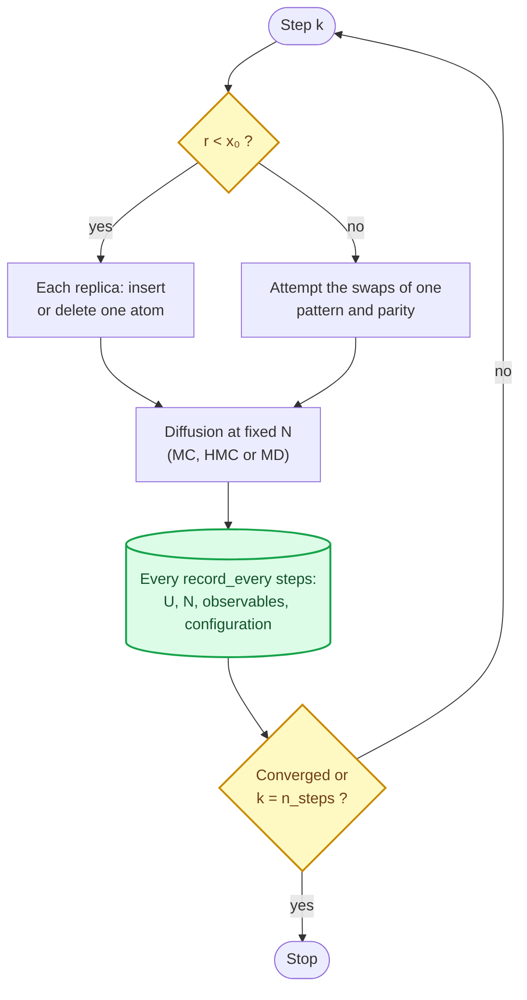

The diffusion is one of four modes:

| `diffusion` | What it does | Exact? |
|---|---|---|
| `mc_moves` | n single-atom displacement attempts ([ZSG19]'s LJ protocol) | yes |
| `mc` | n MC cycles, each atom attempted once per cycle on average | yes |
| `hmc` | n hybrid-MC trajectories (leapfrog + Metropolis on $H = U + K$) | yes, for any time step |
| `md` | n steps of thermostatted MD (Bussi or Langevin; natively in LAMMPS) | time-step bias |

For MD, fresh Maxwell–Boltzmann velocities are drawn at the start of every
segment. The thermostat counts 3N degrees of freedom, because frozen atoms
and walls break momentum conservation. With LAMMPS's default count of
$3N - 3$, 2-atom systems ran at 55 % of the target kinetic energy.

### 1.7 MBAR: from samples to every (T, μ)

Each sample n, recorded at any grid point, has a reduced potential at an
arbitrary state (T, μ):

$$
u(\mathbf x_n; T,\mu) = \beta U_n - \beta\mu N_n + N_n\ln\Lambda^3(T). \tag{6}
$$

This is Eq. (1) without the state-independent $V^N/N!$. MBAR [Shirts &
Chodera] solves self-consistently for the free energies $f_k$ of the sampled
states, and from them gives normalised weights at any target state:

$$
w_n(T,\mu) = \frac{e^{\,f(T,\mu)-u(\mathbf x_n;T,\mu)}}
{\sum_k N_k\, e^{f_k - u(\mathbf x_n;T_k,\mu_k)}},
\qquad \sum_n w_n = 1,
\qquad \langle A\rangle_{T,\mu} = \sum_n w_n A_n , \tag{7}
$$

where $f(T,\mu)$, the reduced free energy of the target state, is fixed by
the normalisation.

- **Any function of the configuration** can be reweighted this way: N,
  the adsorbed count, coordination numbers, an RDF, U and U² for the heat
  capacity.
- **Phases** are labelled by N (or by another integer descriptor). The
  probability of phase $i$ is $p_i = \langle\chi_i\rangle$, its free energy is
  $f_i = -k_BT\ln p_i$, and the stable phase is the most probable one
  [ZSG19, Eq. 8].
- **Reliability** is measured per target state by the Kish effective
  number of samples,

$$
n_\text{eff}(T,\mu) = \Big(\sum_n w_n^2\Big)^{-1}. \tag{8}
$$

At a simulated state it is at least that state's own sample count, and
more where neighbouring replicas overlap with it, because MBAR pools them.
It approaches 1 where one sample dominates: extrapolation beyond the
sampled range, or a gap between replicas that do not overlap. Correlated
samples make the true count smaller by the statistical inefficiency. The
package greys out and hatches cells with $n_\text{eff}$ below a chosen threshold
(Figures 5 and 10).

### 1.8 Validation on an exactly solvable case

With $U \equiv 0$ (an LJ potential with $\varepsilon = 0$), Eq. (1) is an ideal gas:
$\langle N\rangle = V e^{\beta\mu}/\Lambda^3$ and $P(N)$ is Poisson. Figure 3 shows a run of the
mixed sweep scheme (`ReplicaExchangeGCMC.run`, reduced units, $\Lambda^3 = 1$,
2 × 6 replicas, 1500 samples each): the direct averages and MBAR
reweighting between and beyond the sampled μ, both against the exact
result.


### 1.9 Heat capacity and phase boundaries

Coverage maps show where the most probable N changes, but not whether the
change is a phase transition or a smooth crossover. [ZSG22] locate phase
boundaries from the heat capacity

$$
C_V(T,\mu) = \frac{\langle E^2\rangle - \langle E\rangle^2}{k_BT^2},
\qquad E = U + K. \tag{9}
$$

The kinetic energy is not sampled, but for n moving atoms (the mobile ones
plus any displaceable substrate) it is known exactly given $n$:
$\langle K\,|\,n\rangle = \tfrac32 n k_BT$ and $\operatorname{Var}(K\,|\,n) = \tfrac32 n (k_BT)^2$. With
$x = U + \tfrac32 k_BT\, n$, this gives

$$
\operatorname{Var}(E) = \operatorname{Var}(x) + \tfrac32 (k_BT)^2 \langle n\rangle . \tag{10}
$$

Both moments come from Eq. (7). Differentiating $\langle E\rangle$ through the weights of
Eq. (1), with $\Lambda^3 \propto T^{-3/2}$, shows that Eq. (9) is exactly
$\partial\langle E\rangle/\partial T$ **at fixed $\beta\mu$**. It is not the heat capacity at fixed p or fixed N.
A unit test checks this identity against a finite difference of the
reweighted $\langle E\rangle$ (`tests/test_observables.py`). For an ideal gas, Eq. (10)
with Poisson-distributed $N$ gives $C_V/k_B = \tfrac{15}{4}\langle N\rangle$. The run of Figure 3
gives 55.1, against $\tfrac{15}{4}\cdot 27e^{-0.6} = 55.6$ exactly. (With the reduced-units
convention $\Lambda^3 = 1$, Eq. (9) is still the [ZSG22] fluctuation formula, but
no longer equals the derivative.)

$C_V$ is extensive and includes the adsorption term (the energy per atom
times $\partial\langle N\rangle/\partial T$). Values of $10^3$–$10^4\,k_B$ for a few tens of
adsorbates are therefore normal near a coverage step.

A first-order phase boundary shows up as a **ridge** of $C_V$: a maximum
along μ (or p) at fixed T, and along T at fixed μ or p, whichever the mesh
holds. `heat_capacity_ridges`
finds these maxima, and [ZSG22] draw the boundaries through them. A change
of coverage without a ridge is a smooth crossover; a ridge that fades out
ends at a critical point.

Two effects produce ridges that are not phase boundaries:

- **Finite size.** In a small cell every $N \to N+1$ step produces some
  $C_V$ bump. A genuine first-order transition is a ridge that stays sharp
  and tall and grows with the cell, with a bimodal $P(N)$ across it.
- **Poor overlap.** $C_V$ is a variance. Between two replicas whose samples
  barely overlap, MBAR rests on few effective samples and underestimates
  it. The result is peaks that sit *on* the sampled μ (or p) at every
  temperature (§4.1, Figure 7). `heat_capacity_ridges(..., ladder=...)`
  flags such points and warns. A real boundary moves with T, and stays
  where it is when the ladder is made denser.

### 1.10 Structural observables

The phase label N does not distinguish two structures with equal coverage,
such as ordered and disordered dimers in [ZSG22]. Structural descriptors
do. Each one is recorded with every sample and reweighted by Eq. (7):

| Observable | Recorded per sample | Reported |
|---|---|---|
| `CoordinationNumber` | bonds $n_b$ (centre–neighbour pairs with $r < r_c$), number of centres $n_c$ | $\langle n_b\rangle/\langle n_c\rangle$ |
| `CoordinationHistogram` | number of centres with CN = 0, 1, …, CN$_\text{max}$ | $P(\text{CN})$ of a centre atom ([ZSG22]'s $H_\text{coord}$) |
| `RadialDistribution` | pair-distance histogram $H(r)$, $n_a$, $n_b$, $V$ | $n(r) = \langle H(r)\rangle/(\langle n_a\rangle\Delta r)$; its integral to $r_c$ is the coordination |
| `FunctionObservable` | anything `f(system)` returns | $\langle f\rangle$ |

The selection `'substrate'` means all slab or cluster atoms, frozen and
displaceable; `'mobile'` means the exchanged atoms.

Ratios are formed after reweighting: ⟨bonds⟩/⟨centres⟩, not ⟨bonds/centres⟩.
The latter weights a configuration with one centre as much as one with
fifty, and is undefined with none. Centre atoms can be restricted to a
height range, such as [ZSG22]'s 3 Å "surface region". Distances follow the
cell's minimum-image convention.

### 1.11 Is the run converged?

[ZSG19] stop when there is "no change in the density of reduced-energy
states ρ(U), with increasing simulation steps" (p. 6). `regc` compares the histograms of u (Eq. 6) of two **disjoint**
consecutive blocks of samples. Comparing the samples at the previous check
with *all* samples, which include them, gives a change that decays like
1/k after k checks whatever the data do. Figure 4 shows that comparison
passing a series that drifts by ten standard deviations. Two blocks of n
samples from one distribution still differ by about $\sqrt{\text{bins}/\pi n}$ (the
expected total-variation distance for equally populated bins), so the tolerance must lie above
that noise floor. Here $n$ counts *independent* samples, and the
criterion takes the maximum over all replicas, which raises the floor
further.


A converged ρ(u) is necessary, not sufficient. Also check that the results
do not change when you discard more of the start of the run (§8).

---

## 2. How the package is organised

### 2.1 Modules

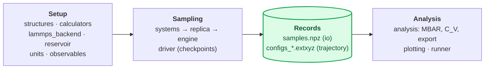

The analysis also reads the reservoir, to convert μ to pressure.

| Module | Main names | Needs |
|---|---|---|
| `systems` | `SlabSystem`, `ClusterSystem`, `BulkSystem` | numpy |
| `calculators` | `LJCalculator`, `PairLJCalculator`, `ASECalculatorAdapter` | numpy (ASE for the adapter) |
| `lammps_backend` | `LammpsCalculator`, `eam_pair_commands`, `lammps_ase_calculator` | LAMMPS Python module |
| `structures` | `slab_geometry_from_atoms`, `cluster_geometry_from_atoms`, `cubic_lattice_constant` | ASE |
| `reservoir` | `MonatomicIdealGasReservoir`, `DiatomicReservoir` | numpy |
| `engine`, `replica` | `ReplicaExchangeGCMC`, `Replica` | numpy |
| `observables` | `CoordinationNumber`, `CoordinationHistogram`, `RadialDistribution`, `FunctionObservable` | numpy |
| `driver`, `io` | `run_with_checkpoints`, `save_samples`, `load_samples` | numpy |
| `analysis` | `MBARSurfaceAnalysis`, `heat_capacity_ridges`, `export_phase_configurations` | pymbar, scipy |
| `plotting` | `plot_map`, `plot_phase_diagram`, `plot_radial_distribution` | matplotlib |
| `runner` | `regc-run config.yaml` | PyYAML |

Optional dependencies are imported inside the functions that need them, so
`import regc` works with numpy alone.

### 2.2 Parallel execution

Between two replica exchanges the replicas are independent. The engine
sends each replica a whole block of steps, to a pool of worker processes
when `n_workers > 1`. Observables are evaluated in the workers; the main
process collects the samples and writes the configuration files.

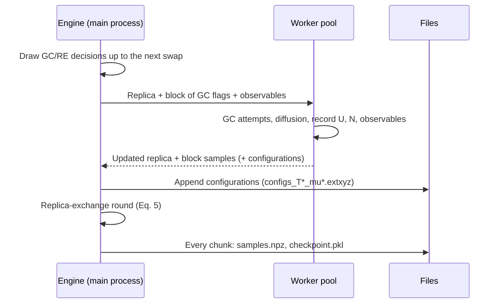

Each replica owns its random stream and it travels with the replica, so
runs with 1 and with many workers give bit-identical samples.

---

## 3. A calculation step by step

A real-units calculation has six steps. The snippets follow H on an Fe
surface with an EAM potential in LAMMPS
(`examples/13_fe_h_eam_surface.py` is the complete script).

### Step 1 — the structure

```python
from ase.build import bcc100
from regc import cubic_lattice_constant, eam_pair_commands, lammps_ase_calculator, \
    slab_geometry_from_atoms

pair = eam_pair_commands("FeH_Wen.eam.fs", ["Fe", "H"])
ase_calc = lammps_ase_calculator(pair, ["Fe", "H"])          # the same potential, in ASE
a = cubic_lattice_constant(ase_calc, "Fe", "bcc")             # the potential's own lattice constant
geometry = slab_geometry_from_atoms(bcc100("Fe", size=(3, 3, 6), a=a, vacuum=None),
                                    n_frozen_layers=3, headroom=6.0)
print(geometry.summary())
```

- **Frozen and free layers:** the bottom `n_frozen_layers` stay frozen;
  the layers above them relax and vibrate.
- **Coordinates:** the top frozen layer sits at z = 0, and
  `geometry.top_z` is the height of the topmost atom.
- **Headroom:** the gas atoms live in the `headroom` above the slab.
- **Clusters:** `cluster_geometry_from_atoms` does the same for a
  nanoparticle in a non-periodic box.

### Step 2 — the calculator and the reservoir

```python
from regc import DiatomicReservoir, LammpsCalculator, kelvin_to_eV

h2 = DiatomicReservoir.from_calculator(ase_calc, "H")        # D0 and e_atom from the potential
print(h2.calculator_info)                                      # check r0, De, D0 against experiment

def make_system(rng):
    return geometry.make_system(LammpsCalculator(pair, ["Fe", "H"]), "H",
                                insertion_z_range=(geometry.top_z - 0.5, geometry.top_z + 4.0))
```

Before a long run, check that the potential's H₂ molecule is reasonable
(bond length, D₀). Also check the adsorption energy of a few sites with
`insertion_energy_scan`.

### Step 3 — the replica ladder

```python
T_K = [300, 400, 500, 650, 800]
p_bar = [1e-8, 1e-6, 1e-4, 1e-2, 1, 1e2]
mus = h2.mu_grid(T_K, p_bar, unit="bar")                      # shape (5, 6), Eq. (3)
```

- **Spacing:** neighbouring replicas must overlap in energy and N. Aim
  for 20–40 % swap acceptance (§8).
- **Pressure grid:** a pressure grid gives a μ grid that is different at
  every T. A μ grid shared by all temperatures is also allowed.

### Step 4 — observables and structures to keep

```python
from regc import CoordinationNumber, RadialDistribution

observables = [
    CoordinationNumber("cn_HFe", r_cut=2.2, center="mobile", neighbor="substrate"),
    RadialDistribution("rdf_HFe", r_max=4.0, n_bins=80, a="mobile", b="substrate"),
]
```

### Step 5 — sampling

```python
from regc import ReplicaExchangeGCMC, run_with_checkpoints

with ReplicaExchangeGCMC([kelvin_to_eV(T) for T in T_K], mus, make_system,
                         lambda_cubed_of_T=h2.lambda_cubed_of_T(), n_workers=30,
                         adsorbed_cutoff=2.2, observables=observables,
                         configurations_dir="run/configurations", configurations_every=2) as sim:
    status = run_with_checkpoints(sim, "run", n_steps=20000, chunk=1000, x0=0.9,
                                  diffusion="md", diffusion_steps=40, record_every=10,
                                  timestep_fs=0.5, taut_fs=20.0)
```

- **Λ³:** `lambda_cubed_of_T` must be the Λ³ of the **exchanged atom**,
  the one the reservoir defines.
- **Chunks:** the run is saved every `chunk` steps and resumes after a
  crash or a wall-time limit (§7).

### Step 6 — analysis

```python
import numpy as np
from regc import MBARSurfaceAnalysis, heat_capacity_ridges, load_samples, plot_map

a = MBARSurfaceAnalysis(load_samples("run/samples.npz", discard=0.2),
                        reservoir=h2, pressure_unit="bar")
T_grid_K = np.linspace(300, 800, 51)
T_grid = np.array([kelvin_to_eV(T) for T in T_grid_K])
p_grid = np.logspace(-8, 2, 81)
theta = a.phase_diagram_Tp(T_grid, p_grid, area=geometry.n_surface, observable="N_ads")
ess = a.effective_sample_size(T_grid, p_grid, pressure=True)
cv = a.heat_capacity(T_grid, p_grid, pressure=True)
ridges = heat_capacity_ridges(T_grid_K, p_grid, cv, valid=ess >= 20)
plot_map(T_grid_K, p_grid, theta, "coverage.png", valid=ess >= 20, points=ridges["points"],
         colorbar_label="H per surface Fe", xlabel="p(H2) (bar)", ylabel="T (K)")
```

The analysis section (§5) covers the remaining tools.

---

## 4. Worked examples

| Example | System | Shows |
|---|---|---|
| `01_validate_calculator.py` | LJ | the native LJ against a brute-force sum |
| `02`–`04` | LJ bulk and surface | parallel runs, frozen substrate, a first phase diagram |
| `05_emt_metal_surface.py` | H on Au(111), EMT | real units and Λ³ of H, with μ set directly |
| `10_hmc_demo.py`, `11_...` | LJ with a relaxing substrate | HMC and MD diffusion |
| `12_paper_lj_surface.py` | [ZSG19] §III A | the paper's LJ surface, MBAR against aiAT (its docstring: about 80 min on 12 cores) |
| `13_fe_h_eam_surface.py` | H on Fe, EAM in LAMMPS | a production workflow with checks and a CLI |
| `14_observables_heat_capacity.py` | [ZSG19] LJ surface | observables, $C_V$, structures of each phase (7–8 min on 12 cores, §4.1) |
| `pd111_o_grace/`, `pt55_o_grace/` | O on Pd(111), O on Pt₅₅; GRACE MLIP | config-file runs on a cluster |

### 4.1 The LJ surface with observables, heat capacity and structures

This is `examples/14_observables_heat_capacity.py`.

**The system [ZSG19, §III A].** A frozen two-layer fcc(111) slab of 18 A
atoms in a 3 × 3 hexagonal cell (lattice vector 11.489 Å). B atoms
adsorb from an ideal gas into a 48 Å zone above the top A layer, which
sits at z = 0. A hard wall there keeps B out of the slab, as in the
paper's setup; without it, B slips through the hollows and is absorbed
between the A layers (algorithm notes, §7). Interactions are LJ:
$\varepsilon_{AB} = 0.66$ eV, $\sigma_{AB} = 1.91$ Å, $\varepsilon_{BB} = 0.01$ eV,
$\sigma_{BB} = 1.2$ Å. The mass of B, 16.48 amu, is not stated in [ZSG19];
it is inferred from their Fig. 3 caption (algorithm notes, §7).

**Two runs.** Both use six temperatures (200–650 K), $2\times10^4$ REGC
steps with $x_0 = 0.99$, ten MC moves of diffusion per step, and a sample
every 50 steps; after discarding the first 20 %, 320 samples per replica
remain. Each takes 7–8 minutes on 12 cores.

| Run | μ ladder | Swap acceptance (T / μ / diagonals) |
|---|---|---|
| coarse | 11 values, −2.4 to −0.9 eV in steps of 0.15 eV | 0.53 / 0.23 / 0.21–0.25 |
| dense | 11 values, −1.65 to −1.25 eV in steps of 0.04 eV | 0.32 / 0.40 / 0.27–0.30 |

Every sample records four observables:

- the B–A coordination ($r_c = 2.8$ Å, beyond the 2.14 Å pair minimum);
- the B–B coordination histogram;
- the B–B and B–A RDFs.

Every sample's configuration is stored as well.

Both runs are illustrations, a sixth of the paper's length. They are not
converged enough for a quantitative comparison with [ZSG19, Fig. 3],
whose most prominent phases are $N_B$ = 0, 18, 45, 59 and 85. What they
do show well is how to read, and how not to read, the maps.

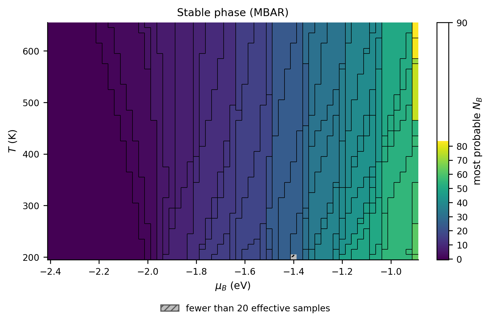


**The heat capacity needs overlap.** In the coarse run, 83 % of the
$C_V$ peaks of Figure 6 lie on one of the 11 sampled μ, at every
temperature. `heat_capacity_ridges(..., ladder=...)` flags this and
warns. A phase boundary that does not move with T would need equal
entropies on both sides, so vertical columns on the ladder are suspect
from the start. Figure 7 tests them by repeating the run with a ladder
almost four times denser over −1.65 to −1.25 eV.

- **Coarse ladder.** At 290 K, the two tallest peaks sit exactly on the
  sampled −1.50 and −1.35 eV.
- **Dense ladder.** Those peaks become broad, lower features. Between two
  replicas that barely overlap, MBAR's variance estimate rests on a few
  samples and collapses, which is what produced the peaks.
- **What survives.** The dense map still has short vertical streaks on its
  own ladder; 2 × 10⁴ steps are not enough. It also has ridges that move
  with T at low temperature, the behaviour expected of real boundaries.
  Only a longer run, or a second ladder offset by half a step, can
  separate the two.


The same goes for the coverage. The coarse run's ⟨N_B⟩ along the 290 K
isotherm rises in steps whose edges lie on the sampled μ. With the dense
ladder it rises smoothly (Figure 8), and $P(N_B)$ stays broad and
single-peaked as it shifts. Over this window, at 290 K and this cell size,
adsorption is a continuous filling, not a sequence of first-order
transitions.

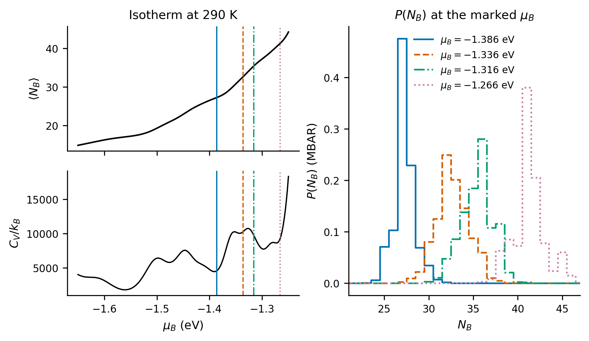

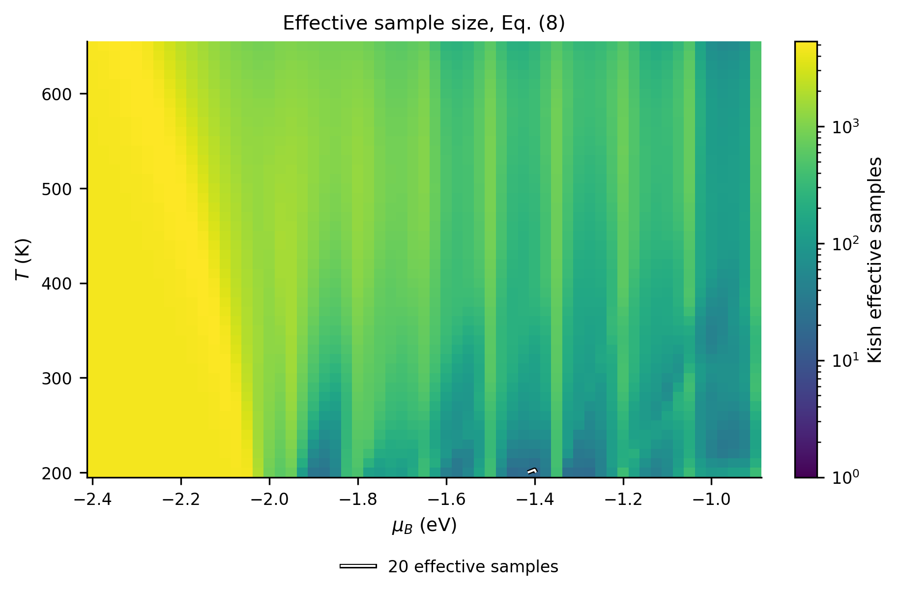


**Structures of the phases.** `export_phase_configurations` labels every
mesh cell with its most probable $N_B$ and groups the cells into connected
regions. For each region it writes the stored configuration with the
largest MBAR weight, among those with that $N_B$, at the cell where that
$N_B$ is most probable. Figure 12 shows four of them; the extxyz files
open in OVITO, ASE or pySNOW.


### 4.2 H on Fe with an EAM in LAMMPS

`examples/13_fe_h_eam_surface.py` is the production version of §3. It has
two extra modes:

- `--check` verifies the setup before any sampling: lattice constant, the
  H₂ molecule, site energies, and energy bookkeeping over one REGC step.
- `--analyze-only` re-analyses a finished run.

MD diffusion runs natively in LAMMPS rather than through ASE's MD, which
the algorithm notes (§2.2) report as about 10³ times faster for an EAM
slab.

LAMMPS's per-run setup dominates the cost of an energy call for a slab
this size, so the calculator skips it when only positions change. It
sends the new positions and runs one step without an integrator, and it
reuses the energy of the configuration before a move and the end energy
of each MD segment. Every energy still agrees with a full setup to
round-off. Measured on a 60-atom Fe(100) + H slab on one core:

| Path | Full setup every call | Fast path | Speed-up |
|---|---|---|---|
| MC displacement move | 3.62 ms | 0.27 ms | 13× |
| GC attempt (count changes: full setup needed) | 3.44 ms | 2.21 ms | 1.6× |
| REGC step, 10 MC moves per replica (2 × 2 replicas) | 177 ms | 31.6 ms | 5.6× |
| REGC step, 40 MD steps per replica | 64.6 ms | 39.0 ms | 1.7× |

`REGC_LAMMPS_FAST=0` restores the full path for checks.

### 4.3 O on Pd(111) with a foundation MLIP (GRACE)

`examples/pd111_o_grace/` runs from a YAML file (§6) with a GRACE
foundation model in LAMMPS (`lammps_name: grace`; the model is chosen with
`GRACE_MODEL` in `run.sh`). The O₂ reservoir takes D₀ from the
model (`d0: self`) and includes O₂'s triplet ground state
(`electronic_degeneracy: 3`, the default for O). The `run.sh` script
submits to Slurm with automatic resubmission (§7).

---

## 5. Analysis in depth

### 5.1 The main tools

| Task | Call |
|---|---|
| Coverage map | `phase_diagram_Tp(T, p, area, observable)` / `phase_diagram(T, mu, ...)` |
| Stable phase | `most_probable_N_Tp(T, p)` / `most_probable_N(T, mu)` |
| One state | `mean_N(T, mu)`, `pN(T, mu)` (reweighted P(N)) |
| Reliability | `effective_sample_size(T, grid, pressure)` |
| Heat capacity | `heat_capacity(T, grid, pressure, kinetic=True)`, `heat_capacity_ridges(...)` |
| Observables | `observable_map`, `mean_coordination`, `coordination_distribution`, `radial_distribution` |
| aiAT comparison | `lowest_energy_N(mu)`, `lowest_energy_N_Tp(T, p)` |
| 2D condensation | `locate_coexistence_p(T, bracket)`, `coexistence_curve_Tp(T, bracket)` |
| Structures | `representative_samples(...)`, `export_phase_configurations(...)` |

Temperatures are always k_BT in the energy unit of U (eV in real units).
Pressures are in the `pressure_unit` given to `MBARSurfaceAnalysis`.

### 5.2 What to plot, and how

The plotting helpers follow three rules:

- **Unreliable cells are shown, not hidden.** Cells with few effective
  samples are grey and named in the legend.
- **Colormaps match the data.** Integer phase labels get one colour per
  value. Continuous quantities use perceptually uniform maps (viridis,
  cividis, magma). C_V uses a logarithmic scale clipped at its 2nd
  percentile, and the colourbar arrow marks the clip.
- **Pressure is plotted as log₁₀ p** on a uniform axis.

```python
plot_map(T_K, p, most, "phases.png", valid=ess >= 20, discrete=True,
         points=ridges["points"], colorbar_label="most probable N")
```

### 5.3 The structures behind the diagram

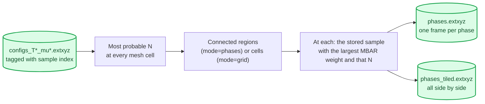

Each exported frame records its state:

- the phase label and its probability there (`P_phase`);
- the effective sample size;
- the sample's weight and origin (`source_T_index`, `source_mu_index`,
  `source_sample`).

Each atom has a `group` column: 0 frozen substrate, 1 displaceable
substrate, 2 mobile. The tiled
file adds `tile_row` and `tile_col`, so a viewer can colour or label the
tiles.

### 5.4 Reliability: correlation, overlap, error bars, mixing

A map from MBAR always looks smooth. `regc.diagnostics` answers four
questions that decide how much of it to believe; `regc-run` runs the
first three automatically and prints warnings.

| Question | Tool | What to look for |
|---|---|---|
| How many independent samples? | `replica_inefficiencies` (uses `statistical_inefficiency`); `MBARSurfaceAnalysis(..., subsample="g")` | $n/g$ per replica, with $g = 1 + 2\sum_t \rho(t)$ for N, U and u; fewer than about 20 makes averages, and especially $C_V$, unreliable. Thinning to every g-th sample makes pymbar's analytical errors honest, at the price of noisier estimates |
| Do neighbouring replicas overlap? | `neighbour_overlap(analysis)` | the MBAR overlap of each pair of grid neighbours; below about 0.03 [Klimovich] the states between them rest on few samples |
| How large is the statistical error? | `bootstrap(analysis, statistic, n_boot)` → `BootstrapResult` | percentile intervals (`interval`), standard errors (`std`), and for an integer map the fraction of resamples that agree with it (`agreement`) |
| Is a $C_V$ peak real? | `ridge_support(ridges, cv_replicates)`, plus `heat_capacity_ridges(..., ladder=...)` | support close to 1, and a peak that is not on a sampled value |

**How the bootstrap works.**

- **Blocks.** Each replica's samples are resampled in blocks of
  consecutive samples about $2g$ long, so the correlation inside a block
  is kept. Each replica is resampled independently, which ignores the
  weaker correlation that swaps create between replicas.
- **MBAR is re-solved for every resample.** It starts from the full-data
  free energies and uses a Newton solver that agrees with pymbar to
  round-off, at about a second per resample for 66 states and 21 000
  samples.
- **Any statistic.** The statistic is any function of the analysis, such
  as a $C_V$ map, a coverage map or the most probable N.

On the ideal gas, the 90 % intervals contain the exact $\langle N\rangle$ in at
least 11 of 16 independent runs; this is a unit test.

**One resample, step by step.** The bootstrap [Künsch] imitates "run the
simulation again" with the samples already in hand, and repeats the whole
analysis on each imitation. In short, then step by step:

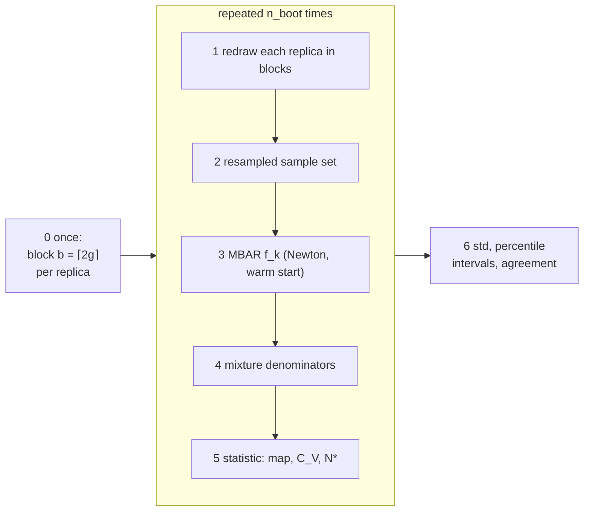

0. **Block length, once.** Each replica's statistical inefficiency $g$
   (the largest of those of N, U and u; §1.11) sets a block length
   $b = \lceil 2g\rceil$, capped at a quarter of its samples.
1. **Redraw.** For each replica, $\lceil n/b\rceil$ block starts are drawn
   uniformly in $[0, n-b]$ with replacement; the blocks of consecutive
   samples are concatenated and cut to $n$. Some stretches of the run
   appear twice, some not at all; correlation inside a block is kept.
   Replicas are redrawn independently: the correlation that replica
   exchange creates between neighbouring replicas is ignored.
2. **Copy.** Every per-sample column (U, N, N_ads, N_s, observables,
   energies under other potentials) is copied at those indices into a new
   sample set with the same ladder and metadata.
3. **Re-solve MBAR.** The resampled set gets its own free energies $f_k$
   from the MBAR equations $\sum_n W_{kn} = N_k$ (§1.7). The package's
   Newton solver starts from the full data's $f_k$ and normally needs 4–5
   steps: about 0.1 s for 32 states and 38 400 samples.
4. **Denominators.** For every sample it stores
   $\ln\sum_k N_k e^{f_k - u_k(x_n)}$. The weight at any target state is
   then one vector operation.
5. **Statistic.** The function you passed (a coverage map, a $C_V$ map,
   the most probable N) is evaluated on the resampled analysis exactly as
   on the full data.
6. **Summary.** Over the `n_boot` replicates: `std()` (standard error),
   `interval(level)` (percentiles; with 40 resamples the 5th percentile is
   the second- or third-smallest value, so use a few hundred for quoted
   95 % intervals), `agreement()` (integer labels).

**Why some resamples took minutes.** In the Fe–H benchmark of §5.6, about
one resample in eight took 175–185 s instead of 0.1 s. Instrumenting the
solver on a replay of those resamples showed the cause: the Newton
iterations reached a gradient of a few 10⁻⁹ (the weight sums matched the
sample counts to about 10⁻⁴ of a sample) and then could not go further.
The decrease of the objective left along the Newton direction was below
its floating-point resolution, so the line search halved the step about
25 times until round-off noise let a step of about 10⁻⁷ pass, 500 times
over (the iteration cap). The solver now stops when only such negligible
steps pass and the gradient is already below 10⁻⁶. On the stalled
resample the result is unchanged to 2.7 × 10⁻¹³ kT (the coverage map to
7 × 10⁻¹⁵), the solve takes 1.2 s, and a 40-resample bootstrap of that run
takes 58 s instead of up to 16 min. A unit test forces the situation
with an unreachable target.

**Comparing two estimates.** To compare two maps with their own error bars
(two runs, or a reweighted map and a direct one), use
$z = (a - b)/\sqrt{\sigma_a^2 + \sigma_b^2}$ per cell: with correct errors
and no bias, about 95 % of cells have $|z| < 2$. Checking whether $b$ lies
in $a$'s 90 % band is a weaker test than it looks. Even for two perfect
estimates with equal errors it succeeds in only about 75 % of cells,
because the band ignores $b$'s own error.

**Mixing.** The engine also counts swaps per neighbouring pair
(`pair_acceptance`) and follows every configuration as a walker across the
grid (`round_trip_counts`). A pattern's average acceptance can hide one
pair that never swaps and cuts the ladder in two. A walker that never
completes a round trip in T has not carried a low-temperature structure
through the hot replicas and back. The driver writes both to `mixing.json`
after every chunk.

**What the LJ runs of §4.1 show (Figure 13).**

- **Correlation.** The statistical inefficiency is about 43 in every
  replica. Each replica's 320 samples hold about 7 independent ones,
  which is far below 20: these runs are illustrations, as §4.1 says.
- **Overlap.** On the coarse ladder, 118 of 215 neighbouring pairs
  overlap less than 0.03. On the dense ladder, 28 of 215 do.
- **Bias versus noise.** The coarse run's $C_V$ peaks on the sampled
  −1.50 and −1.35 eV have bootstrap support 1.00 and 0.98 (Figure 13;
  the one on −1.95 eV, outside the figure's window, has 1.00). They are
  reproducible, yet they are the overlap artefact of §4.1. The bootstrap
  measures variance, and that artefact is a bias, the same in every
  resample. Error bars and the overlap and ladder checks are therefore
  complementary; use both.
- **The dense run is not clean either.** Its broad, low peak on the
  sampled −1.45 eV also has support 1.00, so a run this short cannot
  settle that feature; its peak near −1.33 eV is supported by fewer than
  half of the resamples.


Two further checks need no extra code:

- **Split the run:** compare the maps from the two halves.
  `samples.discard(0.5)` keeps the second half; for the first half, build
  a `SampleSet` from the first `n_samples // 2` entries of each replica.
- **Cells with $n_\text{eff} \approx 1$** have no meaningful average, whatever
  their error bar says.

---

### 5.5 Filling the gaps instead of starting over

The dense run of §4.1 was a second, separate run of 66 replicas. When the
overlap check finds gaps, a cheaper route is to add states only where
they are missing and analyse old and new samples together. MBAR does
not need the states to form one rectangular grid.

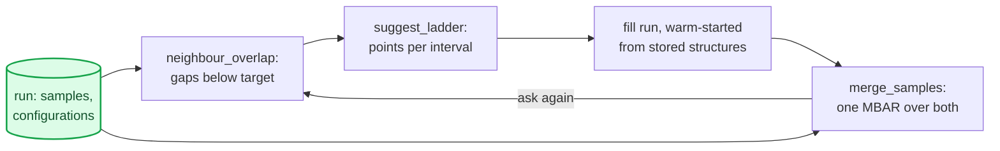

- **Advisor.** `suggest_ladder(analysis, target_overlap)` cuts every gap
  with overlap $o$ into $\lceil\ln o/\ln o_\text{target}\rceil$ pieces.
  Each interval of the ladder gets one set of points, shared by all
  temperatures, so the fill runs are rectangular grids.
  `to_config()` writes them as `replica_exchange` snippets.
- **Merge.** `merge_samples(run, fill)` keys states `(run, it, imu)`
  and lists their (T, μ). It refuses runs that do not sample the same
  ensemble (exchanged species, Λ³, substrate). In a config file,
  `phase_diagram.merge: [fill_dir]` does the same, and also checks the
  structure and the potential.
- **Warm start.** `system_factory_from_configurations` starts every new
  replica from the last stored structure of its nearest sampled state.

For the coarse run of §4.1 the advisor proposes 17 new μ columns at a
target overlap of 0.03 (102 replicas, about 1.5 times the original run).
Merging the coarse run with the dense run of Figure 7 (132 states,
solved in 17 s by first solving each run alone) cuts the neighbouring
pairs below 0.03 from 118 of 215 to 36 of 231. Inside the dense window
the merged ⟨N⟩ and $C_V$ at 290 K lie within the dense run's 90 %
bootstrap band at 81 % and 87 % of the points.
Most of them fall at μ above −1.5 eV, where the coverage changes
fastest. That is where the dense run of Figure 7 was needed, and the
advisor's spacing there, about 0.04 eV, is the one chosen by hand for
the dense run.

### 5.6 Another potential, without a new run

A REGC run is expensive; evaluating a potential on a stored configuration
is not. If the configurations of a run with potential A are kept, the
phase diagram of another potential B (a refitted EAM, a fine-tuned MLIP,
single points from DFT) follows by reweighting, as long as B favours
configurations that A visited.

**The physics.** MBAR gives every sample $n$ drawn at the sampled states
$k$ the mixture density $\sum_k N_k e^{f_k - u_k^A(x_n)}$. The weight of
the sample in any other ensemble is the ratio of that ensemble's
Boltzmann factor to the mixture density [Shirts & Chodera]. For the grand
ensemble of potential B at (T, μ):

$$w_n^B(T,\mu) \propto \frac{\exp[-\beta U_B(x_n) + \beta\mu N_n - N_n\ln\Lambda^3]}
{\sum_k N_k \exp[f_k - u_k^A(x_n)]}.$$

Only $U_B(x_n)$ is new: the denominators are A's, solved once. Three
consequences:

- **The effective sample size measures the overlap of A and B.**
  $n_\text{eff} = 1/\sum_n w_n^2$ under B, compared with A's own, says
  how many of A's samples still carry B's average. A ratio near 1 means
  B's distribution lies where A sampled; a ratio far below 1 means B
  favours configurations that A rarely visited, and only a run with B can
  say what happens there.
- **Shifts linear in N are free.** $U_B = U_A + cN$ is A at $\mu - c$, and
  the reweighting reproduces this to round-off (a unit test). What limits
  the overlap are changes in site preference and in the H–H interaction,
  not a change of the average binding energy.
- **Grand potentials.** The ratio of the two grand partition functions is
  an average over A, $e^{-\beta(\Omega_B - \Omega_A)} = \langle e^{-\beta(U_B - U_A)}\rangle_A$
  at each (T, μ): free-energy perturbation [Zwanzig] in the grand
  ensemble (`grand_potential_shift`).

μ keeps its meaning only if both potentials put the gas reference (the
isolated molecule: $D_0$, $e_\text{atom}$) at the same energy. If B binds H2
differently, its reservoir maps p to a different μ; pass B's reservoir
to `with_potential` (`regc-reevaluate` stores it in the records file, and
the runner uses it).

**The records file.** `records: {save: true}` (or
`ReplicaExchangeGCMC(records_path=...)`) writes `records.h5`, with one row
per recorded sample:

| Dataset | Shape | Content |
|---|---|---|
| `samples/state` | (n, 2) | grid point (it, imu) |
| `samples/sample` | (n,) | sample index at that grid point |
| `samples/walker` | (n,) | the configuration's walker (followed through swaps) |
| `samples/N`, `samples/N_s` | (n,), (n, S) | mobile atoms (per species with several) |
| `samples/E/<name>` | (n,) | energy under potential `<name>`; NaN where not evaluated |
| `config/offset`, `config/length` | (n,) | where the sample's atoms are in `positions` (−1: not stored) |
| `config/positions`, `config/species` | (m, 3), (m,) | all stored atoms, frozen, substrate, mobile |

The atom count varies from sample to sample, so positions are one long
array addressed by offset and length. The file is flushed at every
checkpoint and every 2048 records. After a resume, the samples recorded
after the last checkpoint are written again, and readers keep the last
record of each (state, sample), so the records always match `samples.npz`.
In the Fe–H benchmark below (about 42 atoms per sample) the file takes
1.1 kB per sample in float64; `every: k` stores
only every k-th configuration and `positions: float32` halves the size.

**The workflow.**

```bash
regc-run run.yaml                                          # records: {save: true}
regc-reevaluate run.yaml other_potential.yaml --name B --workers 8
# add  potentials: [B]  to phase_diagram, then
regc-run run.yaml --analyze-only    # <plot>_B.png, _B_difference.png, _B_ess.png
```

`other_potential.yaml` holds a `calculator` section (and any other section
to replace). The new setup must build the same cell; if the lattice
constant comes from the potential, fix it in `structure`. Re-evaluation
writes after every chunk and skips what is done, so it can be interrupted
and repeated, and it evaluates only the new samples after a run has been
extended. `--every k` evaluates every k-th sample; the subset must not
depend on the configurations, or the reweighting is biased. In Python:

```python
from regc.records import reevaluate, attach_energies
reevaluate("out/records.h5", make_system_B, "B", n_workers=8)
samples = attach_energies(load_samples("out/samples.npz", discard=0.2), "out/records.h5")
A = MBARSurfaceAnalysis(samples, reservoir=res, pressure_unit="bar")
B = A.with_potential("B")                  # every map of B; bootstrap(B, ...) works too
```

**Benchmark: H on Fe(100), EAM → EAM′.** To test the method against a
direct answer, the Fe–H EAM of [Wen] (A) was compared with EAM′ (B), the
same potential plus a weak Fe–H Morse term,
$D[(1 - e^{-\alpha(r - r_0)})^2 - 1]$ with $D$ = 0.01 eV,
$\alpha$ = 1.5 Å⁻¹, $r_0$ = 2.0 Å, cut at 3 Å. EAM′ binds adsorbed H a few
hundredths of an eV more strongly. Fe–Fe and H–H are unchanged, so the
lattice constant (2.8549 Å), slab, H2 reservoir ($D_0$ = 4.4577 eV) and μ
ladder are identical. Both potentials were sampled with the same setup:

| Setting | Value |
|---|---|
| Slab | Fe(100) 3 × 3 × 4, 2 frozen + 2 displaceable layers, 9 surface atoms, H in z ∈ (0, 7.85] Å |
| Grid | 400, 500, 625, 780 K × $p_{H_2}$ = 10⁻⁶ … 100 bar (8 values) = 32 replicas |
| Sampling | REGC, $x_0$ = 0.9, MC diffusion, 15 000 steps, 1200 samples per replica kept |
| Cost | EAM 2 h 10 min, EAM′ direct 2 h 25 min (6 workers each); re-evaluating 48 000 EAM configurations with EAM′: 77 s |

Before comparing, every 25th stored configuration of each run (1920 per
run) was re-evaluated from scratch with its own potential. The energies
recorded during sampling agree to 7.6 × 10⁻¹² eV, so the direct EAM′ run
sampled exactly the model that the re-evaluation computed.


| Quantity (20 T × 33 p mesh, H per surface Fe) | Value |
|---|---|
| Change caused by EAM′ (direct runs) | up to 0.17, mean 0.09 |
| Reweighted − direct | mean \|d\| 0.010, max 0.074 |
| Bootstrap standard error, median | 0.005 (reweighted), 0.006 (direct) |
| Cells with \|z\| < 2 / < 3 | 94 % / 99 %, max \|z\| 3.3 |
| Mean z | +1.0 |
| Share of the EAM → EAM′ change recovered | median 1.07 (5–95 %: 0.98–1.26), 527 cells with a change > 0.05 |
| $n_\text{eff}$ under EAM′ / under EAM | median 0.91, min 0.37; $n_\text{eff}$ ≥ 759 everywhere |
| $\Omega_{B} - \Omega_{A}$ on the sampled states | −0.001 eV (780 K, 10⁻⁶ bar) to −0.54 eV (400 K, 100 bar) |

What the benchmark shows:

- **The change is reproduced.** EAM′ raises the coverage by up to 0.17 H
  per surface Fe. The reweighted map recovers that change to about 10 %,
  within 3.3 combined standard errors in every cell, from 77 s of
  energy evaluations instead of a 2.4 h run (Figure 14a, b).
- **Overlap is good everywhere** (Figure 14c). It is lowest at 400 K and
  high pressure. There the surface holds the most H, the per-atom change
  adds up (the grand potentials differ by 0.54 eV), and B's weights
  concentrate on fewer of A's samples. A stronger perturbation would
  first fail there.
- **A small systematic offset remains.** The reweighted coverage is
  higher than the direct one by about 0.01 H per surface Fe, about one
  combined standard error (Figure 14b is mostly red). Where it comes from:
  - It is not a code error: the energy check rules that out.
  - It is not poor overlap: with at least 759 effective samples, the
    bias of the reweighting ratio is far smaller.
  - It appears in both halves of the runs independently (+0.011 from
    samples 20–60 %, +0.009 from 60–100 %). Both runs creep upwards from
    the first to the second half, the direct EAM′ run more (+0.005 vs
    +0.003), so slow equilibration of the direct run explains part of it.
  - The rest is within what one pair of runs can show. The bootstrap
    ignores the correlation between replicas, and this ladder is coarse:
    26 of 94 neighbouring pairs overlap less than 0.03, and `cross_left`
    swaps are accepted in 6.5 % of attempts (never for several pairs).
    Independent repeats with other seeds would measure the run-to-run
    scatter directly; this benchmark does not have them.
- **In practice:** read the effective-sample-size map first. Treat
  differences of about one bootstrap standard error between potentials as
  unresolved, and confirm the region that matters with a short direct run
  of the other potential.

Not yet implemented: one MBAR over states sampled with *different*
potentials (runs of A and of B analysed together, each sample evaluated
with both). The records file already holds what that needs.

## 6. Running from a config file

The command `regc-run config.yaml` runs the whole pipeline: structure →
reservoir → REGC → MBAR → maps and structures. A minimal config with the
new analysis options:

```yaml
structure:
  build: {surface: fcc111, symbol: Pd, size: [4, 4, 4]}
  n_frozen_layers: 2
  headroom_angstrom: 6.0
gas: {species: O, insertion_z_range_above_surface: [-0.5, 3.5]}
calculator: {type: LAMMPS, pair_style: "grace/runtime",
             pair_coeff: "* * model.npz Pd O", species: [Pd, O], lammps_name: grace}
reservoir: {type: diatomic, d0: self, bond_length_angstrom: 1.2075,
            vibrational_wavenumber_cm: 1580.2}       # electronic_degeneracy 3 by default for O
replica_exchange:
  scheme: regc
  temperatures_K: [300, 400, 500, 650, 800]
  pressures: [1.0e-12, 1.0e-9, 1.0e-6, 1.0e-3, 1.0]
  pressure_unit: bar
  n_steps: 20000
  x0: 0.9
  diffusion: md
  diffusion_steps: 40
  md: {timestep_fs: 1.0, taut_fs: 20.0}
  record_every: 10
  adsorbed_cutoff: 2.4
  n_workers: auto
observables:
  - {type: coordination, name: cn_OPd, r_cut: 2.6}
  - {type: rdf, name: rdf_OO, r_max: 5.0, n_bins: 100, a: mobile, b: mobile}
configurations: {save: true, every: 2}
checkpoint: {chunk: 1000}
phase_diagram:
  T_min_K: 300
  T_max_K: 800
  n_T: 51
  p_min: 1.0e-12
  p_max: 1.0
  n_p: 61
  observable: N_ads
  most_probable: true
  heat_capacity: true
  min_ess: 20
  rdf_states: [[400, 1.0e-6], [700, 1.0e-6]]
  export_configurations: {mode: phases, min_cells: 4}
  bootstrap: {n: 100, seed: 0}                     # intervals, label agreement, C_V peak support
output: {directory: output}
```

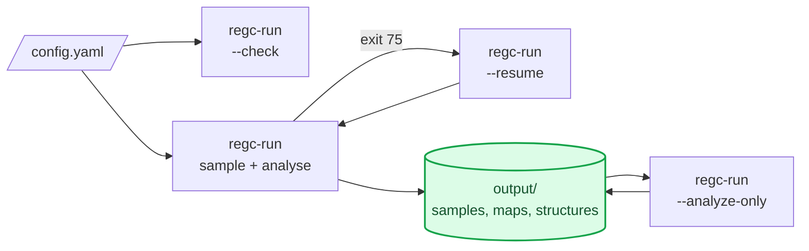

- `--check` builds and prints the setup (structure, reservoir, μ ladder,
  energies) without sampling.
- A plain run samples and analyses; with a `checkpoint` section it stops
  cleanly with exit code 75 at a time limit.
- `--resume` continues from the checkpoint.
- `--analyze-only` recomputes the maps and exports from the saved samples,
  for example with a new mesh, `min_ess` or export mode.

| Output | Contents |
|---|---|
| `samples.npz` | U, N, N_ads, observables per replica and sample; ladder, μ grid, Λ³, observable definitions |
| `run_metadata.json` | the full setup (resume and `--analyze-only` read it) |
| `phase_diagram.png`, `_most_probable.png`, `_heat_capacity.png`, `_cn_<name>.png`, `_rdf_<name>.png` | the maps |
| `phase_diagram_data.npz` | all maps as arrays, with `effective_samples`, the C_V ridge points, the reliability arrays (`n_independent`, `overlap_min`, `round_trips_T`) and, with `bootstrap`, the intervals and agreement |
| `phase_diagram_uncertainty.png` | with `bootstrap`: half-width of the coverage interval |
| `mixing.json` | swap acceptance per pattern and per pair, and round trips per walker (§5.4) |
| `configurations/configs_T*_mu*.extxyz` | sample-tagged structures |
| `configurations_phases.extxyz`, `..._tiled.extxyz` | the structures of the phase diagram |

Every key is listed in the [reference manual](../MANUAL.md), §14.

---

## 7. Long runs on a cluster

```mermaid
stateDiagram-v2
    accTitle: Life cycle of a checkpointed run
    accDescr: A run is set up, then alternates sampling chunks and checkpoints; a time limit ends the job with exit code 75 for resubmission, a resumed run reloads the checkpoint, and the run ends when the steps are done or the convergence test passes.

    [*] --> setup
    setup --> chunk: fresh start (metadata saved)
    chunk --> checkpoint: chunk steps done
    checkpoint --> chunk: time left
    checkpoint --> stopped: next chunk would pass the time limit
    stopped --> resumed: resubmit (exit code 75)
    resumed --> chunk: checkpoint and metadata match
    checkpoint --> finished: n_steps done or ρ(u) converged
    finished --> [*]
```

`run_with_checkpoints` and `regc-run` save `samples.npz` and a pickled
checkpoint after every chunk. Each file is written atomically: a temporary
file is synced to disk, then renamed. A resumed run continues bit-identically.
After every chunk the driver also checks each replica's running energy
against a full recomputation, and resyncs it, with a warning, if it has
drifted.

Resuming is refused when anything that defines the samples has changed:

- the T ladder, the μ grid or Λ³;
- `adsorbed_cutoff` or the observables;
- any key of `run_metadata.json`, which is compared in both directions.

The calculators, however, are taken from the current setup. A moved
potential file still works, and a changed potential setting takes effect,
with a warning if the stored energies change. Samples recorded before
such a change belong to the old potential: discard them (or restart), or
MBAR will mix two energy surfaces.

`chunk` must be a multiple of `record_every`, because each chunk counts
steps from 1. `n_workers: auto` uses the CPUs the job may use (the Slurm
affinity), not the whole node.

**Watching a run.** `regc-monitor OUTPUT_DIR` serves a local web page
(http://127.0.0.1:8050) that refreshes every 5 s (Figure 15). It shows
progress, rate and remaining time; the replica grid (mean, current and
spread of N, sample counts, energies; click a cell for that replica's
traces); mean N against step; swap acceptance per pattern, the worst
pairs and the round trips of every walker; the ρ(u) checks; the files
written so far, including which potentials `records.h5` holds energies
for; the plots of a finished analysis; and the end of the log. It reads
`status.json`, a heartbeat that every run writes at most every 5 s
(`save_status`; `regc-run` always does). Runs without it are followed
through their log, `samples.npz` and `mixing.json`. A run whose log has
not changed for two minutes shows as *quiet*, not *stalled*, because a
log reports only every 10 % of the run. The monitor never writes
anything. On a cluster, forward the port (`ssh -L 8050:localhost:8050
node`). The page loads Plotly from a CDN in the browser, or from a local
file with `--plotly-js`.


---

## 8. Good practice and pitfalls

| Check | Why | How |
|---|---|---|
| Units | T enters as k_BT in eV; Λ³ must be the exchanged atom's | `kelvin_to_eV`, `reservoir.lambda_cubed_of_T()` |
| D₀ and e_atom from the potential | an external D₀ shifts every μ by the potential's error | `DiatomicReservoir.from_calculator(..., d0="self")` |
| Swap acceptance 20–40 % | lower: replicas do not mix; higher: wasted replicas | `sim.swap_acceptance()`, printed every chunk |
| Equilibration discarded | early samples remember the start | `discard=0.2`; check that 0.4 gives the same maps |
| Effective samples | maps beyond the ladder are extrapolations | `effective_sample_size`; `min_ess: 20` |
| Independent samples $n/g \ge 20$ per replica | correlated samples overstate what a run knows | `replica_inefficiencies`; printed by `regc-run` |
| Neighbour overlap ≥ 0.03 | between poorly overlapping replicas, variances such as $C_V$ are biased low | `neighbour_overlap`; add replicas in the gaps |
| $C_V$ peaks off the ladder | peaks on the sampled μ or p are an overlap artefact (§4.1) | `heat_capacity_ridges(..., ladder=...)`; fill the gaps with `suggest_ladder` and analyse with `merge_samples` |
| Disjoint-block convergence | a nested comparison always "converges" | `convergence_every` with blocks long enough for the noise floor |
| Cutoffs below half the cell | otherwise periodic images are missed | errors are raised; enlarge the cell |
| Insertion zone covers the adsorption sites | atoms outside it cannot be deleted | `insertion_z_range`, `insertion_energy_scan` |
| p_insert = p_delete | detailed balance | enforced |
| Quantum nuclei | H is classical here: no zero-point energy on the surface | compare with D, or correct afterwards |
| Finite cell | every N step gives a C_V bump; long-period phases need a larger cell | compare two cell sizes |

When something goes wrong:

- **Nothing adsorbs:** check the sign and scale of μ against e_atom, and
  the insertion zone.
- **Everything adsorbs:** check D₀ (an experimental D₀ with an approximate
  potential) and Λ³.
- **Swap acceptance near 0:** neighbouring T or μ are too far apart for
  their energy distributions to overlap; add replicas.
- **Maps change with `discard`:** the run is not equilibrated; run longer.

---

## 9. References

- **[ZSG19]** Y. Zhou, M. Scheffler, L. M. Ghiringhelli, *Determining
  surface phase diagrams including anharmonic effects*, Phys. Rev. B
  **100**, 174106 (2019). doi:10.1103/PhysRevB.100.174106
- **[ZSG22]** Y. Zhou, C. Zhu, M. Scheffler, L. M. Ghiringhelli, *Ab
  initio approach for thermodynamic surface phases with full consideration
  of anharmonic effects: the example of hydrogen at Si(100)*, Phys. Rev.
  Lett. **128**, 246101 (2022). doi:10.1103/PhysRevLett.128.246101
- **[Reuter–Scheffler]** K. Reuter, M. Scheffler, *Composition, structure,
  and stability of RuO₂(110) as a function of oxygen pressure*, Phys. Rev.
  B **65**, 035406 (2001). doi:10.1103/PhysRevB.65.035406
- **[Shirts & Chodera]** M. R. Shirts, J. D. Chodera, *Statistically
  optimal analysis of samples from multiple equilibrium states*, J. Chem.
  Phys. **129**, 124105 (2008). doi:10.1063/1.2978177
- **[Bussi]** G. Bussi, D. Donadio, M. Parrinello, *Canonical sampling
  through velocity rescaling*, J. Chem. Phys. **126**, 014101 (2007).
  doi:10.1063/1.2408420
- **[JANAF]** M. W. Chase Jr., *NIST-JANAF Thermochemical Tables*, 4th ed.,
  J. Phys. Chem. Ref. Data Monograph 9 (1998); tables H-050 (H₂) and O-029
  (O₂), <https://janaf.nist.gov>.
- **[Klimovich]** P. V. Klimovich, M. R. Shirts, D. L. Mobley, *Guidelines
  for the analysis of free energy calculations*, J. Comput.-Aided Mol. Des.
  **29**, 397–411 (2015). doi:10.1007/s10822-015-9840-9
- **[Wen]** M. Wen, *A new interatomic potential describing Fe-H and H-H
  interactions in bcc iron*, Comput. Mater. Sci. **197**, 110640 (2021).
  doi:10.1016/j.commatsci.2021.110640
- **[Zwanzig]** R. W. Zwanzig, *High-temperature equation of state by a
  perturbation method. I. Nonpolar gases*, J. Chem. Phys. **22**,
  1420–1426 (1954). doi:10.1063/1.1740409
- **[Künsch]** H. R. Künsch, *The jackknife and the bootstrap for general
  stationary observations*, Ann. Statist. **17**, 1217–1241 (1989).
  doi:10.1214/aos/1176347265
- **[SAS]** T. Kassis, V. Agarwal, Y. He, D. Patel, A. M. Brueckner,
  *Scientific Agent Skills: A Library of Procedural Knowledge for Research
  Agents*, arXiv:2609.00065 (2026). doi:10.48550/arXiv.2609.00065

---

## Appendix A. Figure provenance

Every figure is produced by `docs/manual/make_figures.py` with the package
in this repository; diagrams are Mermaid sources inside this file
(exported to `figures/diagrams/*.mmd` and rendered by `build_manual.py`).

| Figure | Function | Data | Settings |
|---|---|---|---|
| 1 | `fig_reservoirs` | `diatomic_gas_mu_eV`; JANAF values from `tests/test_reservoir.py` | H₂, O₂ spectroscopic constants of §1.3 |
| 2 | `fig_swap_patterns` | `swap_pairs` of the engine | 4 × 5 grid |
| 3 | `fig_ideal_gas` | a sweep-scheme run, seed 7 | $V = 27$, $T = 1.0, 1.5$, 6 μ, 1500 samples per replica |
| 4 | `fig_convergence` | synthetic Gaussian series, seed 1 | 4000 samples per block, 10 bins |
| 5, 6, 9–12 | `fig_lj_surface`, `_draw_phases` | coarse `examples/14` run (§4.1), first 20 % of each replica discarded | 320 samples per replica; mesh 46 T × 61 μ; $n_\text{eff} \ge 20$ |
| 7, 8 | `fig_cv_ladder`, `fig_lj_surface` | coarse and dense `examples/14` runs (`--mu-min -1.65 --mu-max -1.25 --mu-step 0.04`) | as above; dense map 46 T × 41 μ |
| 13 | `fig_reliability` | both runs | `neighbour_overlap`; `bootstrap` with 60 resamples, seeds 0 and 1, 90 % intervals |
| 14 | `fig_reweighting` | `data_feh_reweighting.npz`: the Fe–H EAM and EAM′ runs of §5.6 (seed 0 each), first 20 % discarded | mesh 20 T × 33 p; `bootstrap` with 40 resamples, seed 1, for each map |
| 15 | screenshot | `regc-monitor` on an LJ test run (4 T × 6 μ, seed 0), headless Chrome | — |

The LJ runs are short illustrations: no error bars are shown on their
maps, and the effective sample size (Figure 9) is the reliability measure
used to mask cells.

The LJ figures are regenerated with
`python docs/manual/make_figures.py --run-dir <coarse> --dense-run-dir <dense>`.

This manual was drafted and revised with an AI assistant using the
Scientific Agent Skills library [SAS] (scientific writing, visualization,
diagramming and critical-review procedures). Every number in it was taken
from the code, its tests, or the runs listed above, and two independent
review passes checked the claims against the code and the cited papers.
The maintainers are responsible for its content.
